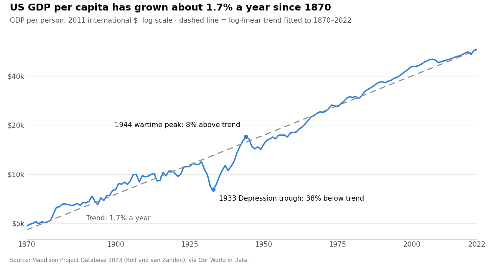

# Why Is Long-Run Growth in GDP per Capita Constant? A Short Literature Review

Oct 16, 2026 · @Manuel Antonio Sanchez Garcia

## Short answer

**Question.** Why has GDP per capita at the technological frontier (essentially the US since about 1870) grown at a near-constant \~2% a year?

**Answer.** There is no settled explanation. Theory delivers constant growth in one of three ways:

1. **By assumption.** Solow (1956) assumes technology grows at a constant rate g.
2. **By a knife-edge.** First-generation endogenous growth (Romer 1990; Aghion–Howitt 1992) needs idea production to be exactly linear in the existing stock of ideas.
3. **By inheritance.** Semi-endogenous growth (Jones 1995) makes long-run growth proportional to population growth, so growth is constant only because population growth roughly was.

The evidence is also weaker than the famous straight line suggests. Constancy holds for the frontier, roughly 1870–2005, and not before 1800 or for most countries. Jones (2002) attributes about 80% of 20th-century US growth to transitional forces (rising schooling and research intensity) that cannot last. On that reading, the steady 2% may partly be a coincidence of offsetting forces rather than a law.

**What changed since 2022.** Two new readings have appeared. Jones and Tonetti (2026) explain the steady 2% as a steady flow of tasks moving from labor to machines. Jones, López-Salido and Philippon (2026) find that US TFP has grown by constant absolute amounts since about 1930, so its percentage growth rate is slowly falling. Neither settles the question for GDP per capita or outside the US.

## 1. The stylized fact and its evidence

The fact comes from Kaldor (1961). His stylized facts are: output per worker grows at a roughly constant rate; the capital–output ratio, factor shares and the return to capital are roughly constant. Jones (2016) restates it for modern data. US log GDP per person from 1870 to the 2010s sits close to a straight line with a slope of about 2% a year, and the Great Depression and WWII appear as temporary deviations.

*Source: Maddison Project Database 2023 (Bolt and van Zanden), via Our World in Data · United States, 1870–2022*

In the [Maddison Project Database 2023](https://ourworldindata.org/grapher/gdp-per-capita-maddison-project-database), the fitted trend is 1.7% a year. That is a little below the ~2% in Jones (2016), which uses a different US series ending in 2014. The 1933 trough sat 38% below trend and 1944 sat 8% above it; both gaps later closed.

The time-series evidence on this fact is mixed:

- **Trend vs. unit root.** Nelson and Plosser (1982) could not reject a unit root in US output, which implies shocks are permanent. Perron (1989) showed that allowing for a break at 1929 restores trend-stationarity. Ben-David and Papell (1995) and Ben-David, Lumsdaine and Papell (2003) find breaks in growth trends across many countries, often a faster post-WWII trend. With Maddison data and fat-tailed shocks, Russo and Foster-McGregor (2022) find less evidence against a unit root than earlier studies, so break-based trend tests have little power.
- **Policy and permanent growth effects.** Jones (1995b) finds that US growth stayed stable while R&D employment and investment rates rose sharply. This contradicts models in which growth scales with those inputs. Kocherlakota and Yi (1996, 1997) test whether policy shocks have permanent growth effects and find mixed results.
- **Low-frequency uncertainty.** Long samples contain only a few independent long-run cycles. Müller and Watson (2016) and Müller, Stock and Watson (2022) show that forecast bands for 50–100-year growth are wide. The data cannot sharply separate "constant" from "slowly drifting" growth. Lunsford and West (2026) test these models out of sample on 17 countries from 1870 to 2020: GDP-per-capita forecasts are reasonably calibrated at 10 and 25 years, but no model is well calibrated at 50.

The fact also has limits:

- **Not before 1800.** Pre-industrial growth in income per person was near zero (Clark 2007; Maddison Project data).
- **Not for most countries.** Growth rates diverged between countries (Pritchett 1997) and persist little from one decade to the next (Easterly et al. 1993; Pritchett and Summers 2014).
- **Not after about 2005.** US productivity growth slowed after about 2005 (Fernald 2015; Gordon 2016; Antolin-Diaz, Drechsel and Petrella 2017). The slowdown is common to the US and large European economies and began before the 2008 crisis, which points to a shift in trend rather than a shock (Fernald, Inklaar and Ruzic 2025; Goldin et al. 2024).
- **Other Kaldor facts are weakening.** The labor share has fallen since about 1980 (Karabarbounis and Neiman 2014).

## 2. Where constant growth comes from in theory

In every family below, constant growth is either assumed, knife-edge, or inherited from another constant rate. The models differ in which one.

**Neoclassical: Solow (1956), Swan (1956), Ramsey–Cass–Koopmans.** With $Y = K^{\alpha}(AL)^{1-\alpha}$ and $A$ growing at an exogenous rate $g$, the economy converges to a balanced growth path:

$$
\frac{\dot y}{y} = g \quad \text{(Solow residual, unexplained)}
$$

Two restrictions make the balanced growth path exist. Uzawa's (1961) theorem says it requires technical change to be labor-augmenting (Harrod-neutral) unless production is Cobb–Douglas; Jones and Scrimgeour (2008) give a short proof. With optimizing households, preferences must also be of the King, Plosser and Rebelo (1988) form, such as CRRA.

**Why is technology labor-augmenting?** This is a puzzle within the puzzle. Acemoglu (2003) shows directed technical change makes it labor-augmenting in the long run. Jones (2005) shows Pareto-distributed ideas yield a Cobb–Douglas aggregate in the long run. Grossman, Helpman, Oberfield and Sampson (2017) obtain balanced growth with capital-augmenting change when education is endogenous. Jones and Liu (2024) show a balanced path can survive ongoing, incomplete automation, because more automation raises the capital share while better machines lower it. The empirical elasticity of substitution is below 1 (Oberfield and Raval 2021), so this question matters in practice.

**First-generation endogenous growth.** These models include AK (Rebelo 1991), learning-by-doing (Romer 1986), human capital (Lucas 1988), expanding varieties (Romer 1990; Grossman and Helpman 1991) and quality ladders (Aghion and Howitt 1992). The core is an idea production function:

$$
\dot A = \delta \, L_A \, A^{\phi}
$$

Constant growth requires $\phi = 1$ exactly; then $g = \delta L_A$. This creates two problems. The first is a knife-edge: φ slightly above 1 gives explosive growth, and φ slightly below 1 gives growth that dies out (Solow 1994; Li 2000; Growiec 2007). The second is scale effects: growth should rise with the number of researchers, but US researchers multiplied while growth did not (Jones 1995b).

**Semi-endogenous growth: Jones (1995a), Kortum (1997), Segerstrom (1998).** With φ < 1, the long-run growth rate is

$$
g_y = \frac{\lambda \, n}{1 - \phi}
$$

where $n$ is the growth rate of researchers, equal in the long run to population growth. Growth is constant because population growth is roughly constant. Bloom, Jones, Van Reenen and Webb (2020) find that research productivity falls about 5% a year across many sectors, which supports φ < 1, and a formal US time-series test also favors this model (Kruse-Andersen 2023). The implication is strong: with falling fertility, frontier growth eventually declines (Jones 2022a, 2022b). Slower population growth already shows up as lower firm entry (Hopenhayn, Neira and Singhania 2022; Karahan, Pugsley and Şahin 2024).

Two recent papers question how the research-productivity decline is read. Ekerdt and Wu (2024) argue much of it is transitional: the research workforce tripled, so the average researcher's ability fell. Fort, Goldschlag, Liang, Schott and Zolas (2026) find that patents per unit of R&D are not falling; what has weakened is the link from new ideas to growth.

**Second-generation Schumpeterian: Young (1998), Peretto (1998), Dinopoulos and Thompson (1998), Howitt (1999).** Product proliferation spreads R&D across more product lines, which removes the scale effect. Growth is then fully endogenous and depends on R&D intensity, not the level of R&D. Ha and Howitt (2007), Madsen (2008) and Laincz and Peretto (2006) find evidence favoring this view. Herzer (2022) argues that this evidence suffers from econometric problems, and his new tests on the US and 19 OECD countries favor semi-endogenous growth. The debate now leans semi-endogenous but is not closed: Aghion, Bergeaud, Boppart and Brouillette (2026) propose a fully endogenous model with weak scale effects that fits both Jones (1995b) and Bloom et al. (2020).

**Idea diffusion and search: Kortum (1997), Lucas (2009), Lucas and Moll (2014), Perla and Tonetti (2014), Buera and Oberfield (2020).** Here constant growth comes from the shape of the productivity distribution. If its right tail is Pareto, learning from others shifts the whole distribution at a constant rate. Exponential growth then follows from a statistical property rather than from linearity in an equation.

| Model family | Source of constant growth | Main evidence for | Main evidence against |
| --- | --- | --- | --- |
| Solow / Ramsey | Assumed exogenous g | Fits the Kaldor facts | Explains nothing about g |
| AK / Romer / Aghion–Howitt | Knife-edge φ = 1 | Microfoundations for R&D | Scale effects absent (Jones 1995b) |
| Semi-endogenous | Constant population growth | Falling research productivity (Bloom et al. 2020); US cointegration tests (Kruse-Andersen 2023) | Predicts slowdown that is hard to date; the measured decline may be transitional or mismeasured (Ekerdt and Wu 2024; Fort et al. 2026) |
| 2nd-gen Schumpeterian | R&D intensity with dilution | Cross-country and long-run tests (Ha and Howitt 2007; Madsen 2008) | Requires a specific dilution parameter, another knife-edge; newer tests favor semi-endogenous growth (Herzer 2022) |
| Diffusion / Pareto tails | Pareto shape of ideas | Firm-size and productivity distributions | Tail shape largely assumed |

## 3. Challenges and alternatives to balanced growth

**Constant growth may be one phase of an accelerating process.** Kremer (1993) shows world population growth rose with population size over a million years, consistent with φ > 0 and scale effects at very long horizons. Unified growth theory (Galor and Weil 2000; Hansen and Prescott 2002; Galor 2011) models a transition from Malthusian stagnation to modern growth. In these models, balanced growth is the last of several regimes, not a universal law.

**Constant aggregate growth can coexist with large compositional change.** Structural transformation moves activity from agriculture to manufacturing to services. Kongsamut, Rebelo and Xie (2001) and Ngai and Pissarides (2007) show that aggregate growth can still be balanced under specific conditions on preferences or technology. Herrendorf, Rogerson and Valentinyi (2014) survey this work. Baumol's cost disease, in which output shifts toward slow-productivity sectors, is a force that bends growth down over time.

**The 2% may be a coincidence of transitional forces.** Jones (2002) decomposes US growth from 1950 to 1993. He finds only about 20% of it is steady-state growth; the rest comes from rising educational attainment and research intensity. Because those forces are bounded, constancy may reflect forces offsetting each other rather than a stable steady state. Fernald and Jones (2014) project slower future growth on this basis. Jones (2022b) repeats the split as a rough calculation for growth since 1950. Of about 2 percentage points a year, roughly 0.5 comes from education, 0.2 from rising employment, 0.3 from reduced misallocation and 0.7 from rising research intensity, leaving about 0.3 from population growth. He explicitly declines to update the accounting with data after 2007.

**Growth may be additive rather than exponential.** Philippon (2022) argues that TFP grows linearly, with roughly constant absolute increments, punctuated by breaks tied to general-purpose technologies. Jones, López-Salido and Philippon (2026) replace that paper. They compare the additive model with exponential models whose trend can drift, using US TFP since 1890 and Bayesian model weights. By 2022 the weight on the additive model is close to 1. Linear growth in levels means a declining percentage rate. The result covers TFP, not GDP per capita, and does not use low-frequency methods.

**The denominator matters.** Fernández-Villaverde, Ventura and Yao (2025) find that advanced economies, Japan included, follow similar growth paths per working-age adult even when per-capita growth differs. Population aging opens a gap between the two measures.

**AI and automation.** Zeira (1998) and Aghion, Jones and Jones (2019) show that automation keeps growth balanced if tasks that are hard to automate remain essential through Baumol effects. Full automation of idea production can instead generate explosive growth (Aghion, Jones and Jones 2019; Trammell and Korinek 2023). Nordhaus (2021) tests for signs of such a singularity in current data and finds none so far.

Two 2026 papers derive explicit conditions:
- **Jones and Tonetti (2026)** find growth stays balanced unless the capital share reaches 100%. Low substitutability across tasks ("weak links") tames the explosion. They also attribute most past US TFP growth to tasks moving to machines.
- **Davidson, Halperin, Houlden and Korinek (2026)** find that automating a modest share of research across sectors can cross the explosive threshold when returns to software research are near 1.

Near-term estimates are modest. Acemoglu (2025) puts the total TFP gain over ten years at under 1%. Aghion and Bunel (2024) and Filippucci, Gal and Schief (2026) find up to about 1 percentage point a year.

## 4. Synthesis

The literature broadly agrees on three points:

- **Constancy is a frontier fact for one period.** It holds at the frontier from about 1870 to 2005. It does not hold for the very long run or for most countries.
- **Exponential growth needs a structural constant.** Getting it from a dynamic model requires either exact linearity in the idea production function or another constant growth rate to feed it, usually population growth.
- **The evidence favors φ < 1.** Diminishing returns to ideas (φ < 1) fit the data better than the knife-edge φ = 1. Recent tests lean toward semi-endogenous over second-generation Schumpeterian models (Herzer 2022; Kruse-Andersen 2023).

Three questions remain open. Their status as of October 2026:

1. **Was the 20th-century 2% a steady state, or a transition that happened to look straight?** *Partly answered.* Jones (2022b) says mostly transition, but only as a rough US calculation. Jones and Tonetti (2026) offer a rival explanation: a steady flow of automation. No one has done a data-based or multi-country decomposition.
2. **Can the data distinguish exponential, additive and slowly declining growth at all, given low-frequency uncertainty?** *Partly answered.* Jones, López-Salido and Philippon (2026) say yes for US TFP, and additive growth wins. Lunsford and West (2026) and Russo and Foster-McGregor (2022) suggest power at horizons of 50 years or more is low. The question is untested for GDP per capita.
3. **Is "constancy" a property of the US specifically, or of the frontier wherever it is located?** *Open.* No paper tests a frontier envelope. Euro-area growth has not been constant (Bergeaud 2024), but growth per working-age adult looks similar across advanced economies (Fernández-Villaverde, Ventura and Yao 2025).

## 5. Gaps and candidate papers

I checked all five ideas against working papers and articles from 2022 to 2026 (search done 16 October 2026).
- **B and C remain clear gaps.**
- **A is still open for GDP per capita,** but it must be repositioned around Jones, López-Salido and Philippon (2026).
- **D is open, but crowded.**
- **E is largely taken by 2026 papers.**

| # | Repositioned question | Open questions it answers (Section 4) | Post-2022 work checked | Data | Method | Feasibility | Novelty risk |
| --- | --- | --- | --- | --- | --- | --- | --- |
| A | Can the data tell exponential, additive and slowly declining growth apart for GDP per capita? A power study that tests the Jones–López-Salido–Philippon verdict | **Q2 directly:** measures how much power low-frequency tests have against each trend shape with about 150 years of data, and whether the TFP verdict carries over to GDP per capita. **Q1 indirectly:** a slowly declining trend is what a fading transition predicts | Jones, López-Salido and Philippon 2026 (US TFP, additive wins); Lunsford and West 2026 (50-year forecasts poorly calibrated); Russo and Foster-McGregor 2022 (weak break tests); Crump, Gospodinov and Wieman 2024 (trend GDP growth falling since the 1960s) | Maddison Project 2023, Jordà–Schularick–Taylor Macrohistory, Penn World Table | Müller–Watson low-frequency projections; Monte Carlo power under each model; robustness to noise specification and parameter count; forecast calibration, not just RMSE | High | Medium: TFP version done |
| B | First data-based, multi-country update of Jones (2002) and Fernald–Jones (2014) to the 2020s: US, UK, France, Germany, Japan | **Q1 directly:** the share of 1950–2020s growth that was transitional, country by country. **Q3 partly:** whether that share differs across frontier economies | Jones 2022b (rough US calculation; declines to update after 2007); Ekerdt and Wu 2024 (decline in research productivity partly transitional); Fort et al. 2026 (ideas-to-growth link weakening); Goldin et al. 2024 (standard accounting for five advanced economies, no ideas structure) | PWT, Barro–Lee education, OECD R&D personnel (MSTI), EU KLEMS | Semi-endogenous accounting with one global idea stock and country-specific transition terms; robustness to φ (Ekerdt–Wu) and to an additive-TFP alternative | High | Low |
| C | Frontier envelope vs. US vs. common factor: is constancy a US fact or a frontier fact? | **Q3 directly:** tests constancy for the max and top-5 envelope across leaders (Netherlands, UK, US) and for an ex-ante rich group, which controls for survivorship. **Q2 partly:** adds a second long series to the trend-shape tests | No paper builds an envelope. Nearest: Müller, Stock and Watson 2022 (common factor); Kremer, Willis and You 2022 (frontier slowdown since 2000); Bergeaud 2024 (euro area not constant); Fernández-Villaverde, Ventura and Yao 2025 (per working-age adult); Bolt and van Zanden 2025 (benchmark choice changes the leadership dates) | Maddison Project 2023, under its 1990, 2011 and 1909 benchmarks | Trend and break tests on the envelope with the additive model as an alternative; per capita and per worker; ex-ante vs. ex-post rich sets | High | Low–medium |
| D | Semi-endogenous vs. Schumpeterian growth with a world research input, robust to how Chinese R&D is weighted | **None directly.** **Feeds Q1:** if growth is semi-endogenous, steady-state growth depends on world researcher growth, which sets how much of the 2% was transitional | Herzer 2022; Kruse-Andersen 2023; Ziesemer 2022, 2024; Luintel and Pourpourides 2026 (all national or OECD inputs, mostly favor semi-endogenous); Jones 2022b leaves China weighting open; König et al. 2022 and Böing et al. 2024 (Chinese R&D and patent quality); De Souza et al. 2026 (US public R&D spills over abroad); Aghion et al. 2026 (a third model to test) | OECD MSTI, UNESCO R&D, triadic or PCT patents (not raw counts) | Cointegration and panel tests following Herzer's checklist; several Chinese R&D weightings (raw, misallocation-discounted, quality-weighted) | Medium | Medium |
| E | Largely pre-empted. Remaining angle: is "steady automation" (Jones–Tonetti) observationally distinct from "transition" (Jones 2022b)? | **Q1 directly:** sets the two rival explanations of the 2% against each other and finds which observable (capital share, automation rate, sectoral research productivity) separates them. **Q2 partly** | Jones and Tonetti 2026; Davidson, Halperin, Houlden and Korinek 2026; Jones 2026 (corrected condition in Aghion, Jones and Jones 2019); Jones and Liu 2024; Almeida, Naudé and Sequeira 2024 | BLS and KLEMS task and capital-share data | Nested model; identification analysis | Medium | High |

B is now the cleanest opening: Jones (2022b) states he will not update the accounting past 2007, and nothing since has. A and C still combine well into one paper, "How constant is constant growth?", which would now answer Q2 and Q3 together for GDP per capita.

## References

Entries from 2022 on were checked online on 16 October 2026; working papers may since have been revised or published. Earlier entries were compiled from memory, so verify their volume and page details before citing.

- Acemoglu, D. (2003). Labor- and capital-augmenting technical change. *JEEA* 1(1).
- Acemoglu, D. (2025). The simple macroeconomics of AI. *Economic Policy* 40(121): 13–58.
- Aghion, P., Bergeaud, A., Boppart, T., and Brouillette, J.-F. (2026). Resetting the innovation clock: endogenous growth through technological turnover. Working paper.
- Aghion, P., and Bunel, S. (2024). AI and growth: where do we stand? Note, June 2024.
- Aghion, P., and Howitt, P. (1992). A model of growth through creative destruction. *Econometrica* 60(2).
- Aghion, P., Jones, B. F., and Jones, C. I. (2019). Artificial intelligence and economic growth. In Agrawal, Gans and Goldfarb (eds.), *The Economics of Artificial Intelligence*. NBER/Chicago.
- Almeida, D., Naudé, W., and Sequeira, T. N. (2024). Artificial intelligence and the discovery of new ideas: is an economic growth explosion imminent? IZA DP 16766.
- Antolin-Diaz, J., Drechsel, T., and Petrella, I. (2017). Tracking the slowdown in long-run GDP growth. *REStat* 99(2).
- Ben-David, D., and Papell, D. (1995). The great wars, the great crash, and steady state growth. *JME* 36.
- Ben-David, D., Lumsdaine, R., and Papell, D. (2003). Unit roots, postwar slowdowns and long-run growth. *Empirical Economics* 28.
- Bergeaud, A. (2024). The past, present and future of European productivity. ECB Forum on Central Banking, Sintra.
- Bloom, N., Jones, C. I., Van Reenen, J., and Webb, M. (2020). Are ideas getting harder to find? *AER* 110(4).
- Böing, P., Brandt, L., Dai, R., Lim, K., and Peters, B. (2024). The anatomy of Chinese innovation: insights on patent quality and ownership. Working paper.
- Bolt, J., and van Zanden, J. L. (2025). Maddison-style estimates of the evolution of the world economy: a new 2023 update. *Journal of Economic Surveys* 39(2): 631–671.
- Buera, F., and Oberfield, E. (2020). The global diffusion of ideas. *Econometrica* 88(1).
- Clark, G. (2007). *A Farewell to Alms*. Princeton.
- Crump, R. K., Gospodinov, N., and Wieman, H. (2024). Sparse trend estimation. Federal Reserve Bank of New York Staff Report 1049.
- Davidson, T., Halperin, B., Houlden, T., and Korinek, A. (2026). When does automating AI research produce explosive growth? Feedback loops in innovation networks. NBER WP 35155.
- De Souza, G., Fieldhouse, A., Mertens, K., Nath, I., and Ramey, V. (2026). The effects of U.S. public R&D on global growth. Federal Reserve Bank of Dallas WP 2622.
- Dinopoulos, E., and Thompson, P. (1998). Schumpeterian growth without scale effects. *J. Econ. Growth* 3.
- Easterly, W., Kremer, M., Pritchett, L., and Summers, L. (1993). Good policy or good luck? *JME* 32(3).
- Ekerdt, L. K. F., and Wu, K.-J. (2024). Self-selection and the diminishing returns of research. Working paper.
- Fernald, J. (2015). Productivity and potential output before, during, and after the Great Recession. *NBER Macro Annual* 29.
- Fernald, J. G., Inklaar, R., and Ruzic, D. (2025). The productivity slowdown in advanced economies: common shocks or common trends? *Review of Income and Wealth* 71(1). (FRBSF WP 2023-07.)
- Fernald, J., and Jones, C. I. (2014). The future of US economic growth. *AER P&P* 104(5).
- Fernández-Villaverde, J., Ventura, G., and Yao, W. (2025). The wealth of working nations. *European Economic Review* 173. (NBER WP 31914.)
- Filippucci, F., Gal, P., and Schief, M. (2026). Aggregate productivity gains from artificial intelligence: a sectoral perspective. *AEA Papers and Proceedings* 116: 31–35.
- Fort, T. C., Goldschlag, N., Liang, J., Schott, P. K., and Zolas, N. (2026). Growth is getting harder to find, not ideas. NBER WP 35182.
- Galor, O. (2011). *Unified Growth Theory*. Princeton.
- Galor, O., and Weil, D. (2000). Population, technology, and growth. *AER* 90(4).
- Goldin, I., Koutroumpis, P., Lafond, F., and Winkler, J. (2024). Why is productivity slowing down? *Journal of Economic Literature* 62(1): 196–268.
- Gordon, R. (2016). *The Rise and Fall of American Growth*. Princeton.
- Grossman, G., and Helpman, E. (1991). *Innovation and Growth in the Global Economy*. MIT Press.
- Grossman, G., Helpman, E., Oberfield, E., and Sampson, T. (2017). Balanced growth despite Uzawa. *AER* 107(4).
- Growiec, J. (2007). Beyond the linearity critique: the knife-edge assumption of steady-state growth. *Economic Theory* 31(3).
- Ha, J., and Howitt, P. (2007). Accounting for trends in productivity and R&D. *JMCB* 39(4).
- Hansen, G., and Prescott, E. (2002). Malthus to Solow. *AER* 92(4).
- Herrendorf, B., Rogerson, R., and Valentinyi, Á. (2014). Growth and structural transformation. *Handbook of Economic Growth* 2.
- Herzer, D. (2022). Semi-endogenous versus Schumpeterian growth models: a critical review of the literature and new evidence. *Review of Economics* 73(1): 1–55.
- Hopenhayn, H., Neira, J., and Singhania, R. (2022). From population growth to firm demographics: implications for concentration, entrepreneurship and the labor share. *Econometrica* 90(4): 1879–1914.
- Howitt, P. (1999). Steady endogenous growth with population and R&D inputs growing. *JPE* 107(4).
- Jones, B. F., and Liu, X. (2024). A framework for economic growth with capital-embodied technical change. *AER* 114(5): 1448–1487.
- Jones, C. I. (1995a). R&D-based models of economic growth. *JPE* 103(4).
- Jones, C. I. (1995b). Time series tests of endogenous growth models. *QJE* 110(2).
- Jones, C. I. (2002). Sources of U.S. economic growth in a world of ideas. *AER* 92(1).
- Jones, C. I. (2005). The shape of production functions and the direction of technical change. *QJE* 120(2).
- Jones, C. I. (2016). The facts of economic growth. *Handbook of Macroeconomics* 2A.
- Jones, C. I. (2022a). The end of economic growth? Unintended consequences of a declining population. *AER* 112(11): 3489–3527.
- Jones, C. I. (2022b). The past and future of economic growth: a semi-endogenous perspective. *Annual Review of Economics* 14: 125–152.
- Jones, C. I. (2026). A.I., automation, and explosive growth: a condition for finite-time blow-up. Research note, Stanford GSB.
- Jones, C. I., and Scrimgeour, D. (2008). A new proof of Uzawa's steady-state growth theorem. *REStat* 90(1).
- Jones, C. I., and Tonetti, C. (2026). Past automation and future A.I.: how weak links tame the growth explosion. Working paper, Stanford GSB.
- Jones, C. J., López-Salido, D., and Philippon, T. (2026). Is growth additive? NBER WP 35415.
- Kaldor, N. (1961). Capital accumulation and economic growth. In Lutz and Hague (eds.), *The Theory of Capital*.
- Karabarbounis, L., and Neiman, B. (2014). The global decline of the labor share. *QJE* 129(1).
- Karahan, F., Pugsley, B., and Şahin, A. (2024). Demographic origins of the start-up deficit. *AER* 114(7): 1986–2023.
- King, R., Plosser, C., and Rebelo, S. (1988). Production, growth and business cycles I. *JME* 21.
- Kocherlakota, N., and Yi, K.-M. (1996). A simple time series test of endogenous vs. exogenous growth models. *REStat* 78(1).
- Kocherlakota, N., and Yi, K.-M. (1997). Is there endogenous long-run growth? Evidence from the US and UK. *JMCB* 29(2).
- König, M., Song, Z., Storesletten, K., and Zilibotti, F. (2022). From imitation to innovation: where is all that Chinese R&D going? *Econometrica* 90(4): 1615–1654.
- Kongsamut, P., Rebelo, S., and Xie, D. (2001). Beyond balanced growth. *REStud* 68(4).
- Kortum, S. (1997). Research, patenting, and technological change. *Econometrica* 65(6).
- Kremer, M. (1993). Population growth and technological change: one million B.C. to 1990. *QJE* 108(3).
- Kremer, M., Willis, J., and You, Y. (2022). Converging to convergence. *NBER Macroeconomics Annual* 36: 337–412.
- Kruse-Andersen, P. K. (2023). Testing R&D-based endogenous growth models. *Oxford Bulletin of Economics and Statistics* 85(5): 1083–1110.
- Laincz, C., and Peretto, P. (2006). Scale effects in endogenous growth theory: an error of aggregation not specification. *J. Econ. Growth* 11.
- Li, C.-W. (2000). Endogenous vs. semi-endogenous growth in a two-R&D-sector model. *Economic Journal* 110.
- Lucas, R. E. (1988). On the mechanics of economic development. *JME* 22.
- Lucas, R. E. (2009). Ideas and growth. *Economica* 76.
- Lucas, R. E., and Moll, B. (2014). Knowledge growth and the allocation of time. *JPE* 122(1).
- Luintel, K. B., and Pourpourides, P. M. (2026). New results and a model of scale effects on growth. *Macroeconomic Dynamics* 30, e10.
- Lunsford, K. G., and West, K. D. (2026). An empirical evaluation of some long-horizon macroeconomic forecasts. *Journal of Econometrics* 255. (NBER WP 34904.)
- Madsen, J. (2008). Semi-endogenous versus Schumpeterian growth models: testing the knowledge production function using international data. *J. Econ. Growth* 13.
- Müller, U., and Watson, M. (2016). Measuring uncertainty about long-run predictions. *REStud* 83(4).
- Müller, U., Stock, J., and Watson, M. (2022). An econometric model of international growth dynamics for long-horizon forecasting. *REStat* 104(5): 857–876.
- Nelson, C., and Plosser, C. (1982). Trends and random walks in macroeconomic time series. *JME* 10.
- Ngai, L. R., and Pissarides, C. (2007). Structural change in a multisector model of growth. *AER* 97(1).
- Nordhaus, W. (2021). Are we approaching an economic singularity? *AEJ: Macro* 13(1).
- Oberfield, E., and Raval, D. (2021). Micro data and macro technology. *Econometrica* 89(2).
- Peretto, P. (1998). Technological change and population growth. *J. Econ. Growth* 3.
- Perla, J., and Tonetti, C. (2014). Equilibrium imitation and growth. *JPE* 122(1).
- Perron, P. (1989). The Great Crash, the oil price shock, and the unit root hypothesis. *Econometrica* 57(6).
- Philippon, T. (2022). Additive growth. NBER WP 29950. Superseded by Jones, López-Salido and Philippon (2026).
- Pritchett, L. (1997). Divergence, big time. *JEP* 11(3).
- Pritchett, L., and Summers, L. (2014). Asiaphoria meets regression to the mean. NBER WP 20573.
- Rebelo, S. (1991). Long-run policy analysis and long-run growth. *JPE* 99(3).
- Romer, P. (1986). Increasing returns and long-run growth. *JPE* 94(5).
- Romer, P. (1990). Endogenous technological change. *JPE* 98(5).
- Russo, E., and Foster-McGregor, N. (2022). Characterizing growth instability: new evidence on unit roots and structural breaks in countries' long run trajectories. *Journal of Evolutionary Economics* 32(2): 713–756.
- Segerstrom, P. (1998). Endogenous growth without scale effects. *AER* 88(5).
- Solow, R. (1956). A contribution to the theory of economic growth. *QJE* 70(1).
- Solow, R. (1994). Perspectives on growth theory. *JEP* 8(1).
- Swan, T. (1956). Economic growth and capital accumulation. *Economic Record* 32.
- Trammell, P., and Korinek, A. (2023). Economic growth under transformative AI. NBER WP 31815.
- Uzawa, H. (1961). Neutral inventions and the stability of growth equilibrium. *REStud* 28(2).
- Young, A. (1998). Growth without scale effects. *JPE* 106(1).
- Zeira, J. (1998). Workers, machines, and economic growth. *QJE* 113(4).
- Ziesemer, T. H. W. (2022). Foreign R&D spillovers to the USA and strategic reactions. *Applied Economics* 54(37): 4274–4291.
- Ziesemer, T. H. W. (2024). Public R&D and growth: a dynamic panel vector-error-correction model analysis for 14 OECD countries. *Economies* 12(8): 216.
