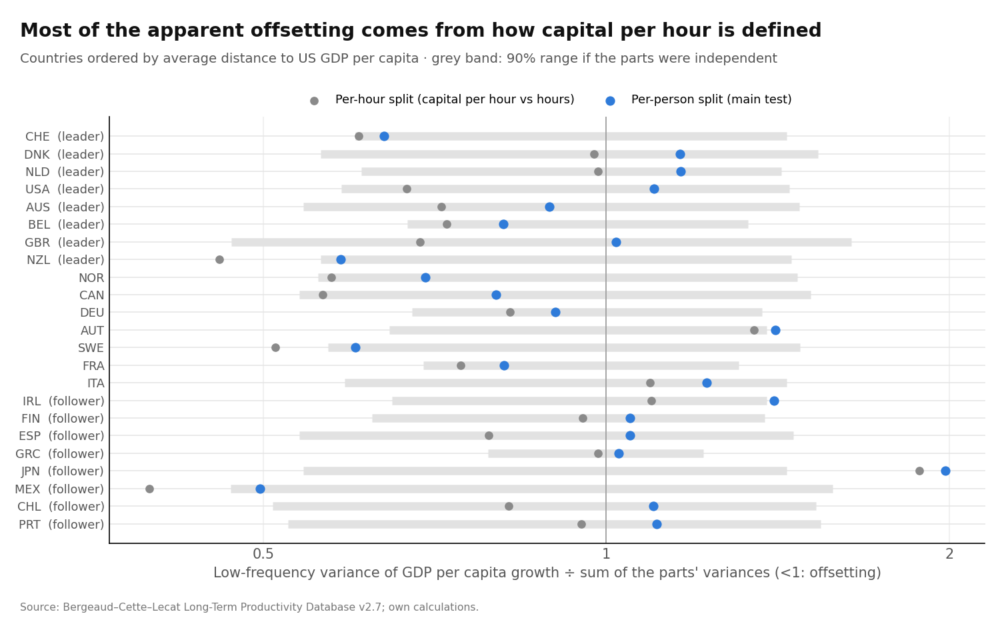
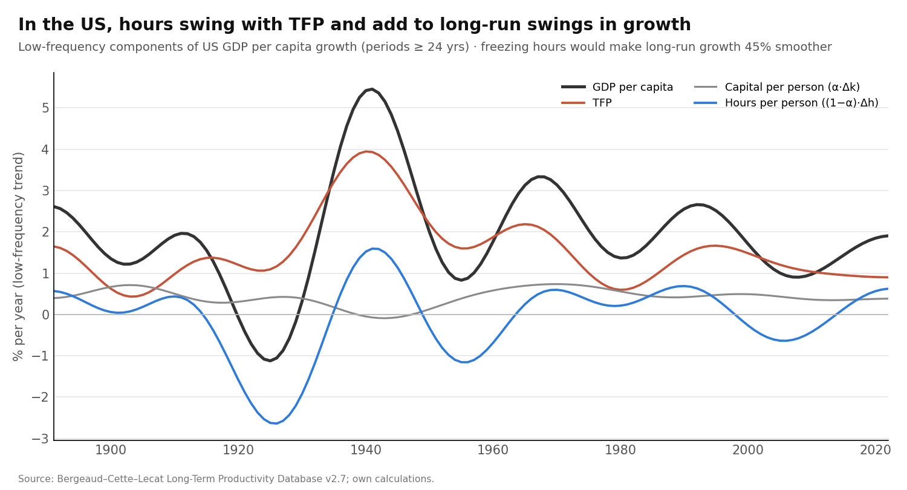
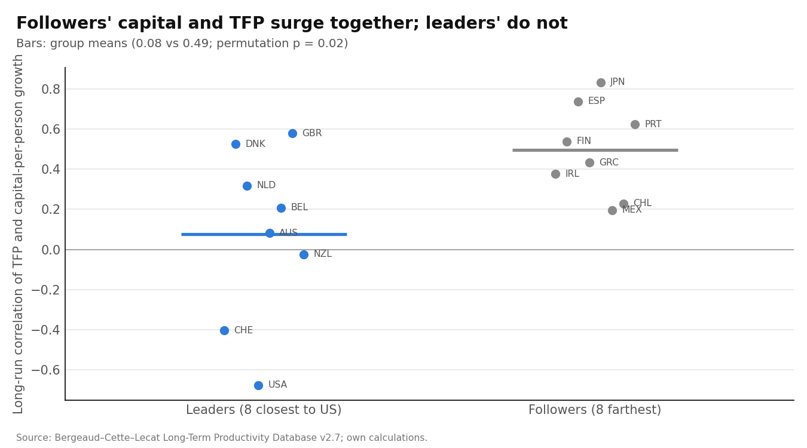
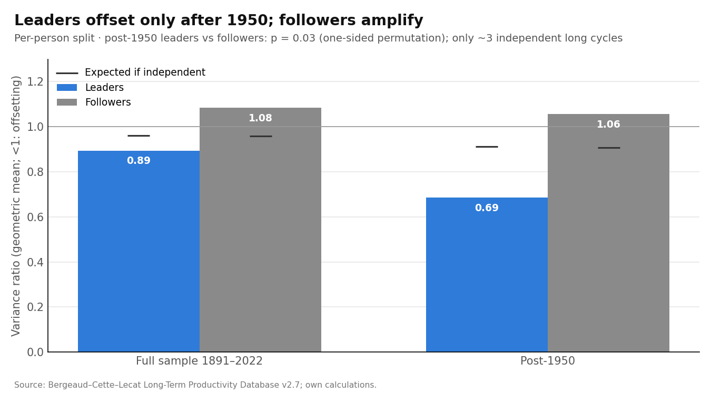
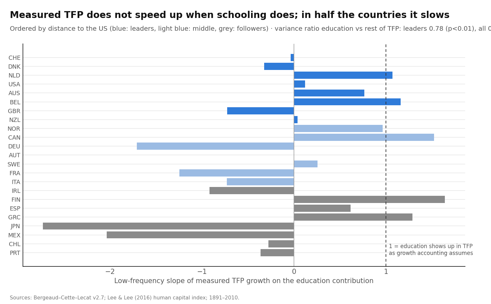
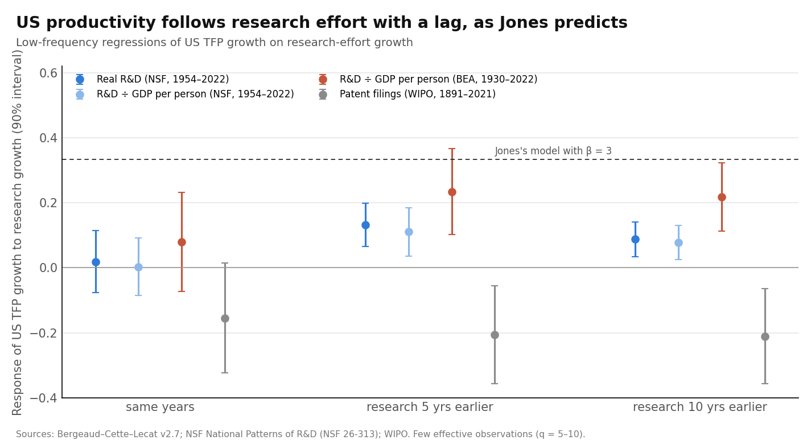

# The Balancing Leader? What Keeps Frontier Growth Steady

**Testing whether the sources of growth offset each other, 1891–2022**

Draft of 17 October 2026 · @Manuel Antonio Sanchez Garcia · code: `scripts/run_balancing.py`; numbers: `output/balancing/results.json`

## Abstract

US income per person has grown about 2% a year for 150 years. Growth accounting splits that growth into productivity (TFP), capital and hours. But the parts move a lot while the total moves little. Jones (1995) noted this means the parts' movements "must be offsetting." We test that directly, for 23 economies over 1891–2022, using only long-run swings (periods of 24 years or more) and comparing against simulated data in which the parts are independent.

**Five findings:**
1. **The obvious test is an accounting artifact.** With capital measured *per hour*, the parts appear to offset strongly (variance ratio 0.71, p = 0.008). But capital per hour falls automatically whenever hours rise, because capital moves slowly. Measured *per person*, the offsetting disappears over the full period: leaders 0.89 (p = 0.24), the US 1.10.
2. **At the US, hours amplify rather than balance.** Hours per person move with TFP over the long run. Without the hours swings, long-run US growth would have been 45% smoother. This holds with an independent hours series (Ramey and Francis).
3. **Leaders and followers differ, but not robustly.** In followers, TFP and capital per person surge together (correlation 0.49 vs 0.08 for leaders, p = 0.02). But the difference vanishes when capital is measured relative to output, so it is consistent with ordinary catch-up investment rather than a distinct mechanism. After 1950 leaders do offset (0.69) and followers do not (1.06), but that rests on few long cycles.
4. **The offsetting that does exist is inside TFP.** Measured TFP does not speed up when schooling grows faster; in about half the countries it slows. The variance ratio between education and the rest of TFP is 0.78 at leaders (p < 0.001).
5. **Jones's mechanism works at the leader.** US TFP follows research effort with a 5–10 year lag. The response is 0.23 (p = 0.03) on 1930–2022 data, against about 0.33 predicted, and the implied β is about 2.4–3.3. Our earlier "tension" with Jones came from using patents as a research measure.

**Bottom line:** the leader's steady pace is not a balance between productivity, capital and hours. It comes from inside TFP: research-driven productivity growth, with schooling and the rest of TFP offsetting each other. That is close to Jones's (2002) transition story, and it shifts the evidence in his favour.

## 1. Question and short answer

**Question.** Is the leading economy's steady growth produced by its sources of growth offsetting each other systematically, and if so, through which channel?

**Short answer.**
- **No offsetting among TFP, capital and hours over the long run.** The appearance of it in standard growth accounting is a definitional artifact.
- **The US is not especially stable.** Its long-run swings in growth (standard deviation 1.3 percentage points) are typical of rich economies.
- **There is offsetting *inside* TFP**, between schooling and the rest of productivity growth.
- **US productivity follows research effort with a lag,** as the semi-endogenous model predicts.

## 2. Data and the two ways to split growth

**Data.**
- **Bergeaud–Cette–Lecat Long-Term Productivity Database** (v2.7): GDP per capita, GDP per hour, hours per person and TFP for 23 economies, 1891–2022. GDP per capita equals GDP per hour times hours per person exactly in the data.
- **Lee and Lee (2016):** long-run human capital, 1870–2010.
- **Ramey and Francis (2009):** US hours, 1900–2005, as an independent check.
- **Penn World Table 11:** a second source from 1950.
- **NSF and BEA:** US R&D, 1929–2024.
- **Bakker, Crafts and Woltjer (2019):** US growth accounts for 1899–1941.

**Two additive splits of growth in GDP per capita** (capital share α = 0.3):

$$
\underbrace{g_y = g_{TFP} + \alpha\, g_{K/H} + g_{H/N}}_{\text{per hour}} \qquad\qquad \underbrace{g_y = g_{TFP} + \alpha\, g_{K/N} + (1-\alpha)\, g_{H/N}}_{\text{per person}}
$$

The per-hour split is the usual one. In it, capital per hour (K/H) shares the denominator H with hours, so when hours rise, capital per hour falls automatically. The per-person split has no shared denominator, so it is our main test.

**The statistic.** We keep only swings with periods of 24 years or more (Müller–Watson cosine projections, q = 11) and compute

$$
R = \frac{\operatorname{Var}_{LF}(g_y)}{\sum_k \operatorname{Var}_{LF}(g_k)}
$$

- **R < 1:** the parts offset.
- **R ≈ 1:** they are independent.
- **R > 1:** they reinforce each other.

**Significance.** We simulate 999 versions of each country's data in which every part keeps its own persistence but the parts are made independent ("phase randomization"). The p-value is the share of simulations with an R as low as the one observed.

**Leaders and followers.** Leaders are the 8 economies closest to US GDP per capita on average: Switzerland, Denmark, Netherlands, US, Australia, Belgium, UK and New Zealand. Followers are the 8 farthest: Ireland, Finland, Spain, Greece, Japan, Mexico, Chile and Portugal.

## 3. Result 1: the obvious test is an artifact

| Group | Per-hour split | Per-person split | Expected if independent |
| --- | --- | --- | --- |
| Leaders | **0.71** (p = 0.008) | 0.89 (p = 0.24) | 0.96 |
| Followers | 0.91 (p = 0.35) | 1.08 (amplifying) | 0.96 |
| All 23 | **0.79** (p = 0.004) | 0.95 (p = 0.43) | 0.96 |

*Geometric means of R by group.*



**What this shows.** In the per-hour split, the largest offsetting term everywhere is capital per hour against hours (average correlation −0.58 at leaders). That is mostly the shared denominator, not a behavioral response. Once capital is measured per person, the evidence for offsetting over 1891–2022 disappears. Anyone using the standard growth-accounting split to argue that the sources of growth balance would be misled.

## 4. Result 2: at the US, hours amplify

| United States, 1891–2022 | Value |
| --- | --- |
| Variance ratio, per-person split | **1.10** (p = 0.66): no offsetting |
| Long-run correlation, TFP and hours | **+0.28** |
| Long-run correlation, TFP and capital per person | −0.68 |
| Long-run swings in growth if hours were frozen | **45% smaller** |
| Share of long-run variance coming from TFP | 41% |
| With Ramey–Francis hours instead (1901–2005) | ratio 1.02; with the cross-source correction 1.21 |



**What this shows.** US hours and productivity rose and fell *together* over the long run: they fell in the 1920s–30s and rose with the wartime boom. Hours were a source of instability, not a stabilizer. Capital per person did move against TFP (−0.68), but its swings are too small to offset much.

**This is not short-run.** The business-cycle literature (Galí 1999; Basu, Fernald and Kimball 2006) finds hours *fall* after technology improvements in the short run. Cette, Drapala and Lopez (2023) find a negative long-run elasticity of hours *per worker* to productivity. Our object differs: hours per *person*, at periods of 24 years or more. There, the US shows co-movement, not offsetting.

## 5. Result 3: leaders vs followers

**Followers' capital and TFP surge together.** The long-run correlation of TFP and capital per person is 0.49 in followers and 0.08 in leaders (permutation p = 0.02). This fits catch-up growth: when followers adopt frontier technology, investment and productivity rise together, so the parts reinforce each other. Japan is the extreme case (correlation 0.83, R = 1.98).



**But this contrast is not robust to how capital is measured.** Standard growth theory predicts capital follows TFP in any economy. In the capital-to-output form of the accounting, which credits TFP-induced capital to TFP (Klenow and Rodríguez-Clare 1997; Jones 2016), TFP and the capital term are negatively correlated in *both* groups: −0.57 for leaders, −0.51 for followers (difference p = 0.72). Neither form is free of a shared term: output appears in the capital-to-output ratio. So the leader–follower difference is best read as consistent with investment-based catch-up (Acemoglu, Aghion and Zilibotti 2006), not as a distinct balancing mechanism.

**After 1950, leaders offset.** Restricting to 1951–2022:

| 1951–2022, per-person split | Ratio | Expected if independent | p |
| --- | --- | --- | --- |
| Leaders | **0.69** | 0.91 | 0.08 |
| Followers | 1.06 | 0.91 | — |
| Leaders − followers | | | **0.03** |



**Caveat.** With 72 years and periods of 24 years or more, there are only about three independent long cycles. The post-1950 contrast is a lead for further work, not an established fact.

**What does not hold:**
- distance to the frontier does not predict R across all 23 economies (slope p = 0.40);
- groups defined by the 1890 gap (ex ante) show no difference.

The leader–follower contrast depends on how the groups are defined.

## 6. Result 4: offsetting inside TFP — schooling vs the rest

We split TFP into the contribution of schooling, (1 − α) × growth of the Lee–Lee human capital index, and the rest. If education raised productivity as growth accounting assumes, and the rest were independent, measured TFP would move one-for-one with the education contribution.

| Group, 1891–2010 | Variance ratio (education vs rest of TFP) | Expected if independent | p | Wars neutralized |
| --- | --- | --- | --- | --- |
| Leaders | **0.78** | 0.98 | < 0.001 | 0.74 |
| Followers | 0.91 | 0.99 | 0.07 | 0.91 |
| All 23 | **0.86** | 0.99 | < 0.001 | 0.84 |



**What this shows.**
- **TFP doesn't respond to schooling in the long run.** The median response of measured TFP to the education contribution is 0.08 at leaders, against 1 if schooling showed up as assumed.
- **In 11 of 23 economies, TFP *slows* when schooling accelerates.** These include the UK (−0.73), Germany (−1.71) and France (−1.25).
- **Removing the wars doesn't change this.**
- **Neither does the measure of human capital.** With Lee–Lee's alternative index the ratios are 0.60 for leaders and 0.75 for all, with a median response of 0.16.
- **Measurement error can't produce it.** In those 11 economies, errors in the human capital index would have to exceed the variance of the education signal itself, which is impossible. Krueger and Lindahl (2001) warn that schooling errors enter the TFP residual with the opposite sign, which is exactly the artifact this bound rules out.

> **Correction added 17 October 2026 (after Project 1, [paper_education_productivity.md](paper_education_productivity.md) §8).**
> - **The variance ratio here is below 1 exactly when the slope of TFP on the education contribution is below 1.** Ordinary measurement error pulls that slope toward 0. The two long-run schooling datasets agree only weakly on *changes* (correlation 0.29 for 25-year changes), so a ratio of 0.78 can be produced by attenuation alone.
> - **The bound above only rules out error as the cause of *negative* country slopes.** With about 10 long cycles per country, 11 of 23 negative slopes is also consistent with a true slope near 0 plus sampling noise.
> - **Read this result as "schooling growth does not show up in long-run TFP, possibly because it is mismeasured",** not as established offsetting.

**Two readings, and we cannot fully separate them:**
1. **Genuine offsetting.** Schooling expanded fastest when the rest of productivity growth was slowing. This is Jones's (2002) transition: rising education and research intensity making up for ideas getting harder to find.
2. **Education matters less, or later, than assumed.** Its productivity effect is smaller or more delayed than Mincer-style returns imply. This echoes the cross-country puzzle of Pritchett (2001) and Benhabib and Spiegel (1994).

Either way, this is where stability comes from: the parts of productivity growth that growth accounting treats as additive do not add up independently.

## 7. Result 5: Jones's mechanism at the leader

The semi-endogenous model says TFP growth follows the growth of research effort: g_A = (λ/β) g_S along a balanced path, with adjustment lags. We measure US research effort as "effective researchers": R&D spending ÷ nominal GDP per person. This is the deflator Jones suggests in the Bloom et al. replication files. We use NSF data (1953–2024) and BEA data (1929–2025).

| US research measure | Years | Implied β (means) | TFP response, same years | Research 5 yrs earlier | Research 10 yrs earlier |
| --- | --- | --- | --- | --- | --- |
| Real R&D (NSF) | 1954–2022 | 3.3 | 0.02 (p = 0.76) | **0.13 (p = 0.03)** | 0.09 (p = 0.05) |
| R&D ÷ GDP per person (NSF) | 1954–2022 | 1.8 | 0.00 | 0.11 (p = 0.07) | 0.08 (p = 0.07) |
| R&D ÷ GDP per person (BEA) | 1930–2022 | 2.4 | 0.08 (p = 0.42) | **0.23 (p = 0.03)** | **0.22 (p = 0.015)** |
| IP investment ÷ GDP per person (BEA) | 1930–2022 | 2.2 | 0.03 | 0.28 (p = 0.11) | **0.28 (p = 0.05)** |
| Patent filings (WIPO) | 1891–2021 | 1.3 | −0.15 | −0.21 (p = 0.05) | −0.21 (p = 0.04) |



**What this shows.**
1. **Productivity follows research with a lag of 5–10 years.** The response (0.11–0.28) is positive and of the order the model predicts (1/β ≈ 0.3–0.45).
2. **Timing points from research to productivity after 1953.** Research growth leads TFP growth (correlation +0.82 at 5 years), while TFP growth does not lead research (−0.79 at 10 years). Over 1930–2022 both directions correlate, because research and productivity both surged mid-century, so that longer sample shows co-movement but not direction.
3. **Patents are a misleading research measure.** Their long-run negative relation with productivity is what created our earlier "tension with Jones." With R&D data the tension disappears.

**The 1930s–40s.** Both productivity databases show US TFP accelerating in 1919–1941 relative to 1899–1919:

| Annual TFP growth, % | 1899–1909 | 1909–1919 | 1919–1929 | 1929–1941 |
| --- | --- | --- | --- | --- |
| Bakker, Crafts and Woltjer (2019) | 0.93 | 0.64 | 1.63 | 1.86 |
| Bergeaud–Cette–Lecat | 1.23 | 0.62 | 2.28 | 2.56 |

The acceleration is real but about a third smaller in BCW. The two databases also disagree on hours in 1919–29: BCW have private hours rising 1.25% a year, while BCL have total hours falling 0.44% a year. **Pre-1930 hours in BCL deserve caution.** The R&D surge of the 1940s (BEA research spending quadrupled in 1940–1950) followed by fast productivity in the 1950s is the episode driving the 1930–2022 estimate.

## 8. Division bias and measurement: what we checked

| Check | Result |
| --- | --- |
| Per-hour vs per-person split | Most apparent offsetting is the shared denominator (Section 3) |
| Error needed to create the remaining TFP–hours offsetting | More than hours' own measured variance in 9 of 23 economies, so impossible as pure error |
| Second source after 1950 (Penn World Table 11) | **Not independent:** hours correlate 0.999 with BCL; it cannot correct hours errors |
| Independent US hours (Ramey–Francis, 1901–2005) | Long-run correlation with BCL 0.90; the US ratio stays ≥ 1 (1.02; corrected 1.21) |
| Error needed to create the education–TFP offsetting | More than the education signal's own variance in 11 of 23 economies |
| Wars removed (1914–19, 1939–49) | Education–TFP offsetting unchanged (0.74 leaders) |
| Pre-1930 US hours | BCL and BCW disagree for 1919–29; results for the US hold with Ramey hours |

## 9. What this means

**For the original question (why is frontier growth so steady?).** The answer is not that hours, capital and productivity balance each other, and it is not global idea flows (first paper). What we find is:
1. **The leader's productivity grows with its research effort,** with a lag, as the semi-endogenous model says. Steady research growth gives fairly steady productivity growth.
2. **Inside productivity, schooling and the rest offset each other.** This smooths the total, consistent with Jones's (2002) story that rising education and research intensity compensated for ideas getting harder to find.
3. **The constancy is approximate.** US long-run growth swings by about ±1.3 percentage points, no less than other rich economies.

**For Jones.** Across the two papers, the evidence has moved *toward* his framework:

| Test | Result |
| --- | --- |
| Integration-weighted world pool (paper 1) | Rejected, but this was our extension, not his model |
| Leader's research effort drives its productivity (here) | **Supported** (lagged, 1930–2022; timing clean after 1953) |
| Implied β | 2.2–3.3, in line with Bloom et al. (2020) |
| Offsetting inside TFP | Consistent with his transition story |

**For the deglobalization paper.** The closure-era productivity surge at the leader, which looked awkward for global-ideas stories, lines up with the *leader's own* research surge. That is the domestic-engine explanation (H2) that paper favoured.

## 10. Limitations

1. **Few long cycles.** With periods of 24 years or more, 132 years give about 5–6 independent long cycles; post-1950 samples give about 3. All long-run inference here is fragile.
2. **Leaders and followers are defined ex post.** Defined ex ante (1890 gap), the group difference disappears.
3. **Education is a 5-yearly index** (Lee–Lee) with assumed Mincer returns. The education–TFP result cannot separate "offsetting" from "education matters less or later than assumed."
4. **US research effort before 1953 is a BEA backcast,** and pre-war research is thin. The 1930–2022 lag estimates are driven by the WWII research surge.
5. **A second source free of shared hours data exists only for the US** (Ramey–Francis). PWT shares BCL's hours.
6. **BCL TFP is not adjusted for capacity utilization or labor quality,** and pre-1930 hours differ from other sources.
7. **Every decomposition has some shared term.** The per-person split removes the capital–hours denominator, but TFP is still a residual. The capital-to-output form brings in output on both sides. Variance ratios are therefore evidence, not proof, of economic balancing.
8. **Madsen (2014) finds the opposite for education** on a similar set of countries, using annual attainment data and panel regressions. We have not reconciled the two; different human-capital series and frequencies are the likely source.

## 11. Literature and novelty

The literature was checked before and after the analysis on 17 October 2026, through Google Scholar (mostly unavailable), Crossref, OpenAlex, RePEc and publisher pages.

| Finding | Closest prior work | Status | How we position it |
| --- | --- | --- | --- |
| Per-hour offsetting is an artifact | Klenow and Rodríguez-Clare (1997); Jones (2016): per-hour accounting mixes induced capital into the components | **Partly known** | First low-frequency, century-long test comparing both splits; qualifies "trade-off" readings such as Dew-Becker and Gordon (2012) |
| No long-run offsetting at the leader; US hours move with TFP | Fernald (2007): postwar hours and productivity share a low-frequency pattern. Tension with Boppart and Krusell (2020) and Cette, Drapala and Lopez (2023), who find hours per *worker* fall as productivity rises | **Partly known** | Our hours are per *person*, so they include the employment margin; that likely reconciles the two |
| Followers' TFP–capital co-movement | Acemoglu, Aghion and Zilibotti (2006): investment-based growth far from the frontier | **Partly known**, and not robust here | Consistent with investment-led catch-up |
| Post-1950 leader offsetting | Blanchard (2004); Prescott (2004): Europe took productivity gains as leisure | **Partly known** as a narrative | New statistical contrast, but fragile (about 3 cycles) |
| Education vs the rest of TFP | Pritchett (2001): across countries, schooling growth and TFP are negatively associated. **Contradicted** by Madsen (2014) and Madsen and Murtin (2017), who find schooling raised productivity in long-run panels | **Known across countries; new as within-country, low-frequency evidence** | "Pritchett's puzzle at low frequency in rich countries." Reconciling with Madsen (2014), on nearly the same countries, is the main open task |
| US TFP follows research with a lag; β ≈ 2.4–3.3 | Bloom et al. (2020): β = 3.4 for 1930–2015. Kruse-Andersen (2023): US cointegration since 1953 favors semi-endogenous growth. Fieldhouse and Mertens (2024): public R&D raises TFP after 8–15 years. Opposed: Ha and Howitt (2007); Madsen (2008) | **Partly known** | Confirms Bloom et al. and Kruse-Andersen with a low-frequency, lag-based test reaching back to 1930 |
| Patents move against TFP | Griliches (1990): raw patent counts are a poor indicator | **Known** | Re-test with quality-weighted patent indices (Kelly, Papanikolaou, Seru and Taddy 2021) |
| 1919–41 TFP acceleration; 1920s hours disagree | Field (2003, 2011); Bakker, Crafts and Woltjer (2019) | **Known** (acceleration); hours discrepancy is a data caveat | Report the BCW-based numbers alongside |

**What is new.** Two things:
- **A formal test of Jones's (1995) offsetting condition** across all growth-accounting components, at low frequency, with independence nulls. Its answer: no offsetting among TFP, capital and hours, once the shared-denominator artifact is removed.
- **The finding that the offsetting that remains is inside TFP,** between schooling and the rest.

The research-lag result mostly confirms existing work, extended back to 1930.

## 12. Reproduce

```bash
python scripts/run_balancing.py
python tests/test_methods.py
```

Data sources and URLs are listed in `data/raw/balancing/SOURCES.csv`.

## References

Checked on 17 October 2026 through Crossref, RePEc, NBER or publisher pages, except † (from memory or abstract only; verify before use).

- Acemoglu, D., Aghion, P., and Zilibotti, F. (2006). Distance to frontier, selection, and economic growth. *JEEA* 4(1): 37–74.
- Bakker, G., Crafts, N., and Woltjer, P. (2019). The sources of growth in a technologically progressive economy: the United States, 1899–1941. *Economic Journal* 129(622): 2267–2294.
- Basu, S., Fernald, J. G., and Kimball, M. S. (2006). Are technology improvements contractionary? *AER* 96(5): 1418–1448.
- Benhabib, J., and Spiegel, M. M. (1994). The role of human capital in economic development. *JME* 34(2): 143–173.
- Bergeaud, A., Cette, G., and Lecat, R. (2016). Productivity trends in advanced countries between 1890 and 2012. *Review of Income and Wealth* 62(3).
- Bergeaud, A., Cette, G., and Lecat, R. (2018). The role of production factor quality and technology diffusion in twentieth-century productivity growth. *Cliometrica* 12(1): 61–97.
- Blanchard, O. (2004). The economic future of Europe. *JEP* 18(4). †(content)
- Bloom, N., Jones, C. I., Van Reenen, J., and Webb, M. (2020). Are ideas getting harder to find? *AER* 110(4): 1104–1144.
- Boppart, T., and Krusell, P. (2020). Labor supply in the past, present, and future: a balanced-growth perspective. *JPE* 128(1): 118–157.
- Cette, G., Drapala, S., and Lopez, J. (2023). The circular relationship between productivity and hours worked: a long-term analysis. *Comparative Economic Studies* 65(4): 650–664.
- Dew-Becker, I., and Gordon, R. J. (2012). The role of labor-market changes in the slowdown of European productivity growth. *Review of Economics and Institutions* 3(2).
- Fernald, J. G. (2007). Trend breaks, long-run restrictions, and contractionary technology improvements. *JME* 54(8): 2467–2485.
- Field, A. J. (2003). The most technologically progressive decade of the century. *AER* 93(4): 1399–1413.
- Field, A. J. (2011). *A Great Leap Forward: 1930s Depression and U.S. Economic Growth*. Yale University Press.
- Fieldhouse, A. J., and Mertens, K. (2024). The returns to government R&D: evidence from U.S. appropriations shocks. Federal Reserve Bank of Dallas WP 2305 (revised).
- Galí, J. (1999). Technology, employment, and the business cycle: do technology shocks explain aggregate fluctuations? *AER* 89(1): 249–271.
- Griliches, Z. (1990). Patent statistics as economic indicators: a survey. *JEL* 28(4). †(venue)
- Ha, J., and Howitt, P. (2007). Accounting for trends in productivity and R&D: a Schumpeterian critique of semi-endogenous growth theory. *JMCB* 39(4): 733–774.
- Jones, C. I. (1995). Time series tests of endogenous growth models. *QJE* 110(2): 495–525.
- Jones, C. I. (2002). Sources of U.S. economic growth in a world of ideas. *AER* 92(1): 220–239.
- Jones, C. I. (2016). The facts of economic growth. *Handbook of Macroeconomics* 2: 3–69.
- Kelly, B., Papanikolaou, D., Seru, A., and Taddy, M. (2021). Measuring technological innovation over the long run. *AER: Insights* 3(3): 303–320.
- Klenow, P. J., and Rodríguez-Clare, A. (1997). The neoclassical revival in growth economics: has it gone too far? *NBER Macroeconomics Annual* 12.
- Krueger, A. B., and Lindahl, M. (2001). Education for growth: why and for whom? *JEL* 39(4): 1101–1136.
- Kruse-Andersen, P. K. (2023). Testing R&D-based endogenous growth models. *Oxford Bulletin of Economics and Statistics* 85(5): 1083–1110.
- Lee, J.-W., and Lee, H. (2016). Human capital in the long run. *Journal of Development Economics* 122.
- Madsen, J. B. (2008). Semi-endogenous versus Schumpeterian growth models: testing the knowledge production function using international data. *Journal of Economic Growth* 13(1): 1–26.
- Madsen, J. B. (2014). Human capital and the world technology frontier. *REStat* 96(4): 676–692.
- Madsen, J. B., and Murtin, F. (2017). British economic growth since 1270: the role of education. *Journal of Economic Growth* 22. †(title)
- Müller, U. K., and Watson, M. W. (2018). Long-run covariability. *Econometrica* 86(3): 775–804.
- Prescott, E. C. (2004). Why do Americans work so much more than Europeans? *FRB Minneapolis Quarterly Review* 28(1).
- Pritchett, L. (2001). Where has all the education gone? *World Bank Economic Review* 15(3): 367–391.
- Ramey, V. A., and Francis, N. (2009). A century of work and leisure. *AEJ: Macroeconomics* 1(2): 189–224.
