# Does Deglobalization Slow the World's Frontier?

**Evidence from 150 years of integration and disintegration, 1870–2022**

Draft of 16 October 2026 · @Manuel Antonio Sanchez Garcia · code and data pipeline in this repository ([README](README.md))

## Abstract

We ask whether growth at the technological frontier slows when the world fragments, and whether the famous "constant 2%" is sustained by ideas flowing between countries. The frontier is defined as an envelope: the highest GDP per capita each year among 16 leading economies. We then build a research pool in which each country's research counts in proportion to how integrated it is with the rest of the world.

Five findings:

1. **Constancy survives a formal test, but only just.** Frontier GDP per capita grew 0.9% a year during the 1914–1949 closure and 2.2% during the 1950–1994 re-integration. Yet break tests cannot reject a constant mean growth rate (p = 0.33): year-to-year noise is too large.
2. **Frontier income moves with integration, but weakly.** The estimated response is positive but not statistically significant: θ = 0.32, with a 90% interval from −0.11 to 0.76.
3. **Frontier productivity did not slow when the world closed.** At the leaders untouched by war (US, Switzerland, Sweden), TFP growth *rose* from 1.2% to 1.7% a year in the closure. Over the long run, US TFP moves *against* integration (θ = −0.43, 90% interval −0.79 to −0.06). The closure-era slowdown in income came from fewer hours worked and from war damage, not from slower productivity growth.
4. **Weighting research by integration makes the model fit worse.** In a semi-endogenous growth model, an integration-weighted research pool fits the data worse than the unweighted world pool, and worse than the leader's own research alone.
5. **The likely cost of fragmentation to the frontier is small.** At the best fit, a fragmentation as large as 1913–1938 costs the frontier nothing. If integration mattered as much as the proposal hypothesized (κ = 1), it would cost about 7% of frontier income by 2042. The data do not support that case, though for income alone they cannot rule it out.

**Endogeneity checks (Section 9).** Integration is not random, so we re-test the results five ways:
- trade costs instead of trade volumes;
- instruments: foreign tariffs and a Feyrer-style geography instrument;
- controls for the Depression, war mobilization and electrification;
- dropping the war years;
- lead–lag timing.

What survives:
- **The positive income–integration link looks like reverse causality.** Integration follows frontier growth by about ten years, and the link disappears when integration is measured by trade costs.
- **The negative US TFP link survives every control,** but the instruments are too weak to show it is causal.
- **In a country panel with year fixed effects,** integration goes with faster TFP growth on average, mostly in countries behind the frontier, but the IV estimates are imprecise.

The direction of the conclusions holds; the claims are weaker. The data show no causal evidence either way that integration drives frontier productivity.

## 1. Question and short answer

**Question.** When the world fragments, does growth at the technological frontier itself slow down, or do only the countries that get cut off fall behind? And is the long-run constancy of frontier growth a product of global idea flows?

**Short answer.**
- **There is no evidence that fragmentation slowed frontier productivity.** The 1914–1949 closure was a period of fast productivity growth at the leader.
- **The frontier's income did slow in the closure,** but through fewer hours worked and war damage, not slower productivity growth.
- **Integration may matter more for countries catching up than for the frontier.** Followers' estimated response is larger than the frontier's (θ = 0.47 vs 0.32), though neither is significant.
- **So constancy at the frontier seems to come from the leader's own research engine,** not from the size of the world's connected idea pool.

## 2. Data and construction

**The frontier envelope.** We use a fixed set of 16 leading economies chosen in advance: the Jordà–Schularick–Taylor sample, minus Norway (oil) and Ireland (multinational profits). The envelope is the highest GDP per capita among them each year, from the Maddison Project Database 2023. The top-5 average, a broader 20-country set, and sets of countries that were rich in 1870 or are rich in 2022 serve as robustness checks.

The leader changes over time:

| Period | Leader |
| --- | --- |
| 1870–1872 | United Kingdom |
| 1873–1898 | Mostly Australia, switching with the US and UK in the 1890s |
| 1899–1930 | United States |
| 1931–1934 | Switzerland |
| 1935–2005 | United States (except Switzerland in 1971) |
| 2006–2022 | Switzerland |

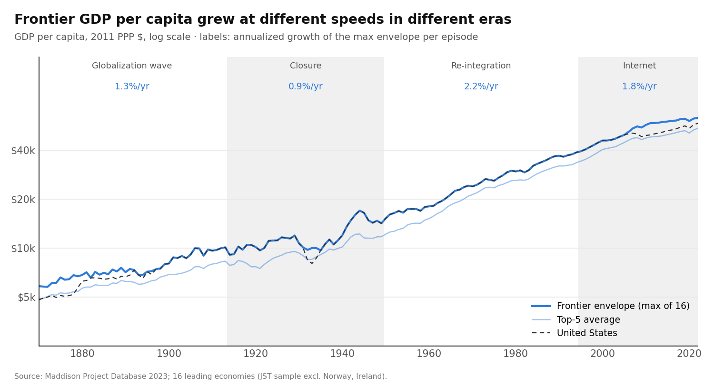

**Productivity.** For TFP and GDP per hour we use the Bergeaud–Cette–Lecat Long-Term Productivity Database (v2.7, 1890–2024). Comparisons of productivity *levels* across countries are fragile: the single highest level switches among Denmark, Switzerland, Belgium and the Netherlands. So for productivity we use the top-5 average and the US, not the single maximum.

**Integration.** Trade openness, (exports + imports) / GDP, from the Jordà–Schularick–Taylor database, extended to 2022 with World Bank data. For the other 15 economies (GDP-weighted), openness was:

| 1870 | 1913 | 1929 | 1938 | 1950 | 1994 | 2022 |
| --- | --- | --- | --- | --- | --- | --- |
| 35% | 44% | 35% | 22% | 29% | 35% | 63% |

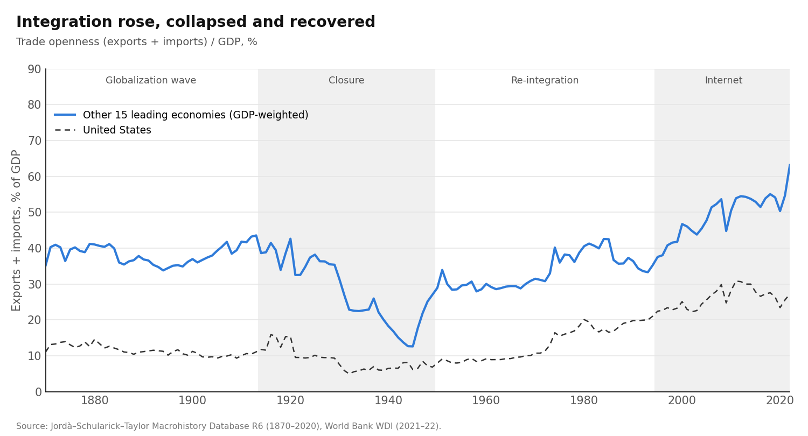

**The effective research pool.** Each country's research $S_i$ (population in the main specification) counts toward the frontier with a weight that rises with its openness. The US, as the research hub, always counts fully:

$$
S^{\text{eff}}_t = \sum_i w_{it} S_{it}, \qquad w_{it} = \min\left(1, \text{open}_{it}^{\kappa}\right), \qquad w_{\text{US}} = 1
$$

$\kappa = 0$ is the conventional unweighted world pool; $\kappa > 0$ means integration matters. The pool's growth splits into a *scale* part (growth of research itself) and an *integration* part (growth of the weights). At $\kappa = 1$, the integration part averaged:

| Episode | Integration component of pool growth |
| --- | --- |
| 1871–1913 | +0.24 pp/yr |
| 1914–1949 | **−1.28 pp/yr** |
| 1950–1994 | +0.27 pp/yr |
| 1995–2022 | +0.74 pp/yr |

## 3. Result 1: frontier growth varied by era, but constancy is not rejected

| Episode | Frontier (max) | Top-5 | US | Top-5 TFP | US TFP | US GDP per hour |
| --- | --- | --- | --- | --- | --- | --- |
| Globalization wave (1870–1913) | 1.28 | 1.24 | 1.73 | 0.71 | 0.98 | 1.45 |
| Closure (1914–1949) | **0.94** | 0.96 | 0.94 | 1.13 | **2.14** | **2.60** |
| Re-integration (1950–1994) | **2.23** | 2.33 | 2.23 | 1.74 | 1.58 | 2.04 |
| Internet (1995–2022) | 1.75 | 1.74 | 1.47 | 0.66 | 1.21 | 1.64 |

*Annualized log growth, % per year, between episode endpoints. Productivity series start in 1890.*

Frontier income growth more than doubled from the closure to the re-integration. But annual growth is very noisy: its standard deviation is 3.7 percentage points even with war years excluded.
- **Unknown-date break tests do not reject a constant mean.** Bai–Perron tests on annual growth, with war years dropped and p-values from a block bootstrap, give UDmax p = 0.33 for the frontier, 0.25 for the top-5 average and 0.28 for the US.
- **The best single break is 1949,** with mean growth of 0.8% before and 2.0% after, but it is not significant (p = 0.22).
- **Only top-5 TFP shows marginal evidence of breaks** (p = 0.07): a mid-century surge, 0.5% → 1.9% → 0.9% with breaks in 1908 and 1973. That is the "one big wave" of Gordon (2016), not an integration pattern.

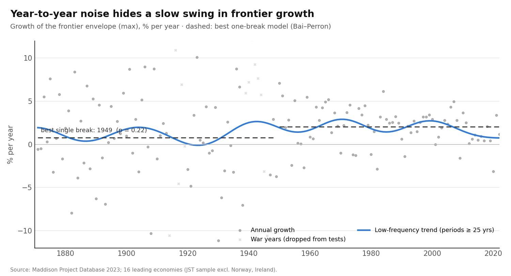

**Interpretation.** The strong form of constancy (2% every decade) is clearly false. The weak form, a constant long-run mean with temporary deviations, survives formal testing at the frontier. This is consistent with Papell and Prodan (2014). Thirty-year swings of a full percentage point are hard to distinguish from noise with 150 years of data.

## 4. Result 2: frontier income co-moves with integration, but weakly

We regress low-frequency growth on the scale and integration components of pool growth, using cosine projections that keep only fluctuations with periods of 25 years or more (Müller and Watson). There are 12 effective observations, so the test is honest about how little long-run information exists. Under the model, the coefficient on the integration component is $\theta = \kappa / (\beta (1-\alpha))$; with $\kappa = 1$ and Bloom et al.'s $\beta = 3$, $\theta = 0.5$.

| Series | θ (integration) | 90% interval | Long-run correlation |
| --- | --- | --- | --- |
| Frontier GDP per capita (max) | 0.32 | −0.11 to 0.76 | 0.38 |
| Frontier GDP per capita (top-5) | 0.25 | −0.17 to 0.66 | 0.32 |
| US GDP per capita | 0.25 | −0.25 to 0.76 | 0.28 |
| Top-5 TFP | 0.20 | −0.17 to 0.57 | 0.34 |
| **US TFP** | **−0.43** | **−0.79 to −0.06** | **−0.54** |
| Followers (average of the other 15) | 0.47 | −0.12 to 1.05 | 0.42 |

What this shows:
- **Frontier income:** the response is positive but not significant. The interval includes both zero and the hypothesized θ = 0.5.
- **US TFP, the leader's productivity:** it moves significantly *against* integration. US productivity grew fastest when the world was most closed.
- **Followers:** their estimate is larger than the frontier's, as catch-up theory predicts (Madsen 2007), though it is not significant either.

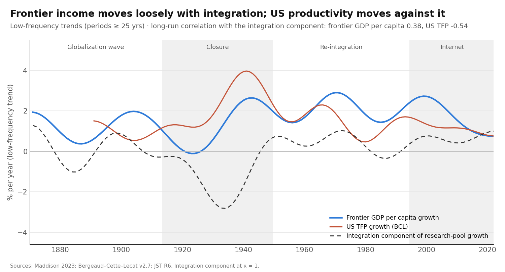

## 5. Result 3: the closure slowed income, not productivity

The proposal's main identification problem was separating *fewer idea flows* from *war damage*. Splitting GDP per capita into productivity and hours resolves much of it.

| Average growth, % per year | 1890–1913 | 1914–1949 | 1950–1994 | 1995–2022 |
| --- | --- | --- | --- | --- |
| **Undamaged leaders (USA, CHE, SWE)** | | | | |
| GDP per capita | 2.05 | 1.57 | 2.22 | 1.47 |
| GDP per hour | 2.11 | 2.29 | 2.35 | 1.49 |
| TFP | 1.25 | **1.72** | 1.58 | 1.14 |
| Hours per person | −0.06 | **−0.72** | −0.13 | −0.02 |
| **War-damaged (BEL, DEU, FRA, ITA, JPN, NLD)** | | | | |
| TFP | 0.93 | 0.86 | 2.76 | 0.55 |

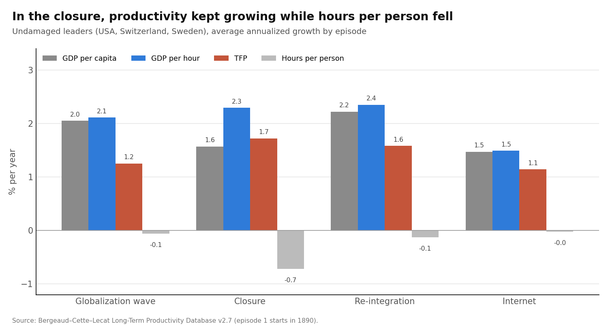

**Undamaged leaders.** In the closure, productivity growth held up or rose, while hours per person fell by 0.7% a year: the Depression's unemployment and shorter working weeks. For the US alone, TFP growth doubled from 0.98% to 2.14% a year, the "great leap forward" of Field (2011).

**War-damaged economies.** Their TFP stalled in the closure and then surged in 1950–1994. That surge is catch-up after destruction plus re-integration, and it does not show up at the frontier.

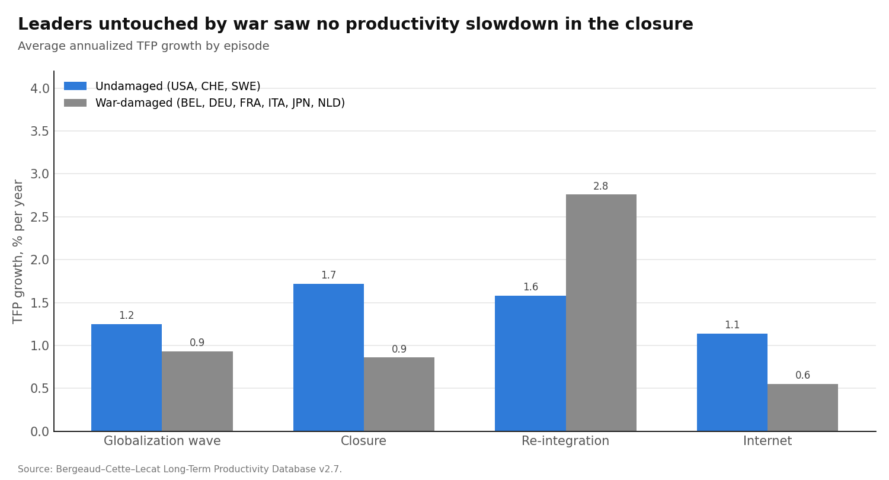

**Formal tests.** These compare mean growth in each episode with 1870–1913, war years dropped, HAC errors:
- **Productivity rose in the closure:** top-5 TFP +1.02 pp (p = 0.04), top-5 GDP per hour +1.26 pp (p = 0.03), US GDP per hour +1.14 pp (p = 0.04).
- **Frontier income fell, but not significantly:** −1.44 pp (p = 0.17).

**The peacetime closure (1929–1938).** This window cut integration without war. It shows no extra slowdown in US TFP (−0.10 pp, p = 0.95). Top-5 TFP fell sharply in those years (−1.78 pp, p < 0.001), but measured TFP is not adjusted for idle capacity, so the Depression's slump is a more likely cause than lost idea flows.

## 6. Result 4: a structural model rejects integration weighting

We estimate the semi-endogenous model below by minimum distance. The model's frontier growth path must match the mean and the 12 low-frequency cosine moments of observed frontier growth:

$$
\frac{\dot A}{A} = a \, S^{\text{eff}}_t \, A_t^{-\beta}, \qquad g_y = \frac{g_A}{1-\alpha}
$$

The table compares three research pools. The share of low-frequency variation explained is measured against a constant-growth benchmark (0 = no better than constant growth):

| Frontier series | H0: world pool, unweighted | H1: integration-weighted (κ = 1) | H2: leader's research only |
| --- | --- | --- | --- |
| GDP per capita (max) | 0.18 | −0.07 | 0.16 |
| GDP per capita (top-5) | 0.26 | −0.07 | 0.26 |
| TFP (top-5) | 0.05 | −0.17 | 0.09 |

What this shows:
- **Integration weighting is the worst of the three.** It fits worse than constant growth for every series.
- **The best κ is 0 everywhere.** The fit gets steadily worse up to κ ≈ 1.5. Beyond that it improves again, because the pool collapses toward US research alone (H2), but it never beats κ = 0.
- **The model explains little in any form.** None of the pools explains more than about a quarter of the low-frequency variation; most of the swing in frontier growth comes from forces outside it.

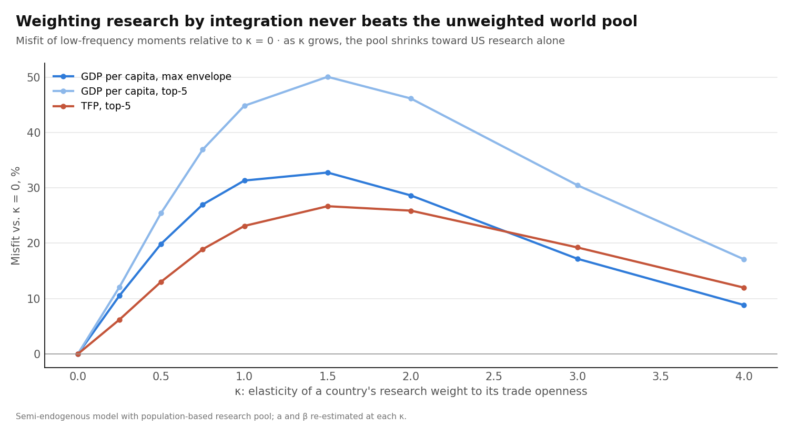

## 7. Could we have detected an effect?

A null result means little if the test has no power. We simulate frontier growth with a known integration effect θ, adding noise resampled from the actual series:

| True θ | Slowdown it implies in 1914–1949 | Power: GDP per capita test | Power: TFP test |
| --- | --- | --- | --- |
| 0 (size) | 0 | 4% | 4% |
| 0.25 | −0.4 pp | 19% | 37% |
| 0.5 | −0.8 pp | 42% | 84% |
| 1.0 | −1.5 pp | 91% | 100% |

*Low-frequency test, one-sided at 5%; 400 simulations per cell.*

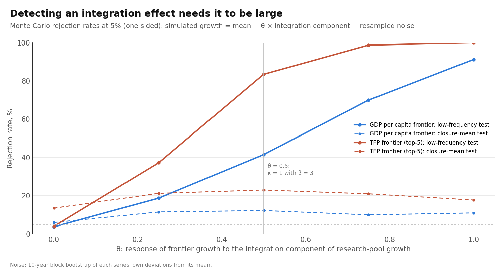

What this shows:
- **For income,** the tests can only detect large effects (θ ≥ 0.75). A κ = 1 effect would be missed more often than not. The income evidence is therefore inconclusive, not a clean null.
- **For productivity,** the test would detect θ = 0.5 84% of the time. The estimate is positive (0.20) but well below that, and for US TFP it is negative. So a κ = 1-sized effect on frontier productivity is unlikely.
- **The episode-mean test is weak,** with power of 23% or less at any θ, and it over-rejects for TFP (13% false alarms). That is why the paper relies mainly on the low-frequency and structural tests.

## 8. Counterfactuals: the cost of fragmentation

Using the structural model at different values of κ:

| | κ = 0 (best fit) | κ = 0.5 | κ = 1 |
| --- | --- | --- | --- |
| Frontier growth 1914–49, actual openness | 1.49% | 1.39% | 1.36% |
| Frontier growth 1914–49, openness frozen at 1913 | 1.49% | 1.62% | 1.75% |
| Frontier income in 1949, actual vs no closure | 0% | −7.9% | −13.1% |
| **Forward scenario:** income in 2042 vs no fragmentation | 0% | −4.5% | −7.2% |
| Forward scenario: income in 2062 vs no fragmentation | 0% | −9.3% | −14.6% |

*Forward scenario: the other economies' openness falls to 51% of its 2022 level over 2023–2032 (the 1913→1938 ratio). Population grows at its 2012–2022 rate.*

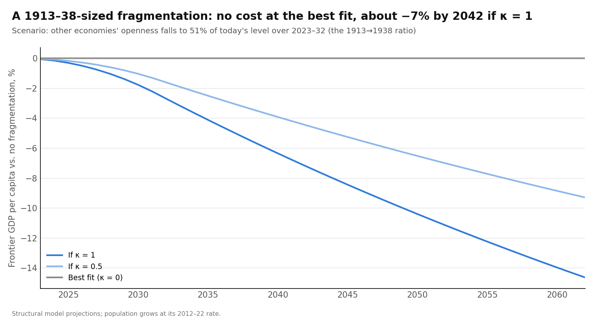

The data favor the first column, and the productivity evidence argues against the third. A κ = 0.5 effect on frontier income cannot be ruled out. These projections treat integration as exogenous; Section 9 shows why that assumption is fragile.

## 9. Endogeneity: is integration really exogenous?

Everything above treats integration as given. It is not: depressions shrink trade, wars cut integration while boosting war production, and technology waves (electrification) can coincide with periods of closure. We run five checks. The code is in `scripts/run_identification.py` and the numbers in `output/results_identification.json`.

**Step 1: trade costs instead of trade volumes.** Trade ÷ GDP moves with anything that moves GDP. We compute bilateral trade costs by inverse gravity (Novy 2013; σ = 8 as in Jacks, Meissner and Novy 2011) from CEPII TRADHIST flows, 1870–2014. Our series correlates 0.92 with the published Jacks–Meissner–Novy trade costs (9,107 pair-years). Each country's weight in the research pool now depends on its trade cost with the US hub.

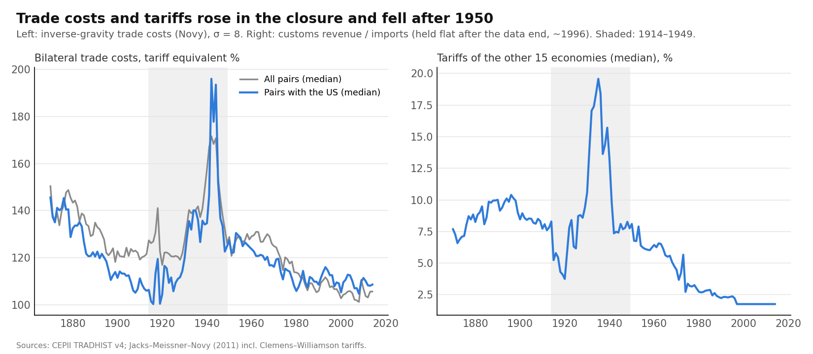

**Step 2: shocks to integration that frontier growth did not cause.**
- **Foreign tariffs.** Tariff changes by the other 15 economies (customs revenue ÷ imports, Clemens–Williamson series in the Jacks–Meissner–Novy data) serve as an instrument.
- **Feyrer-style geography.** This is the part of trade costs predicted by fixed sea and air distances, interacted with distance elasticities that change by decade as transport technology changes. Feyrer's own data were not accessible, so we rebuilt the instrument from TRADHIST sea distances and great-circle distances.
- **The Suez closure (1967–75).** It lengthened sea routes for 55 country pairs, but it did not measurably raise trade costs among our economies: the elasticity is −0.04 (t = −0.9), and no pair involving the US was affected. It fails as an instrument and is reported only for transparency.
- **The WWI boycott of German science (1919–26).** It removed about 7.5% of the effective research pool, a drop of about 8 log points. That is small, and the boycott overlaps with post-war turmoil, so it cannot be tested separately with annual aggregate data.

**Step 3: controls for confounders.** Over 1903–2020 we add three controls:
- the change in US unemployment (the Depression);
- the change in US military spending as a share of GDP (war mobilization; Correlates of War v7);
- growth of US electricity use per person (the electrification wave).

**Step 4: the wars removed.** Growth in 1914–1919 and 1939–1949 is replaced by its window average, so only the net change across each war window remains.

**Step 5: timing.** We ask whether integration moves before or after growth.

**Results for the frontier (low-frequency estimates of θ):**

| Specification | Frontier GDP per capita | US TFP |
| --- | --- | --- |
| Openness, main paper | 0.32 (t 1.3) | −0.43 (t −2.1) |
| Openness, wars neutralized (step 4) | **0.73 (t 2.7)** | −0.26 (t −1.1) |
| Openness + controls, 1903–2020 (step 3) | 0.58 (t 2.1) | **−0.49 (t −2.2)** |
| Openness + controls, wars neutralized | 0.55 (t 3.0) | **−0.54 (t −2.1)** |
| Trade costs, OLS (step 1) | **0.03 (t 0.05)** | **−0.97 (t −2.3)** |
| Trade costs, wars neutralized | 1.30 (t 1.3) | **−1.75 (t −2.4)** |
| Trade costs, IV (step 2; first-stage F) | 0.02 (t 0.0; F 2.2) | −0.71 (t −1.2; F 5.3) |
| Trade costs, IV + controls, no wars | 2.59 (t 2.0; F 0.9) | −0.84 (t −0.6; F 0.9) |

*Openness rows and trade-cost rows are on different scales: compare signs and t-statistics across them, not sizes.*

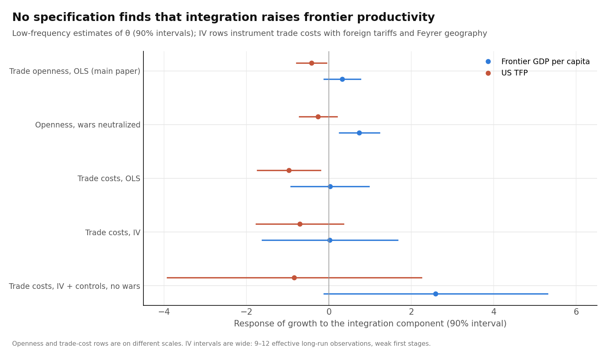

**Timing (step 5).** We regress frontier growth jointly on the integration component ten years *earlier* and ten years *later*:

| | Integration 10 years earlier | Integration 10 years later |
| --- | --- | --- |
| Frontier GDP per capita | −0.12 (t −0.7) | **0.69 (t 3.6)** |
| US TFP | **−0.57 (t −3.6)** | 0.31 (t 2.0) |

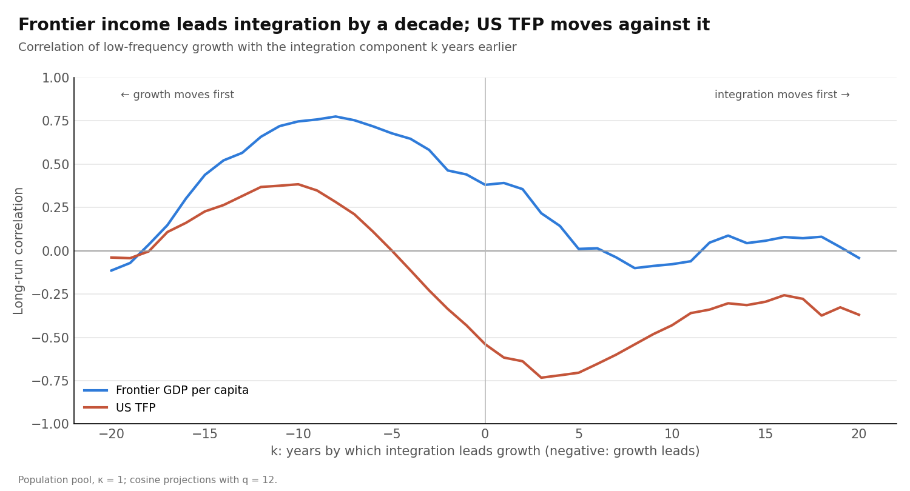

**Panel of 16 countries (5-year periods, country and period fixed effects, war periods dropped).** Period fixed effects remove everything common to all countries: the Depression, the world wars, global technology waves. The regressor is the change in each country's trade-cost connection to all the others, instrumented by partners' tariffs and the Feyrer geography term. Distance to the frontier is the log gap in GDP per capita to the US. Standard errors are clustered by country (16 clusters).

| Effect of integration on growth | TFP, 1891–2014 (320 obs.) | GDP per capita, 1871–2014 (378 obs.) |
| --- | --- | --- |
| OLS, pooled | **0.23 (se 0.09)** | 0.16 (se 0.12) |
| IV, pooled (first-stage F) | 0.48 (se 0.49; F 7.5) | −0.15 (se 0.42; F 7.1) |
| OLS, at the frontier (gap = 0) | 0.02 | −0.05 |
| OLS, at the median follower (30% below US) | 0.17 | 0.15 |
| IV, at the frontier | 0.10 (se 0.30) | −0.06 (se 0.53) |
| IV, at the median follower | 0.34 (se 0.33) | −0.21 (se 0.50) |

**What survives the checks:**
1. **The positive link between frontier income and integration is most likely reverse causality.** Integration follows frontier growth by about a decade (t = 3.6), not the other way round. Measured by trade costs, which are less mechanically tied to GDP, the link is zero (0.03). Booms raise trade; trade does not visibly raise the frontier.
2. **The negative link between US TFP and integration is robust but not shown to be causal.** It survives controls for the Depression, war mobilization and electrification, removing the wars, and switching to trade costs (t between −2.1 and −2.4). Productivity tends to rise in the decade *after* integration falls. But the instruments are too weak at the frontier (F of 0.9–5.3) to establish causality. It is consistent with a "closure pushes the leader to innovate at home" story (Nelson and Wright 1992; émigré scientists, Moser, Voena and Waldinger 2014), but it does not prove it.
3. **With global shocks removed, integration is associated with faster productivity growth, mainly behind the frontier.** The panel's OLS effect is 0.23 on average: about 0.02 at the frontier and 0.17 for the median follower. The IV estimates point the same way (0.10 at the frontier, 0.34 for followers) but are imprecise, with first-stage F of 5–7.5, below the conventional threshold of 10.

**Bottom line of the endogeneity checks.** Nothing here supports "integration drives frontier productivity." The correlations that pointed that way turn out to be timing (growth first) or measurement (trade ÷ GDP). Causal estimates at the frontier are not possible with these instruments: one time series of about 150 years gives too little long-run variation. The credible causal statement is narrower: with global shocks removed, integration matters more for countries catching up than for the leader, and even that is only suggestive given the weak first stages.

## 10. Robustness

The positive but insignificant response of frontier income to integration is stable across the main specification choices:

| Variant | θ (integration) | t |
| --- | --- | --- |
| Main (population pool, q = 12) | 0.32 | 1.34 |
| Patent-based pool, 1885–1977 (q = 8) | 0.12 | 0.28 |
| Netherlands dropped (its openness series breaks in 1914–20) | 0.30 | 1.22 |
| US weighted by its own openness (no hub status) | 0.13 | 1.26 |
| Coarser filter (q = 8, periods ≥ 38 yrs) | 0.32 | 1.32 |
| Finer filter (q = 16, periods ≥ 19 yrs) | −0.02 | −0.05 |
| World openness growth as the regressor | 0.14 | 1.53 |

- **The patent-based pool also prefers κ = 0** in the structural model.
- **The envelope barely depends on the country set.** The broader 20-country set and the countries rich in 1870 give the same episode growth rates as the main sample. The countries rich in 2022 differ in 1870–1913 (1.54% a year) and after 1995 (2.9% a year). That set includes Norway and Ireland, which is why those two are excluded from the main sample.

## 11. What this means

**For the proposal's hypotheses.** The results fit H2 best: what matters for frontier productivity is the leader's own research, consistent with Nelson and Wright (1992). They also fit H0 at the frontier: no breaks tied to integration can be detected. H1 (fragmentation slows the frontier) is not supported for productivity and is not established for income. After the endogeneity checks these are statements about evidence that is *absent*, not causal estimates: the instruments are too weak at the frontier to establish causality in either direction.

**For the original question: why is frontier growth so constant?**
- **"Global ideas keep the frontier steady" fails a direct test.** When integration collapsed, frontier productivity sped up rather than slowed. The one correlation that pointed toward global ideas (frontier income) turns out to run from growth to integration.
- **Constancy looks like a property of the leader's research engine.** The leader seems to grow at a pace set by its own research, education and capital deepening, and other forces offset the shocks: hours fell in the 1930s while productivity rose.
- **The open question becomes "why does the leader's engine run at a steady pace?"** It is no longer "why does the world's idea pool grow steadily?"
- **Integration may matter elsewhere:** for followers' catch-up rather than for the frontier's pace. The country panel with year fixed effects points the same way (about 0.02 at the frontier, 0.17 for the median follower), but that is suggested, not established.

**For today's fragmentation debate.** History gives no sign that closing the world slows the frontier's productivity. The costs of fragmentation are more likely to fall on countries cut off from the frontier. Two cautions:
- today's research is far more networked than in the 1930s;
- our integration measure is trade, not scientific collaboration.

## 12. Limitations

1. **Endogeneity is diagnosed, not solved, at the frontier.** Section 9 shows the main correlations are either reverse causality (frontier income) or robust but not instrumented (US TFP). The instruments available (foreign tariffs, Feyrer-style geography) are weak at the frontier (F of 0.9–5.3) and only moderate in the panel (F of 5–7.5). The Suez closure fails as an instrument, and the scientific boycott is too small and overlaps with post-war turmoil. Foreign tariffs can themselves respond to the Depression; the Feyrer instrument relies on decade-specific elasticities estimated from the same trade data.
2. **Integration is measured by trade in goods, not by flows of ideas.** Scientific links (citations, co-authorship, foreign inputs to patents) were not available before 1950. If idea flows and trade diverged, for example through migration of scientists to the US in the 1930s (Moser, Voena and Waldinger 2014), our measure misses it.
3. **Research effort is proxied by population.** The patent alternative is limited to 1885–1977, because the European Patent Office (from 1978) moves filings away from national offices.
4. **China, Korea and the former USSR are not in the research pool.** This matters most after 1990, and the forward scenario inherits the omission.
5. **Measured TFP is not adjusted for capacity utilization,** so Depression-era TFP is understated, especially in Europe.
6. **War-year output is interpolated** in the sources. Annual tests drop war years, the low-frequency analysis keeps them, and Section 9 also neutralizes them.
7. **κ is weakly identified.** At large κ the model converges to a "leader only" pool, which makes the fit non-monotonic in κ.
8. **The 1913→1949 endpoint averages include the wars.** The formal tests drop war years and are the more reliable comparison.
9. **Trade-cost data have their own issues.** Wartime trade costs are interpolated, and tariffs are held flat after the series end (about 1996). The UK's 1950 tariff (31%) is inflated by revenue duties.

## 13. Reproduce

```bash
pip install -r requirements.txt
python tests/test_methods.py
python scripts/run_all.py            # main results
python scripts/run_identification.py # endogeneity checks (Section 9)
```

Every number above is in [output/results.json](output/results.json) and [output/results_identification.json](output/results_identification.json). The methods are checked on simulated data in [tests/test_methods.py](tests/test_methods.py):
- the break test finds planted breaks and has close to its nominal 5% false-alarm rate under the null;
- the low-frequency regression recovers a known slope;
- the model recovers a known κ;
- the low-frequency IV removes a known endogeneity bias;
- the panel IV recovers a known effect with fixed effects.

## References

- Bai, J., and Perron, P. (2003). Computation and analysis of multiple structural change models. *Journal of Applied Econometrics* 18(1). †
- Bergeaud, A., Cette, G., and Lecat, R. (2016). Productivity trends in advanced countries between 1890 and 2012. *Review of Income and Wealth* 62(3).
- Bloom, N., Jones, C. I., Van Reenen, J., and Webb, M. (2020). Are ideas getting harder to find? *AER* 110(4).
- Bolt, J., and van Zanden, J. L. (2025). Maddison-style estimates of the evolution of the world economy: a new 2023 update. *Journal of Economic Surveys* 39(2).
- Bertoli, S., Goujon, M., and Santoni, O. (2016). The CERDI-seadistance database. CERDI Études et Documents 2016-07. †
- Correlates of War Project (2024). National Material Capabilities, version 7.0. <https://correlatesofwar.org/data-sets/national-material-capabilities/>
- Feyrer, J. (2019). Trade and income—exploiting time series in geography. *AEJ: Applied Economics* 11(4). †
- Field, A. J. (2011). *A Great Leap Forward: 1930s Depression and U.S. Economic Growth*. Yale University Press.
- Fouquin, M., and Hugot, J. (2016). Two centuries of bilateral trade and gravity data: 1827–2014. CEPII Working Paper 2016-14.
- Jacks, D. S., Meissner, C. M., and Novy, D. (2011). Trade booms, trade busts, and trade costs. *Journal of International Economics* 83(2). †
- Gordon, R. J. (2016). *The Rise and Fall of American Growth*. Princeton University Press.
- Hansen, B. E. (2000). Testing for structural change in conditional models. *Journal of Econometrics* 97(1). †
- Jones, C. I. (1995). R&D-based models of economic growth. *JPE* 103(4).
- Jones, C. I. (2022). The past and future of economic growth: a semi-endogenous perspective. *Annual Review of Economics* 14.
- Jordà, Ò., Schularick, M., and Taylor, A. M. (2017). Macrofinancial history and the new business cycle facts. *NBER Macroeconomics Annual* 31. †
- Madsen, J. B. (2007). Technology spillover through trade and TFP convergence: 135 years of evidence for the OECD countries. *Journal of International Economics* 72(2).
- Moser, P., Voena, A., and Waldinger, F. (2014). German Jewish émigrés and US invention. *AER* 104(10).
- Müller, U. K., and Watson, M. W. (2018). Long-run covariability. *Econometrica* 86(3). †
- Novy, D. (2013). Gravity redux: measuring international trade costs with panel data. *Economic Inquiry* 51(1). †
- Nelson, R. R., and Wright, G. (1992). The rise and fall of American technological leadership. *Journal of Economic Literature* 30(4).
- Papell, D. H., and Prodan, R. (2014). Long run time series tests of constant steady-state growth. *Economic Modelling* 42.

† Cited from memory; verify details before use. All other entries were checked during the literature search on 16 October 2026.
