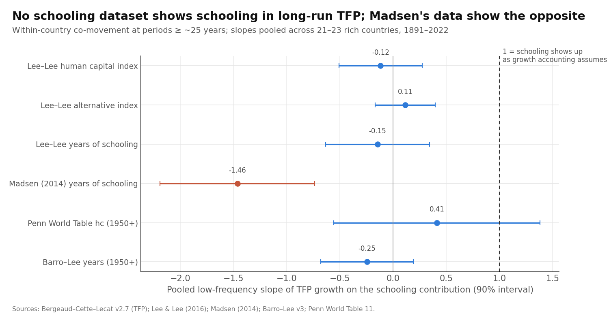
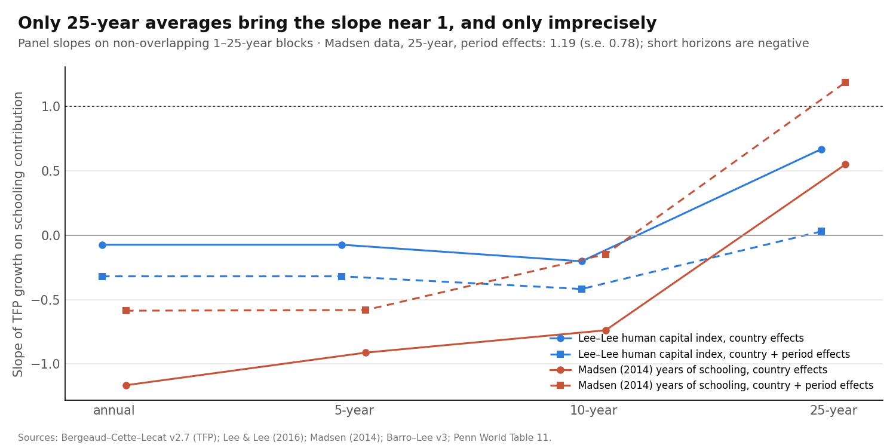
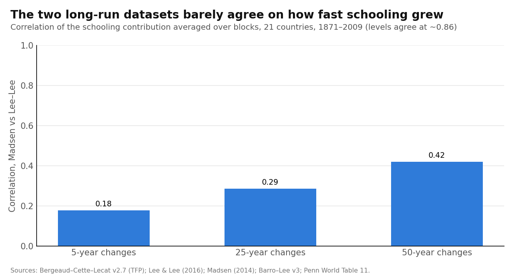

# Where Has All the Schooling Gone, Over 120 Years? A Low-Frequency Look at Pritchett vs Madsen

Draft of 17 October 2026 · @Manuel Antonio Sanchez Garcia · ex-ante review and pre-registered design: [litreview_education.md](litreview_education.md) · code: `scripts/run_education.py` · numbers: `output/education/results.json`

## Abstract

Growth accounting assumes that each extra year of schooling raises productivity by roughly the Mincer return (about 8%). If so, then within a country, the long swings in schooling growth should show up one-for-one in productivity growth. Paper 2 found they don't. Madsen (2014) found that schooling did raise productivity growth in nearly the same countries.

We test the gap with six schooling datasets, 21–23 rich economies, 1891–2022. We use only the long swings (periods of about 25 years or more), plus lags, level specifications, a frequency ladder, a cross-dataset errors-in-variables correction, and alternative productivity measures. All tests were fixed in advance.

**Four findings:**
1. **The near-zero long-run slope is robust.** It holds across datasets, lags and level specifications. Pooled slopes run from −0.25 to +0.41, against 1 if schooling showed up as assumed. **With Madsen's own schooling series it is strongly negative:** −1.46 (s.e. 0.44).
2. **Madsen's data do not overturn it at low frequency.** With his own TFP the slope is −0.03. Only 25-year panels with period effects get near 1 (1.19, s.e. 0.78), and imprecisely.
3. **The decisive problem is measurement.** The two long-run datasets barely agree on how fast schooling *grew*: correlation 0.18 for 5-year changes and 0.29 for 25-year changes, although levels agree at 0.86. Instrumenting one dataset with another fails: first stages are weak (F = 7–13) or come from shared sources.
4. **The result predicted by "it's just measurement error" (a slope pulled toward 0 but still positive) cannot be ruled out with Lee–Lee data. A significantly negative slope can't come from ordinary error.** It requires systematic error or genuine offsetting.

**Bottom line:** the puzzle is not solved by Madsen's data, by lags, or by levels. But schooling changes before 1950 are measured too poorly to tell "schooling doesn't raise productivity growth" from "we can't measure schooling growth". This partly replicates Krueger and Lindahl (2001): we extend their within-country finding to 120 years and to Madsen's data.

## 1. Question and short answer

**Question.** Over the long run and within countries, does faster schooling growth come with faster productivity growth, as growth accounting assumes? And is our earlier "no" real, or a data problem the literature already solved?

**Short answer.**
- **It is not an artifact of one dataset, of lags, or of specification.**
- **Madsen's positive results come from different choices:**
  - shorter horizons;
  - the level × distance-to-frontier term;
  - his own productivity series.
  
  They do not come from long-run co-movement.
- **But the data on schooling *changes* are too unreliable to settle the question.** So we have a robust fact, not yet a proven puzzle.

## 2. Data and design

**Productivity.**
- Bergeaud–Cette–Lecat (BCL) TFP and GDP per hour, 23 economies, 1891–2022. BCL TFP does **not** subtract human capital, so a true effect shows up as a slope of 1 on the schooling contribution.
- Madsen's (2014) own TFP series, as a check.

**Schooling** (contribution = 0.7 × 0.08 × change in years, or the change in the log human-capital index):

| Dataset | Coverage | Method |
| --- | --- | --- |
| Lee–Lee (2016): human capital index, alternative index, years | 1870–2010, 23 economies | perpetual inventory from enrolment |
| **Madsen (2014)** years of schooling | 1870–2009, 21 economies | perpetual inventory, his own reconstruction |
| Barro–Lee (2013) | 1950–2015 | census and survey attainment |
| Penn World Table 11 human capital | 1950–2022 | built on Barro–Lee and Cohen–Leker |
| Cohen–Soto, de la Fuente–Doménech | 1960–2010 (10-year steps) | census-based, cleaned |

**Method.**
- **Low-frequency (Müller–Watson) regressions:** TFP growth on the schooling contribution, using only periods of about 25 years or more.
- Run country by country and pooled; plus panels at 1-, 5-, 10- and 25-year horizons.

*The JSON keys in the script use a different test numbering from the ex-ante review. Here we use the review's names.*

## 3. Result 1: no dataset shows schooling in long-run TFP

| Schooling dataset | Pooled slope (s.e.) | Median country | Share of countries negative |
| --- | --- | --- | --- |
| Lee–Lee human capital index | −0.12 (0.24) | 0.00 | 48% |
| Lee–Lee alternative index | 0.11 (0.17) | 0.16 | 39% |
| Lee–Lee years (Mincer 8%) | −0.15 (0.30) | 0.00 | 48% |
| **Madsen (2014) years** | **−1.46 (0.44)** | −1.46 | **76%** |
| Penn World Table hc (1950+) | 0.41 (0.59) | 0.98 | 35% |
| Barro–Lee years (1950+) | −0.25 (0.26) | −0.05 | 52% |

*Expected if schooling shows up as growth accounting assumes: 1.*

**What this shows.**
- **Every long-run dataset gives a slope near 0 or below,** and every pooled interval excludes 1 except Penn World Table's (0.41 ± 0.97), which covers only 1950–2022.
- **Madsen's data give the most negative result.** Using his reconstruction instead of Lee–Lee makes the puzzle *worse*, not better.
- **Cohen–Soto and de la Fuente–Doménech have too few long-run observations** (10-year steps from 1960) for this test; they are used only in Section 6.

## 4. Result 2: lags and level specifications don't rescue it

**Lags.** Pooled low-frequency slope of TFP growth on the schooling contribution *k* years earlier:

| Dataset | No lag | 10 years | 20 years | 30 years |
| --- | --- | --- | --- | --- |
| Lee–Lee human capital index | −0.12 | −0.12 | −0.09 | −0.36 |
| Madsen years | −1.46 | −1.39 | −0.77 | −1.19 |
| Barro–Lee years (1950+) | −0.25 | −0.83 | — | — |

**Levels (Nelson–Phelps; Benhabib–Spiegel).** TFP growth on the schooling *level* and on level × distance to the frontier, pooled at low frequency:

| Dataset | Level | Level × distance to frontier |
| --- | --- | --- |
| Lee–Lee human capital index | 0.27 (0.28) | −0.14 (0.95) |
| Madsen years | −0.12 (0.71) | **2.54 (1.65)** |

**What this shows.**
- **Waiting a generation for cohorts to replace each other does not turn the slope positive** (Topel 1999; Hanushek and Woessmann 2011).
- **The only sign in Madsen's direction is his level × distance-to-frontier term,** which is positive with his data but not significant (t = 1.5). That is his robust term too. So Madsen's case rests on the **catch-up (Nelson–Phelps)** channel, not on schooling *growth* moving productivity growth.

## 5. Result 3: the sign depends on the horizon

Panel slopes on non-overlapping blocks, with country effects (and period effects):

| Horizon | Lee–Lee index: country effects | + period effects | Madsen years: country effects | + period effects |
| --- | --- | --- | --- | --- |
| 1 year | −0.07 | −0.32 | **−1.16** | −0.59 |
| 5 years | −0.07 | −0.32 | −0.91 | −0.58 |
| 10 years | −0.20 | **−0.42** | −0.74 | −0.15 |
| 25 years | 0.67 (0.44) | 0.03 | 0.55 (1.19) | **1.19 (0.78)** |

**Alternative productivity measures** (pooled low-frequency slope):

| Outcome | Lee–Lee index | Madsen years |
| --- | --- | --- |
| BCL TFP (baseline) | −0.12 | −1.46 |
| BCL GDP per hour | 0.01 (0.31) | **−1.55 (0.51)** |
| Madsen's own TFP | — | −0.03 (0.61) |
| Madsen's own TFP, 25-year panel + period effects | — | 0.78 (0.51) |

**What this shows.**
- **Short horizons are negative,** which is the opposite of the pre-registered "positive at 5 years with period effects".
- **Only 25-year blocks approach 1, and only imprecisely.** With 84–105 country-blocks, the standard errors are 0.5–1.2.
- **GDP per hour does not help.** It *includes* the direct Mincer effect of schooling, yet its slope is ~0 with Lee–Lee and −1.55 with Madsen.
- **The productivity series matters as much as the schooling series.** Madsen's schooling with his own TFP gives ~0; with BCL TFP it gives −1.46.

## 6. Result 4: measurement is the binding constraint

**Do the datasets agree on schooling *changes*?** Correlation of the schooling contribution, Madsen vs Lee–Lee, 21 economies:

| | Levels | 5-year changes | 25-year changes | 50-year changes |
| --- | --- | --- | --- | --- |
| Correlation | ~0.86 | 0.18 | 0.29 | 0.42 |

*A quick pre-run replication with country and year effects removed gave 0.15, 0.25 and 0.60 (see the ex-ante review). Both say the same: changes are poorly measured.*

**Cross-dataset errors-in-variables.** Instrument one dataset's schooling growth with another's; if errors are independent, this removes attenuation:

| Regressor instrumented by | Horizon | IV slope (s.e.) | First-stage F | Verdict |
| --- | --- | --- | --- | --- |
| Lee–Lee by Madsen | 5-year, 1891–2009 | −2.80 (1.44) | 9.2 | weak instrument, negative |
| Lee–Lee by Madsen | 25-year | −1.01 (1.21); with period effects 0.43 (1.32) | 12.9; 6.9 | uninformative |
| Madsen by Lee–Lee | 25-year | 0.52 (1.09); with period effects −1.65 (1.21) | 12.9; 7.4 | uninformative |
| Lee–Lee by Barro–Lee | 1951–2010 | −0.48 (0.23) | 11,767 | **shared source:** errors not independent |
| Lee–Lee hc by Penn World Table hc | 1951–2010 | 0.03 (0.44) | 38.6 | partly shared source (Barro–Lee) |
| Barro–Lee by Cohen–Soto; Lee–Lee or Barro–Lee by de la Fuente | 1951–2010 | — | 0.04–0.96 | **no agreement at all** |

**What this shows.**
1. **Datasets agree on *who* is educated but not on *when* schooling grew.** With reliability around 0.3, a true slope of 1 would be measured at about 0.3.
2. **With Lee–Lee data, an attenuated "true 1" cannot be ruled out:** the 90% interval for −0.12 reaches +0.27.
3. **Ordinary error cannot produce Madsen's −1.46.** Random error pulls a positive slope toward 0, never below it, so a significantly negative slope needs **systematic** error (Portela, Alessie and Teulings 2010) or genuine offsetting.
4. **The correction the literature relies on (Krueger and Lindahl 2001) is not feasible here:** independent datasets don't agree enough to serve as instruments, and those that agree share sources.

## 7. Scorecard against the pre-registered predictions

| Test (ex-ante) | Prediction if "it's just data" | Outcome |
| --- | --- | --- |
| T1. Several datasets | slopes vary widely | **Partly:** −1.46 to +0.41, but none near 1 |
| T2. Errors-in-variables | IV slope moves toward 1 | **Not feasible:** weak or shared instruments; point estimates mostly negative |
| T3. Lags 10–30 years | lagged slopes larger | **No** |
| T4. Level × distance to frontier | positive | **Only with Madsen's data, not significant** (2.54, s.e. 1.65) |
| T5. Frequency ladder | positive at 5 years with period effects | **No:** negative at 1–10 years; ~1 only at 25 years (imprecise) |
| T6. GDP per hour | positive | **No:** 0.01 (Lee–Lee), −1.55 (Madsen) |

**Against our pre-set criteria:**
- **For a "genuine puzzle":** the null survives datasets, lags and Madsen's data, but the errors-in-variables leg could not be run credibly.
- **For "already solved":** the slope did not recover toward 1 with Madsen's data, lags or errors-in-variables.

**So neither verdict is reached.**

## 8. What this means, within the literature

| Literature | Our evidence over 1891–2022 |
| --- | --- |
| Benhabib and Spiegel (1994); Pritchett (2001): schooling *growth* doesn't explain growth | **Extended:** also holds within countries over 120 years at low frequency, with every dataset |
| Krueger and Lindahl (2001): within-country zeros are measurement error | **Consistent but unconfirmable:** long-run reliability is ~0.3, so attenuation can explain Lee–Lee's zero, but not Madsen's negative |
| de la Fuente and Doménech (2006); Cohen and Soto (2007): better data, good results | **Not testable at low frequency:** their series start in 1960 and disagree with each other on changes (F < 1) |
| Madsen (2014): schooling raises productivity, especially via level × distance to frontier | **His channel is the level × frontier term,** not schooling growth; his schooling with BCL productivity gives negative slopes |
| Portela, Alessie and Teulings (2010): perpetual-inventory series have systematic errors | **Consistent:** the two perpetual-inventory datasets disagree on changes even at 50 years (0.42) |
| Hanushek and Woessmann (2008, 2012): quality, not years | **Not tested** (no long-run test-score series) |

**Honest flag: how much is replication?**
- **The zero result itself is Pritchett's and Krueger–Lindahl's,** moved to a 120-year low-frequency setting.
- **What is new:**
  1. it holds with Madsen's own reconstruction, and is *more* negative there;
  2. the two long-run datasets have quantified, low agreement on changes;
  3. the frequency ladder shows the effect appears only at 25-year horizons;
  4. Madsen's result rests on the Nelson–Phelps term.

**A correction to paper 2.** Paper 2 ([paper_balancing_leader.md](paper_balancing_leader.md), finding 4) read a variance ratio of 0.78 between schooling and "the rest of TFP" as offsetting inside TFP. Algebraically, that ratio is below 1 exactly when the slope of TFP on schooling is below 1. Attenuation from errors of the size measured here (reliability ~0.3) produces exactly that.
- **What survives** is only the *negative* point estimates. The pooled Lee–Lee slope (−0.12) is not distinguishable from attenuated positive values, while Madsen's (−1.46) is.
- **Paper 2's bound ("errors would have to exceed the signal") applies to negative country slopes,** but with q = 10 each country slope is noisy enough that 11 of 23 being negative is consistent with a true slope near 0.
- **"Offsetting inside TFP" should therefore be read as "schooling growth does not show up in long-run TFP, possibly because it is mismeasured".**

**For your original question.** Jones (2002) attributes a large share of US growth to rising educational attainment, a transition that must end. If schooling growth does not show up in productivity at low frequency, there are two possible readings:
- **growth accounting overstates education's role** in keeping growth steady; or
- **we cannot measure the transition's timing well enough to see it.**

Either way, **education cannot currently be shown to be one of the forces that kept the 2% steady.**

## 9. Limitations

1. **Pre-1950 schooling is reconstructed from enrolment** in both long datasets. The main problem is precisely their disagreement.
2. **We use years of schooling, not skills.** Quality (Hanushek–Woessmann) may matter more but has no long-run series.
3. **Reverse causality** (Bils and Klenow 2000) is not addressed. At low frequency, expected growth could raise schooling.
4. **TFP depends on a capital share of 0.3 and BCL's capital stocks.** The result differs with Madsen's TFP (≈0 instead of −1.46).
5. **About 120 years give roughly 10 long cycles per country.** Country-level slopes are very noisy; only pooled results should be read.
6. **What would settle it:**
   - census-based schooling by birth cohort for 1900–1950, e.g. IPUMS for the US, which you plan to use;
   - an independent second reconstruction, to build a credible errors-in-variables instrument.

## References

See [litreview_education.md](litreview_education.md) (verified 17 October 2026). Key: Benhabib and Spiegel (1994); Pritchett (2001); Krueger and Lindahl (2001); de la Fuente and Doménech (2006); Cohen and Soto (2007); Madsen (2014); Lee and Lee (2016); Barro and Lee (2013); Portela, Alessie and Teulings (2010); Hanushek and Woessmann (2008, 2012); Bils and Klenow (2000); Nelson and Phelps (1966); Topel (1999); Jones (2002); Bergeaud, Cette and Lecat (2018).
