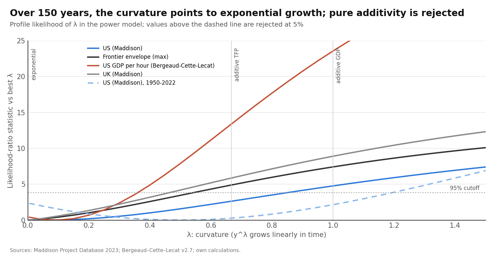
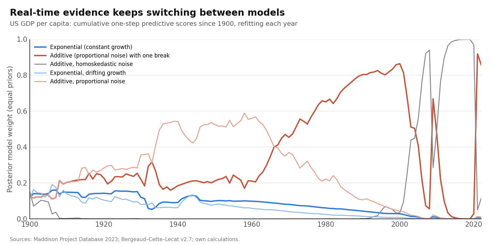
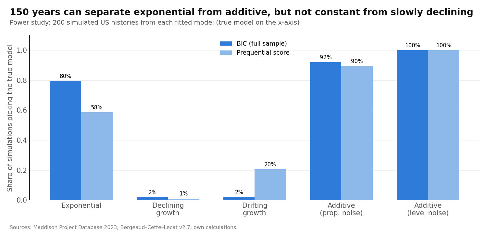
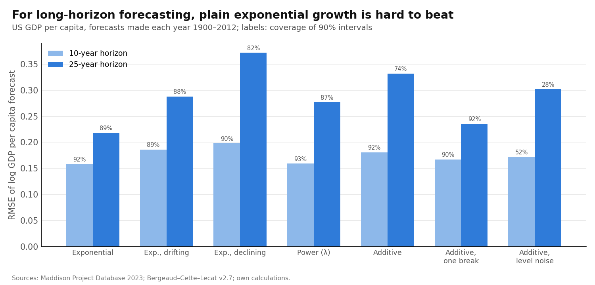

# Constant, Additive or Slowly Declining? What 150 Years of GDP per Capita Can and Cannot Tell

Draft of 17 October 2026 · @Manuel Antonio Sanchez Garcia · ex-ante review and design: [litreview_growth_shape.md](litreview_growth_shape.md) · code: `scripts/run_growth_shape.py`, `scripts/run_growth_shape_power2.py` · numbers: `output/growth_shape/`

## Abstract

Is long-run growth of frontier GDP per capita exponential (a constant rate), additive (a constant dollar increment, so a falling rate), or exponential with slowly declining trend growth? We compare models on US, UK, frontier-envelope and US per-hour series, 1870–2022. The comparison uses one-step predictive scores refit each year, a power model that nests the alternatives, long-horizon forecasts, and power studies.

**Four findings:**
1. **A single additive path since 1870 is rejected.** The curvature parameter λ is estimated at 0–0.1, which means exponential growth. λ = 1 (additive) is rejected in every long series (likelihood-ratio statistics of 4.8–23.6).
2. **Additive growth since a 1930s break scores best in real time,** for the US (log Bayes factor ≈ 4.6 against constant exponential) and, more weakly, for the frontier (≈ 2.3). This matches Jones, López-Salido and Philippon (2026) for TFP.
3. **Slowly declining growth cannot be detected.** Even a decline from 2.5% to 1.0% over 150 years is detected only 35% of the time. A declining exponential is mistaken for additive 30–36% of the time.
4. **For forecasting 10–25 years ahead, constant exponential growth is best or near-best and well calibrated.**

**Bottom line:** the data reject "pure additive" and are consistent with "constant 2%". But they cannot tell constant growth from additive-since-1930s or from slowly declining growth: those three stories are close to observationally equivalent.

## 1. Question and short answer

**Question.** Is the famous straight line exponential, additive, or slowly bending, and can we know?

**Short answer.**
- **Not purely additive over 150 years.**
- **Exponential fits the whole period best in shape.**
- **Since the 1930s, additive increments fit slightly better in real time,** but that is also what a slowly declining exponential would look like.
- **Whether growth is slowly falling is beyond what 150 years of data can resolve.**

## 2. Data and models

**Series.** US GDP per capita (Maddison 2023, 1870–2022; Bergeaud–Cette–Lecat, 1890–2022), the frontier envelope from paper 1, the UK, and US GDP per *hour* (to separate demographics from productivity). Robustness: war years neutralized, and 1950–2022.

**Models.** All are scored on the same scale (log GDP per capita):

| Model | Shape | Parameters |
| --- | --- | --- |
| Exponential | constant growth g | 2 |
| Exponential, declining | g falls linearly in time | 3 |
| Exponential, drifting | growth learned from the past with discounting (steady-state Kalman filter) | 2 |
| Additive, level noise | y rises by b dollars a year; noise in dollars | 2 |
| Additive, proportional noise | y rises by b dollars a year; noise in % | 2 |
| **Power (Box–Cox)** | y^λ rises linearly: λ → 0 exponential, λ = 1 additive, λ ≈ 2/3 = additive TFP | 3 |
| One-break versions | exponential or additive with one break, date chosen by likelihood | 4 |
| Volatility-trend versions | noise standard deviation changes at rate f a year (common across models) | +1 |

**Scoring.**
- **Prequential:** each year from 1900, refit on the past and score the next year. The sum is a genuine sequential marginal likelihood (JLP instead temper overlapping 10-year scores).
- **BIC.**
- **Long horizon:** forecasts 10 and 25 years ahead.
- **Power:** two power studies.

## 3. Result 1: pure additivity is rejected; the curvature points to exponential

| Series | λ (best) | 95% interval | LR vs exponential (λ = 0) | LR vs additive (λ = 1) |
| --- | --- | --- | --- | --- |
| US (Maddison) | 0.05 | 0.00–0.85 | 0.0 | **4.8** |
| Frontier envelope | 0.00 | 0.00–0.50 | 0.0 | **7.4** |
| US (BCL) | 0.05 | 0.00–0.70 | 0.0 | **5.7** |
| US GDP per hour | 0.10 | 0.00–0.35 | 0.4 | **23.6** |
| UK | 0.00 | 0.00–0.45 | 0.0 | **8.9** |
| US, wars neutralized | 0.00 | 0.00–0.60 | 0.0 | **7.1** |
| US, 1950–2022 | 0.50 | 0.00–1.15 | 2.3 | 2.2 |

*LR above 3.84 rejects at 5%.*

**What this shows.**
- **Over 150 years, a single dollar increment is rejected everywhere.**
- **Exponential is never rejected.**
- **The "additive TFP" curvature (λ ≈ 2/3) is excluded** for the frontier, the UK and GDP per hour, but not for the US GDP per capita series.
- **Post-1950 data alone cannot tell anything apart** (λ = 0.5, interval 0–1.15). That is the window where most of the debate (Philippon 2022; Vollrath 2022) takes place.

## 4. Result 2: real-time scores favor "additive since the 1930s", but they keep switching

| Series | Best prequential model | Log Bayes factor vs constant exponential | Final weight on the best |
| --- | --- | --- | --- |
| US (Maddison) | Additive with a break (~1930s) | 4.6 | 0.86 |
| Frontier envelope | Additive with a break | 2.3 | 0.72 |
| US, wars neutralized | Additive with a break | 4.2 | 0.96 |
| UK | Additive with a break | 0.5 | 0.43 |
| US, 1950–2022 | Additive with a break | 1.6 | 0.32 |

**What this shows.** After a break around 1934 (the break year chosen by the models), constant dollar increments predict slightly better than constant growth. That is consistent with JLP's (2026) TFP result. But:
- **The weights move a lot over time.** Additive-with-break led in 1970–2000, then lost ground, then recovered after 2020.
- **The evidence is moderate:** log Bayes factors of 2–5, against JLP's 30+ for TFP.
- **Noise drives naive comparisons.**
  - The additive model with *dollar* noise wins some contests only because volatility in % terms fell. A common volatility trend is estimated at about −1% a year in every model.
  - With volatility trends in all models, the US per-hour series favors exponential (264.9 vs 252.2 for additive).
  - This is Erdil's (2022) warning confirmed on GDP.

## 5. Result 3: what the data can and cannot detect

**Power study A (each fitted model as the truth, 200 simulated US histories).**

| True model | Picked by BIC | Picked by prequential score | Estimated λ (median, 80% range) |
| --- | --- | --- | --- |
| Exponential | 80% | 58% | 0.15 (0.00–0.65) |
| Additive, proportional noise | 92% | 90% | 1.15 (0.60–1.50) |
| Additive, level noise | 100% | 100% | 1.18 (0.70–1.50) |

**Power study B (meaningful declines imposed).**

| True model | Decline detected by a slope test | Picked as declining (BIC) | Mistaken for additive (BIC) |
| --- | --- | --- | --- |
| Trend growth 2.5% → 1.0% over 1870–2022 | 35% | 5% | 31% |
| Trend growth 2.0% → 1.5% | 10% | 0.5% | 14% |
| Drifting trend (more variable) | — | 21% (drifting picked) | 24% |

**What this shows.**
1. **150 years *can* separate exponential from single-increment additive growth:** their λ distributions barely overlap.
2. **150 years *cannot* detect a realistic slow decline in trend growth.** Müller and Watson's point about the few long-run observations is decisive here.
3. **A declining exponential is often mistaken for additive.** Additive-after-a-break and declining-exponential are close to observationally equivalent, so the additive "wins" in the literature do not, on their own, distinguish the two.

## 6. Result 4: forecasting

| US GDP per capita, RMSE of log level (coverage of 90% intervals) | 10 years | 25 years |
| --- | --- | --- |
| Exponential | **0.158 (92%)** | **0.218 (89%)** |
| Power (λ) | 0.159 (93%) | 0.277 (87%) |
| Additive with a break | 0.167 (90%) | 0.235 (92%) |
| Exponential, drifting | 0.186 (89%) | 0.288 (88%) |
| Additive, level noise | 0.172 (**52%**) | 0.302 (**28%**) |

**What this shows.**
- **Constant exponential growth is the best long-horizon forecaster for the US and is well calibrated.**
- **For the frontier envelope, the drifting model is marginally better** (25-year RMSE 0.179 vs 0.207).
- **Additive models with dollar noise are badly overconfident.**
- This agrees with Lunsford and West (2026), who find growth behaves like a stationary series at 10–25 years.

## 7. What this means, within the literature

| Claim in the literature | Our evidence for GDP per capita |
| --- | --- |
| "Growth is additive" (Philippon 2022; JLP 2026, for TFP) | **Partly:** additive since the 1930s scores best in real time, but only moderately, and a declining exponential produces the same signature |
| "A 2% straight line fits 150 years" (Jones 2016, 2023) | **Supported:** exponential shape is never rejected and forecasts best |
| "Trend growth has declined" (Antolin-Diaz et al. 2017; Crump et al. 2024; Fernald 2015) | **Not detectable** over 150 years at realistic sizes, so neither confirmed nor refuted |
| "Long-run inference is weak" (Müller and Watson 2016; Müller, Stock and Watson 2022; Lunsford and West 2026) | **Confirmed and quantified:** a 1.5-point decline is detected 35% of the time |
| "Noise specification decides" (Erdil 2022) | **Confirmed:** dollar-noise additive models win on falling volatility, not on shape |

**For your original question.** "Constant 2%" survives as the best description of the *shape* of 150 years of frontier income. But the data cannot rule out that growth has been slowly falling, or rising in fixed dollar steps, since the 1930s. Constancy is a property we cannot reject, not one we have confirmed.

## 8. Limitations

1. **Annual data without measurement error in the models.** Pre-1929 series are reconstructions (Romer 1989).
2. **Normal errors.** Fat tails (the wars, the Depression) are handled only by neutralizing war years.
3. **The power studies use Gaussian noise at the US level;** real shocks are fatter-tailed.
4. **The frontier envelope switches leaders,** which adds its own curvature.
5. **Break models choose the break date by likelihood,** which flatters them in-sample. The prequential scores partly correct for this.

## References

See [litreview_growth_shape.md](litreview_growth_shape.md); all were verified on 17 October 2026. Key: Philippon (2022); Jones, López-Salido and Philippon (2026); Erdil (2022); Vollrath (2022); Jones (2016, 2023); Müller and Watson (2016); Müller, Stock and Watson (2022); Lunsford and West (2026); Antolin-Diaz, Drechsel and Petrella (2017); Crump, Gospodinov and Wieman (2024); Fernald (2015); Stock and Watson (1998); Papell and Prodan (2014).
