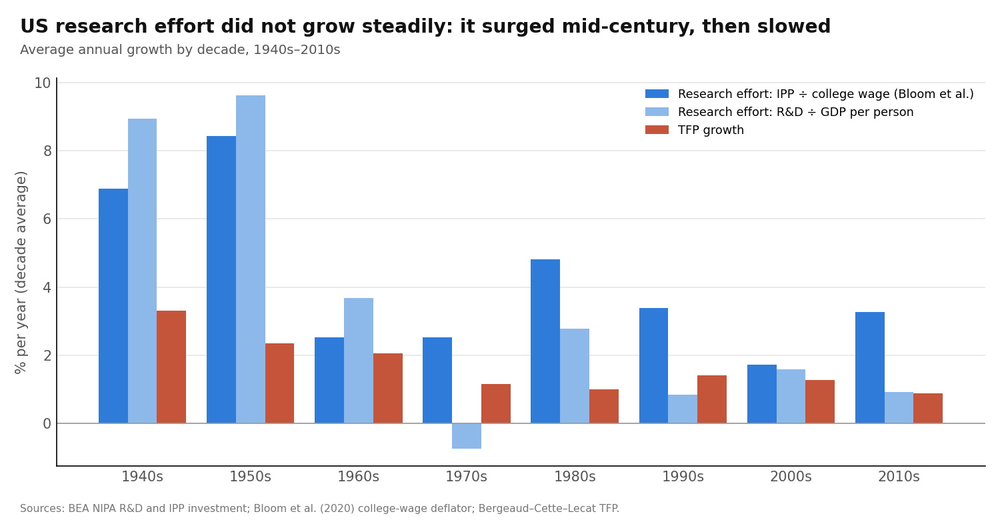
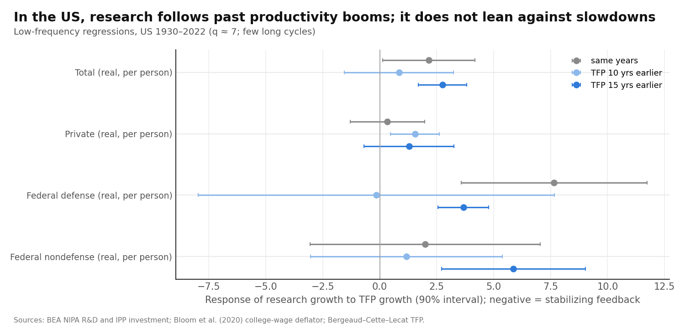
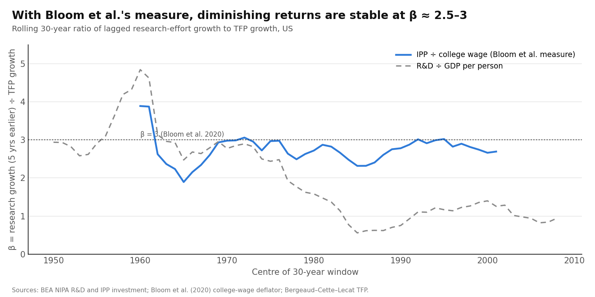

# Does Research Effort Grow Steadily, and Is That Why Growth Is Steady? Testing Four Explanations, US and OECD, 1930–2022

Draft of 17 October 2026 · @Manuel Antonio Sanchez Garcia · ex-ante review and pre-registered design: [litreview_research_effort.md](litreview_research_effort.md) · code: `scripts/run_research_effort.py` · numbers: `output/research_effort/results.json`

## Abstract

In the semi-endogenous model, frontier productivity growth equals research-effort growth divided by the strength of diminishing returns (β). Steady ~2% growth therefore requires research effort to grow steadily, or to move together with β. We test four explanations, fixed in advance, for why research effort might grow steadily:
- **(A) coincidence:** falling population growth happens to be offset by rising research intensity;
- **(B) balancing:** intensity responds to population or to the supply of educated workers;
- **(C) stabilizing feedback:** research rises after productivity slowdowns;
- **(D) stable diminishing returns.**

**Data:** BEA R&D by funder (1929–2025), OECD MSTI (1981–2025), long-run US TFP.

**Five findings:**
1. **US research effort did not grow steadily.** It grew 7–10% a year in the 1930s–50s and about 2–3% a year on average after 1960, under any measure. TFP growth roughly halved with it, from 2.8% to 1.3%.
2. **There is no balancing between population and intensity (A/B).** Population growth is too smooth to offset anything: its long-run standard deviation is 0.3 points, against 3.5 for intensity. The long-run variance ratio is 1.05 (independence: 1.00).
3. **There is no stabilizing feedback in the US aggregate (C).** Research growth follows *past productivity booms* (+2.8 for TFP 15 years earlier, p = 0.008), led by federal research. Across OECD countries there is a *relative* stabilizer: countries growing faster than the OECD average later expand research more slowly (−0.78, p = 0.016). It disappears for the common, OECD-wide component.
4. **β is stable (≈ 2.3–3.0) only under Bloom et al.'s exact measure** (intellectual-property investment ÷ college wage). With R&D alone, the ratio of research growth to TFP growth falls by half after 1960.
5. **"World" research (47 MSTI economies) grew faster and steadier than US research after 1982:** real R&D 4.1% vs 3.7% a year; researchers 3.3% vs 2.4%.

**Bottom line:** steady GDP per capita growth at the frontier is **not** explained by steadily growing research effort. Research surged mid-century and slowed, and productivity growth followed it as Jones's model predicts. The surge was driven by wars and the Cold War, not by a stabilizing mechanism.

## 1. Question and short answer

**Question.** Why would research effort grow at a steady pace, and does that produce ~2% growth?

**Short answer.**
- **It doesn't grow at a steady pace.** It grew fast until about 1960 and slowly afterwards.
- **None of the stabilizing mechanisms (B, C) appears in the US aggregate.**
- **What links research to productivity is stable only under one particular way of measuring research.**
- **The steadiness of GDP per capita must come from elsewhere, or be partly an illusion.** Project 2 shows that a slowdown of this size is hard to detect in 150 years of GDP data.

## 2. Data and identity

**Research effort.**
- **Main measure:** R&D spending ÷ nominal GDP per person (Jones). It splits exactly into research intensity (R&D/GDP) plus population growth: g_S = g_intensity + n.
- **Bloom, Jones, Van Reenen and Webb's (2020, BJVW) measure,** from their replication files: intellectual-property investment (R&D plus software and entertainment originals) ÷ the wage of college graduates.

**Funders (BEA NIPA, 1929–2025):** private; federal defense; federal nondefense; state and local. Both nominal values and real quantity indexes are used. *Pre-1953 figures are a BEA backcast.*

**Productivity:** Bergeaud–Cette–Lecat US TFP.

**OECD MSTI, 1981–2025:**
- researchers (full-time equivalents);
- real R&D spending (GERD, constant PPP dollars);
- R&D as a share of GDP;
- population.

**Method.** Low-frequency (Müller–Watson) regressions with about 7 long cycles; panels with country and period effects; rolling 30-year windows.

> **Correction made while writing.** The first run averaged MSTI levels with MSTI growth-rate and index rows; the extract stores all three under the same measure. This corrupted the OECD panel and the world aggregates. The code now keeps level rows only. **All OECD and world numbers below come from the corrected run.** US results were unaffected.

## 3. Fact: research effort surged mid-century, then slowed

**US research effort growth, % per year (decade averages):**

| Decade | Population growth n | Intensity growth | Research effort (R&D ÷ GDP per person) | BJVW measure (IPP ÷ college wage) | TFP growth |
| --- | --- | --- | --- | --- | --- |
| 1930s | 0.7 | 6.5 | 7.3 | — | 1.6 |
| 1940s | 1.3 | 7.6 | 8.9 | 6.9 | 3.3 |
| 1950s | 1.7 | 7.9 | 9.6 | 8.4 | 2.3 |
| 1960s | 1.3 | 2.4 | 3.7 | 2.5 | 2.1 |
| 1970s | 1.0 | −1.8 | −0.7 | 2.5 | 1.2 |
| 1980s | 0.9 | 1.8 | 2.8 | 4.8 | 1.0 |
| 1990s | 1.2 | −0.4 | 0.9 | 3.4 | 1.4 |
| 2000s | 0.9 | 0.6 | 1.6 | 1.7 | 1.3 |
| 2010s | 0.7 | 1.2 | 1.9 | 3.3 | 0.9 |
| **Mean** | 1.1 | 2.9 | **4.0** | **4.2** (1940–2015) | **1.7** |

**What this shows.**
- **The long-run average fits Jones's arithmetic.** Research effort grew 4.0% a year on average and TFP 1.7%, so β ≈ 2.4; with a capital multiplier of 1.4, that implies GDP per capita growth of about 2.4%.
- **The average hides two regimes.**

  | Measure | 1940s–50s | 1960s–2010s |
  | --- | --- | --- |
  | BJVW measure | ~7.7% | ~3.0% |
  | R&D ÷ GDP per person | ~9.3% | ~1.7% |

- **TFP growth fell from about 2.8% to about 1.3%,** in step with research.
- **Almost all of the swing is intensity, not population.** The mid-century intensity surge matches the OSRD, the Cold War and Sputnik (Gross and Sampat 2023; Kantor and Whalley 2025).

## 4. Hypotheses A and B: do population and intensity offset each other?

| Test | Result | Expected if B (balancing) |
| --- | --- | --- |
| US long-run variance ratio, research effort vs (population + intensity), 1930–2022 | **1.05** (independence: 1.00; p for offset 0.64) | below 1 |
| Long-run correlation of population growth and intensity growth | **+0.25** | negative |
| Long-run standard deviation: population growth / intensity growth | **0.33 / 3.53** points | comparable sizes |
| OECD panel, within-country correlation (5-year blocks, 22 economies, 1982–2022) | **−0.04** | negative |
| US: intensity growth on growth of the tertiary-educated population and on population growth (long run, 1931–2010) | tertiary −0.48 (s.e. 1.62); population 4.5 (5.4); R² 0.15 | positive tertiary coefficient |

**What this shows.**
- **Population growth cannot be the balancing force: it barely moves.** Over 1930–2022 its long swings are a tenth of the size of intensity's.
- **The two are, if anything, positively related** (both high in the baby-boom and Cold War 1950s). That favors **A (coincidence) over B**.
- **Researcher supply (tertiary graduates) does not predict intensity at low frequency,** though with 4 degrees of freedom the test is weak.
- **Literature:**
  - consistent with Jones (2002, 2022): rising intensity, not population, carried mid-century research growth;
  - no support for the balancing in Strulik, Prettner and Prskawetz (2013) at the frontier.

## 5. Hypothesis C: does research lean against productivity slowdowns?

**US, long-run slope of research growth on TFP growth k years earlier:**

| Research measure | Same years | 5 years earlier | 10 years earlier | 15 years earlier |
| --- | --- | --- | --- | --- |
| Total, real per person | 2.16 (1.23) | 1.36 (1.31) | 0.85 (1.46) | **2.76 (0.65)** |
| Private, real per person | 0.33 (0.99) | 0.79 (0.83) | **1.54 (0.65)** | 1.29 (1.20) |
| Federal defense, real per person | **7.65 (2.48)** | 4.24 (3.43) | −0.15 (4.75) | **3.67 (0.67)** |
| Federal nondefense, real per person | 2.00 (3.07) | 1.27 (2.63) | 1.17 (2.55) | **5.87 (1.92)** |
| Research effort (R&D ÷ GDP per person) | 1.38 (1.61) | 1.79 (1.15) | 1.58 (1.23) | **2.67 (0.85)** |

*Negative = stabilizing feedback. Bold: p < 0.06.*

**Forward link (TFP growth on research growth k years earlier):**

| | Same years | 5 years | 10 years |
| --- | --- | --- | --- |
| Slope (s.e.) | 0.08 (0.09) | **0.23 (0.08)** | **0.22 (0.06)** |

The implied loop gain is 0.23 × 0.85 = **+0.20**: mildly amplifying, not stabilizing.

**OECD panel (5-year blocks, 1982–2022, 21–22 economies), research growth on TFP growth over the previous 5 years:**

| Specification | Researchers | Researchers per person | R&D intensity |
| --- | --- | --- | --- |
| Country + period effects | **−0.78 (0.30)** | **−0.83 (0.33)** | **−0.66 (0.31)** |
| + lagged research growth | **−0.78 (0.35)** | — | **−0.58 (0.27)** |
| + current TFP growth | **−0.78 (0.30)** | — | −0.65 (0.33) |
| + TFP level (catch-up) | **−0.79 (0.28)** | — | −0.58 (0.35) |
| **Country effects only (common component kept)** | −0.11 (0.30) | −0.16 (0.32) | −0.28 (0.37) |

**What this shows.**
1. **In the US, research follows booms, not slumps.** Every coefficient is positive. The strongest are federal research 15 years after TFP booms, which is the 1930s–40s productivity boom followed by the 1950s–60s Cold War and space R&D. With about 7 long cycles, **this is essentially one episode**, so it is not evidence of a systematic positive feedback. But it is clearly not a stabilizer.
2. **Research does raise TFP 5–10 years later** (0.22–0.23). This is the same link paper 2 found, and the direction matches Fieldhouse and Mertens (2023).
3. **Across OECD countries, there is a *relative* stabilizer.** A country that grew faster than others in the past 5 years then expands its researchers more slowly than others. This survives:
   - lagged research growth;
   - current TFP growth;
   - TFP level;
   - per-person scaling.
4. **The relative stabilizer vanishes once common shocks are kept.** The OECD-wide component, which is what matters for the frontier, shows no stabilizing response.
5. **Literature:**
   - consistent with procyclical R&D (Barlevy 2007; Fabrizio and Tsolmon 2014; Comin and Gertler 2006), now at low frequency and by funder;
   - the relative OECD result is new to us, but could reflect convergence in research intensity rather than a growth stabilizer.

## 6. Hypothesis D: are diminishing returns stable?

**Rolling 30-year β = research growth (5 years earlier) ÷ TFP growth, US:**

| Window starting | 1935 | 1945 | 1950 | 1955 | 1960 | 1965 | 1970 | 1975 | 1980 | 1985 |
| --- | --- | --- | --- | --- | --- | --- | --- | --- | --- | --- |
| R&D ÷ GDP per person | 2.9 | 4.8 | 2.5 | 2.8 | 2.4 | 1.6 | 0.6 | 0.8 | 1.2 | 1.4 |
| BJVW (IPP ÷ college wage) | — | 3.9 | 1.9 | 3.0 | 3.0 | 2.7 | 2.3 | 2.8 | 3.0 | 2.7 |

**Two-regime version (decade averages):**

| Research measure | β, 1940s–50s | β, 1960s–2010s |
| --- | --- | --- |
| IPP ÷ college wage (BJVW) | 2.7 | **2.3** |
| R&D ÷ college wage | 3.7 | **1.8** |
| R&D ÷ GDP per person | 3.3 | **1.3** |

**What this shows.**
- **Under BJVW's exact measure, β is remarkably stable at 2.3–3.0 from the 1950s.** This replicates Bloom et al. (2020), using their own deflator data.
- **But stability depends on counting software and other intellectual property as research.** With R&D only, on either deflator, β halves after 1960. Measured that way, research slowed *more* than TFP did.
- **Research productivity** (TFP growth per unit of research, GDP-per-person deflator) fell 2–14% a year in each decade from the 1940s to the 1980s, rose in the 1990s (+1.3%), and fell again in the 2000s and 2010s (−3.4%, −6.3%). That is less regular than BJVW's ~5% a year.
- **Literature.**
  - **Partly replicates BJVW;** Ekerdt and Wu (2024) and Fort et al. (2026) also question how regular the decline is.
  - **The measurement dependence is the useful addition:** whether "ideas get harder to find at a constant rate" depends on whether 1980s–2010s software investment counts as research effort.

## 7. World vs US research

**OECD MSTI, 47 reporting economies, chain-linked, % per year:**

| | 1980s | 1990s | 2000s | 2010s | Mean 1982–2022 |
| --- | --- | --- | --- | --- | --- |
| Real R&D, all 47 | 5.3 | 2.2 | 4.3 | 4.7 | **4.1** |
| Real R&D, US | 4.8 | 3.3 | 2.8 | 3.6 | **3.7** |
| Researchers, all 47 | 4.1 | 2.1 | 3.3 | 3.3 | **3.3** |
| Researchers, US | — | 2.8 | 1.9 | 2.1 | **2.4** |

**What this shows.**
- **Since 1982, research in the reporting world grew faster than in the US.** This is plausibly driven by fast-growing entrants such as China and Korea; we have not decomposed it. The 1990s dip is likely the collapse of research in transition economies.
- **If frontier ideas come from the world pool** (Jones 2002; Kortum 1997), the relevant research effort has grown faster and somewhat more steadily than US research alone. This cannot be tested before 1981 without IPUMS-type and historical data.
- **Paper 1 found no evidence that integration-weighted world research drives the frontier.** So this remains a possibility, not a finding.

## 8. Scorecard against the pre-registered tests

| Hypothesis | Pre-registered test | Outcome |
| --- | --- | --- |
| **A. Coincidence** | variance ratio ≈ independence | **Supported:** 1.05 vs 1.00. But population is too smooth for coincidence to matter either way. Intensity carries the swings |
| **B. Balancing via supply/demography** | ratio below the null; intensity responds to tertiary or population growth | **Not supported** (ratio 1.05; correlation +0.25; OECD −0.04; supply test weak) |
| **C. Stabilizing feedback** | negative response to past TFP growth | **Not in the US or the common OECD component.** The US is procyclical (amplifying, driven by one Cold War episode). There is a *relative* cross-country stabilizer in the OECD (−0.78) |
| **D. Stable β** | flat rolling β | **Measurement-dependent:** flat (2.3–3.0) with BJVW's measure; halves with R&D only |

## 9. What this means for the original question

| Chain of argument | Evidence |
| --- | --- |
| Steady 2% requires steady research growth (semi-endogenous) | Research growth was **not** steady: ~8% before 1960, ~2–3% after |
| …or else β moving to compensate | β is stable (BJVW measure) or falling (R&D measure). Neither compensates |
| So TFP growth should have fallen | **It did:** ~2.8% → ~1.3% |
| Then why does GDP per capita look steady? | Project 2: a decline of this size is detected only about a third of the time in 150 years of data. Paper 2: capital and hours do not offset |

**Implications.**
1. **Jones's engine works,** in the sense that productivity growth followed research growth with a stable β under his co-authors' measure. But **it did not run steadily:** the mid-century research surge came from war and geopolitics, and the slowdown followed.
2. **The "constancy" of 2% is partly a sampling illusion:**
   - before 1930, there is little measured research;
   - after 1930, research and TFP swing together, and GDP per capita data are too noisy to reject constancy (Project 2).
3. **The one stabilizer we found works *between* countries, not for the frontier as a whole.** It cannot explain a steady world frontier.
4. **The one open, testable route to a steady engine is the world research pool.** It grew faster and steadier than US research after 1982, but its pre-1981 path is unmeasured.

**Honest flag: replication vs novelty.**
- **Replicated:**
  - the mid-century intensity surge and its transitional nature (Jones 2002, 2022);
  - stable β under BJVW's measure (Bloom et al. 2020);
  - procyclical R&D (Barlevy and others).
- **New (as far as our ex-ante review found):**
  - the low-frequency feedback tests by funder;
  - the common-vs-relative split in OECD feedback;
  - the dependence of β stability on counting intellectual-property investment beyond R&D;
  - the direct test showing population growth is too smooth to balance intensity.

## 10. Limitations

1. **About 7 long cycles since 1930,** and one dominant episode (WWII and the Cold War). All long-run regressions are suggestive.
2. **Pre-1953 R&D is a BEA backcast; pre-1929 research effort is unmeasured.** IPUMS occupational data (scientists and engineers from the census) would extend research labor back to 1850 and test whether the 1870–1930 steadiness had a research counterpart.
3. **R&D intensity has GDP in its denominator,** so fast growth mechanically lowers it. The real-per-person measures avoid this and give the same signs.
4. **MSTI aggregates are chain-linked over a changing set of economies.** Entry of China and others raises world growth by construction of coverage, not only by real expansion.
5. **TFP is from one source (BCL)** with a capital share of 0.3.

## References

See [litreview_research_effort.md](litreview_research_effort.md) (verified 17 October 2026). Key: Jones (1995, 2002, 2022a, 2022b); Bloom, Jones, Van Reenen and Webb (2020); Kortum (1997); Strulik, Prettner and Prskawetz (2013); Barlevy (2007); Fabrizio and Tsolmon (2014); Comin and Gertler (2006); Gross and Sampat (2023); Kantor and Whalley (2025); Fieldhouse and Mertens (2023); Ekerdt and Wu (2024); Fort et al. (2026); Goolsbee (1998); Ryoo and Rosen (2004).
