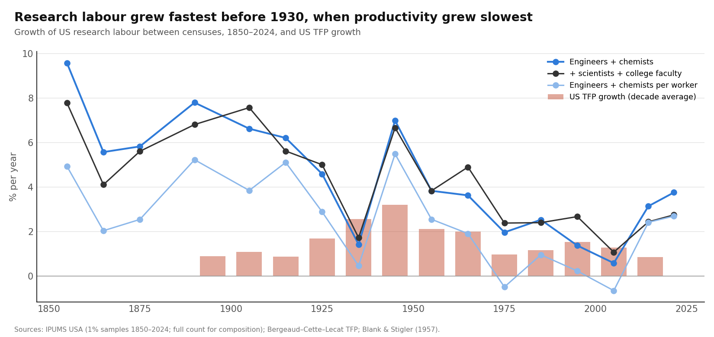
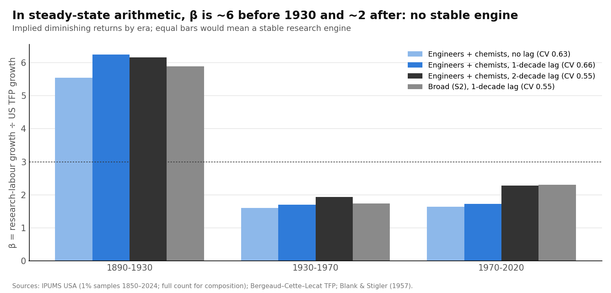
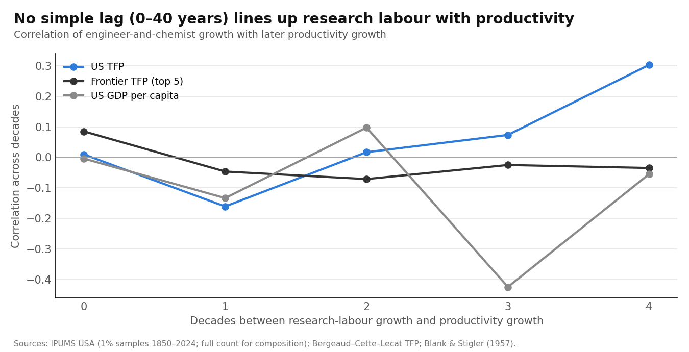
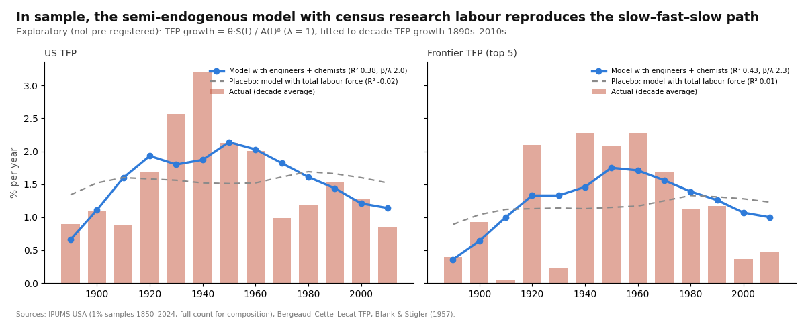

# Research Labour Before R&D Statistics: US Census Evidence, 1850–2024

Draft of 17 October 2026 · @Manuel Antonio Sanchez Garcia · ex-ante review and pre-registered design: [litreview_research_labor_history.md](litreview_research_labor_history.md) · code: `scripts/run_research_labor_history.py` · numbers: `output/research_labor_history/results.json`

*Data: IPUMS USA (Ruggles et al.), extracts 1 and 2 of 17 October 2026. The microdata are not redistributed; only aggregate counts appear here.*

## Abstract

Before 1930 the frontier grew only about 1.1–1.4% a year, and there are no R&D statistics. We use IPUMS census microdata to count US research labour (engineers, chemists, scientists, college faculty) from 1850 to 2024. Our 1% samples match Blank and Stigler's (1957) published counts within ±7%.

**Five findings:**
1. **Research labour grew fast and fairly steadily before 1930, much faster than after.** Engineers and chemists grew about 6.6% a year in 1850–1930 (spread across intervals: 1.5 points), against about 2.9% after 1930 (1.7 points). Per worker they rose from 0.24 per 1,000 in 1850 to 5.8 in 1930 and 24 in 2024.
2. **The simple "research growth ÷ productivity growth" formula fails.** The implied β is about 6 for 1890–1930 and about 1.7–2.3 after 1930, with or without lags of 10–20 years.
3. **Simple lags don't fix it.** Correlations between research-labour growth and productivity growth 0–40 years later are near zero (−0.16 to +0.30).
4. **Early "engineers" were mostly not research workers.** In 1910 only 28% worked in manufacturing, communications or utilities, against 63% in 1960. In 1940, 43% had no college degree.
5. **Exploratory, not pre-registered: the semi-endogenous model in its dynamic form reproduces the frontier's slow–fast–slow path.**
   - **Setup:** research labour starts from a tiny base, so productivity growth rises only gradually. That is transition dynamics, not the steady-state formula.
   - **Fit:** the model explains 38% (US) and 43% (frontier) of decade-to-decade variation in TFP growth over 1890–2020, with β ≈ 2.0–2.5, close to Bloom et al. (2020).
   - **Placebo:** the same model driven by the total labour force explains nothing (R² ≈ 0).
6. **But the dynamic model fails a pre-registered hold-out test.** Fitted on 1891–1970, it forecasts 1971–2020 *worse* than constant growth:
   - forecast error 0.71 vs 0.68 for the US, and 0.90 vs 0.60 for the frontier;
   - it predicts a US slowdown that is too mild (1.78% vs an actual 1.17%), and no frontier slowdown at all;
   - fitted only up to 1950, its parameters aren't identified at all.

**Bottom line:** the slow pre-1930 frontier and the mid-century peak are *consistent* with Jones's (2002) transition story extended to 1850. But the story is **not validated out of sample**: the post-1970 slowdown was deeper than the slowdown in research labour can explain with the parameters that fit the earlier period. We can describe the hump. We cannot yet claim the transition causes it.

## 1. Question and short answer

**Question.** Did US research labour grow steadily before R&D statistics existed, and does it explain why the frontier grew slowly before 1930?

**Short answer.**
- **It grew steadily, but fast** (about 6–7% a year), far faster than productivity.
- **The steady-state semi-endogenous formula can't reconcile the two.** The dynamic version of the same model can, *in sample*: when research capacity starts near zero, productivity growth rises slowly toward its steady state.
- **That gives a hump:** about 1% around 1900, about 2% in mid-century, about 1% today. This is the frontier's actual path.
- **But the dynamic model fails a pre-registered out-of-sample test.** Fitted to 1891–1970, it cannot forecast how deep the post-1970 slowdown was.

## 2. Data and validation

**Data.**
- **IPUMS USA, two extracts.**
  - **(A):** full-count censuses 1850–1950 plus samples 1960–2024, restricted to science and engineering occupations (3.3 million persons).
  - **(B):** 1% samples of the labour force, 1850–2024 (13.2 million persons).
- **Occupations:** the harmonized 1950 classification (OCC1950).

**Validation: engineers + chemists + surveyors vs Blank and Stigler's census tables.**

| Year | Blank & Stigler | IPUMS 1% samples | IPUMS full count |
| --- | --- | --- | --- |
| 1900 | 52,086 | 54,169 | 46,544 |
| 1910 | 105,028 | 104,783 | 91,989 |
| 1920 | 189,062 | 185,421 | 141,815 |
| 1930 | 276,941 | 293,254 | 229,785 |
| 1940 | 337,877 | 341,236 | 392,821 |
| 1950 | 636,400 | 675,671 | 524,607 |

**Which source for what.**
- **Levels come from the 1% samples,** which are within ±7%. The full count, coded automatically, misses 11–25%.
- **The full count is used for composition and as a check for 1850–1900.** Its growth rates over 1850–1900 average about 7.3% a year, the same as the 1% samples.

**Coding issues handled.**
- **1940 has no natural scientists in OCC1950,** so they are interpolated.
- **Industry was not asked before 1910.** IPUMS imputes it from occupation, so industry-based measures start in 1910.
- **The 1950 census asked about education only of a subsample,** so college shares are computed among people with education reported.
- **Technicians are excluded** because their category jumps in 1940.

**Series.**
- **S1:** engineers + chemists.
- **S2:** S1 + natural scientists + college faculty.
- **S3:** S1 in manufacturing, communications or utilities, plus natural scientists (from 1910).

## 3. Result 1: research labour grew fast and steadily before 1930

| | 1850 | 1880 | 1900 | 1930 | 1950 | 1970 | 2000 | 2024 |
| --- | --- | --- | --- | --- | --- | --- | --- | --- |
| Engineers + chemists | 1,261 | 10,272 | 48,855 | 279,125 | 647,864 | 1,366,800 | 2,461,334 | 4,181,601 |
| Per 1,000 workers | 0.24 | 0.63 | 1.78 | 5.82 | 10.6 | 16.5 | 17.7 | 23.7 |

**Growth between censuses (% per year):**

| Series | 1850–1930 mean (spread) | 1930–1970 | 1970–2024 |
| --- | --- | --- | --- |
| S1 engineers + chemists | **6.6** (1.5) | 4.0 | 2.2 |
| S2 broad | 6.1 (1.3) | 4.3 | 2.3 |
| S1 per worker | 3.8 (1.2) | 2.6 | 0.9 |
| US TFP (BCL) | 1.1 (1890–1930) | 2.5 | 1.2 |



**What this shows.**
- **Before 1930, research labour grew 4.6–9.6% a year in every interval** (the 9.6% for 1850–60 rests on very small counts). Its intervals vary slightly *less* than after 1930 (spread 1.5 vs 1.7 points).
- **Productivity did the opposite:** slowest when research labour grew fastest.
- **Two breaks:** the 1930s Depression (1.4%) and the wartime and post-war surge of the 1940s (7.0%).
- **The census measure tracks Project 3's R&D measures after 1940:** decade correlations of 0.68 (Bloom et al.'s measure) and 0.77 (R&D ÷ GDP per person); 0.76–0.83 for the research-industry series S3.

## 4. Result 2: the steady-state formula gives no stable β, with or without lags

**Implied β = research-labour growth ÷ US TFP growth:**

| Series and lag | 1890–1930 | 1930–1970 | 1970–2020 | Variation across eras |
| --- | --- | --- | --- | --- |
| S1, no lag | 5.5 | 1.6 | 1.6 | 0.63 |
| S1, one decade | **6.2** | **1.7** | **1.7** | 0.66 |
| S1, two decades | 6.2 | 1.9 | 2.3 | 0.55 |
| S2, one decade | 5.9 | 1.7 | 2.3 | 0.55 |
| S1, one decade, frontier TFP | 8.2 | 2.5 | 2.1 | 0.66 |



**Correlation of research-labour growth with productivity growth *k* decades later** (13 decades):

| k | 0 | 1 | 2 | 3 | 4 |
| --- | --- | --- | --- | --- | --- |
| US TFP | 0.01 | −0.16 | 0.02 | 0.07 | 0.30 |
| Frontier TFP | 0.08 | −0.05 | −0.07 | −0.03 | −0.03 |



**What this shows.**
- **After 1930, β is fairly stable at 1.7–2.3.** That is consistent with Bloom et al.'s (2020) β ≈ 3 and our Project 3 (2.3–3.0).
- **Before 1930 it is three times higher.** Research labour grew six times faster than productivity.
- **Lags of 10–40 years don't change this.** The only hint is a weak +0.30 at four decades for US TFP, which is not seen for the frontier.
- **This repeats, with better data, what the graduate counts and Blank–Stigler suggested.**

## 5. Result 3: early engineers were mostly not research workers

| Share of engineers + chemists who… | 1910 | 1920 | 1930 | 1940 | 1960 | 1990 | 2024 |
| --- | --- | --- | --- | --- | --- | --- | --- |
| work in manufacturing, communications or utilities | 28% | 38% | 46% | 54% | 63% | 49% | 37% |
| are wage or salary workers | 84% | 90% | 93% | 93% | 97% | 91% | 90% |
| have a college degree | — | — | — | 57% | 57% | 71% | 82% |

*Industry is not available before 1910, and education not before 1940. The decline after 1960 in the industry share partly reflects engineers moving to professional services (software, design), which the 1950 industry classification doesn't separate.*

**What this shows.**
- **In 1910, most engineers built and ran railways, mines, roads and buildings.** They worked on applying technology, not producing ideas.
- **The shift into the industries where corporate research labs grew (Mowery 1983) came during 1910–1960.**
- **This supports the pre-registered reading (c),** that early engineers were mostly not doing research, as one part of the explanation.

## 6. Result 4 (exploratory, not pre-registered): the dynamic semi-endogenous model fits the hump

**Why we went beyond the design.** The ratio "research growth ÷ productivity growth" equals β only on a balanced growth path. The model itself is

$$
g_{A,t} = \theta \, \frac{S_t^{\lambda}}{A_t^{\beta}}
$$

When research labour S starts tiny, as it did in 1850 (0.24 per 1,000 workers), productivity growth starts low and *rises* as S builds up, even if S grows at a steady rate. That is the transition dynamics Jones (2002) emphasized for 1950–93.

**What we fitted.** We simulated the model annually from the 1891 TFP level with census S (interpolated between censuses) and fitted θ and β to decade TFP growth over 1890s–2010s.

| Research input and outcome | λ | β | β/λ | R² (vs constant growth) |
| --- | --- | --- | --- | --- |
| S1, US TFP | 1 (fixed) | 2.03 | 2.03 | **0.38** |
| S1, US TFP | 0.75 (fixed) | 1.56 | 2.08 | 0.34 |
| S1, US TFP | 1.24 (free) | 2.47 | 2.00 | 0.39 |
| S2, US TFP | 1 (fixed) | 2.21 | 2.21 | 0.32 |
| S1, frontier TFP | 1 (fixed) | 2.28 | 2.28 | **0.43** |
| S1, frontier TFP | 0.75 (fixed) | 1.75 | 2.34 | 0.36 |
| **Placebo: total labour force, US TFP** | 1 (fixed) | 0.95 | 0.95 | **−0.02** |
| **Placebo: total labour force, frontier TFP** | 1 (fixed) | 1.13 | 1.13 | **0.01** |



**Fitted vs actual US TFP growth (λ = 1):**

| | 1890s | 1910s | 1930s | 1950s | 1970s | 1990s | 2010s |
| --- | --- | --- | --- | --- | --- | --- | --- |
| Model | 0.7 | 1.6 | 1.8 | 2.1 | 1.8 | 1.4 | 1.1 |
| Actual | 0.9 | 0.9 | 2.6 | 2.1 | 1.0 | 1.5 | 0.9 |

**What this shows.**
- **The same model with a plausible β of about 2–2.5 reproduces the shape:** slow around 1900, fastest in mid-century, slowing since.
- **The shape comes from research labour specifically.** A model driven by the total labour force, which also decelerated, fits nothing.
- **What it misses:**
  - the height of the 1930s–40s peak (Field's "great leap" and wartime);
  - the depth of the 1970s dip.

  The fitted peak is in the 1950s, a decade later than the actual one.
- **When λ is left free, it exceeds 1** (1.24, or 1.5 at the bound for the frontier). That implies increasing returns to research effort, which is implausible. With λ fixed at 1 or 0.75 the fit barely changes.

## 6b. Result 5: the pre-registered hold-out test fails

**The rules, written before running** (addendum to the ex-ante review):
- fit the dynamic model on 1891–1970, then forecast 1971–2020 from the actual 1970 TFP level using the actual census research labour;
- the model passes only if, for **both** US and frontier TFP, it beats constant growth, beats the placebo, and predicts the post-1970 slowdown.

| Fit 1891–1970 → forecast 1971–2020 | Model | Constant growth | Last decade | Steady-state formula | Placebo | Predicted mean | Actual mean | Actual 1931–70 |
| --- | --- | --- | --- | --- | --- | --- | --- | --- |
| US TFP, S1, λ = 1 | 0.71 | 0.68 | 0.87 | **0.60** | 2.52 | 1.78 | 1.17 | 2.48 |
| US TFP, S2, λ = 1 | 0.85 | 0.68 | 0.87 | **0.55** | 2.52 | 1.93 | 1.17 | 2.48 |
| Frontier TFP, S1, λ = 1 | 0.90 | 0.60 | 1.40 | **0.51** | 2.92 | 1.82 | 0.97 | 1.72 |
| Frontier TFP, S2, λ = 1 | 1.03 | 0.60 | 1.40 | **0.43** | 2.92 | 1.96 | 0.97 | 1.72 |

*Numbers are forecast errors (root-mean-square error of decade TFP growth, pp) and means (%/yr). λ = 0.75 does worse in every case.*

**Decade by decade (US, S1, λ = 1):**

| | 1970s | 1980s | 1990s | 2000s | 2010s |
| --- | --- | --- | --- | --- | --- |
| Forecast | 2.20 | 1.97 | 1.78 | 1.51 | 1.42 |
| Actual | 0.99 | 1.18 | 1.54 | 1.28 | 0.86 |

**Harder split (fit 1891–1950 → forecast 1951–2020):** the fitted β collapses toward 0 (0.4–0.7 with λ = 1, and 0 with λ = 0.75). Forecasts explode to 4–13% a year. The pre-1950 data alone cannot identify the model.

**What this shows.**
1. **Verdict: fail.** The model loses to constant growth for both the US and the frontier. It predicts a slowdown for the US but not for the frontier.
2. **The in-sample fit (R² 0.38–0.43) leaned on post-1970 data.** The β estimated on 1891–1970 (1.4–1.6) is lower than the full-sample β (2.0–2.3). The post-1970 data were needed to "learn" that ideas got harder to find faster than before.
3. **The model's direction is right for the US, but the slowdown is too small and starts too late.** In 1970s it predicts 2.2% against an actual 1.0%.
4. **The best forecaster is the simple steady-state formula** (research growth in the previous decade ÷ the 1891–1970 average ratio). That fits Project 3's finding that productivity follows research with a lag. But it carries the pre-1930 inconsistency (β of 6 vs 2), so it is a forecasting rule, not a structural explanation.
5. **This echoes Project 2:** constant growth is hard to beat at long horizons.

## 7. Scorecard against the pre-registered tests

| Test | Prediction if "research labour is the engine" | Outcome |
| --- | --- | --- |
| T1. Steady growth | steady research growth | **Yes, but fast:** 6.6% a year before 1930 (spread 1.5), 2.9% after |
| T2. Stable β by era (steady-state formula) | about 2–3 in every era | **No:** 6 before 1930, 1.7–2.3 after |
| T3. Long lags | peak at 2–4 decades | **No** (near zero; 0.30 at 4 decades for the US only) |
| T4. Frontier | same pattern | Same: β 8.2 vs 2.1–2.5; no lag pattern |
| T5. Early engineers as research workers | high research-industry share, degrees | **No:** 28% in research industries in 1910; 43% without degrees in 1940 |
| T6. Tracks R&D after 1940 | positive correlation | **Yes** (0.68–0.83) |
| T8. Hold-out test of the dynamic model (addendum) | beats constant growth and placebo; predicts post-1970 slowdown, for US **and** frontier | **Fail:** loses to constant growth for both; no frontier slowdown predicted; pre-1950 data cannot identify it |

**Pre-registered answers to the puzzle:**
- **(a) Steady research with stable β:** rejected.
- **(b) Diffusion lags:** not supported.
- **(c) Early engineers not doing research:** partly supported.
- **Exploratory finding, beyond the pre-registered readings:**
  - **(d) Transition dynamics:** the steady-state formula is the wrong test. The dynamic model with β ≈ 2–2.5 reproduces the slow–fast–slow path in sample, and a placebo does not.
  - **But (d) fails the pre-registered hold-out test (T8),** so it remains a description, not a validated explanation.

## 8. What this means, within the literature

| Literature | Our evidence |
| --- | --- |
| Blank and Stigler (1957): engineers and chemists 1890–1950 | **Replicated** (±7%), and extended to 1850–2024 |
| Jones (2002): about 80% of 1950–93 growth was transitional (rising research intensity) | **Extended to 1850–2024:** the same transition logic fits the 1890–2020 TFP path's shape |
| Bloom et al. (2020): β ≈ 3 since 1930 | **Consistent:** dynamic β ≈ 2.0–2.5; steady-state β after 1930 ≈ 1.7–2.3 |
| Madsen (2010): transitional dynamics matter in OECD growth since 1870 | **Consistent** |
| Mowery (1983); Mowery and Rosenberg (1989): corporate research labs grew after 1900 | **Consistent:** the share of engineers in research industries rose from 28% (1910) to 63% (1960) |
| Nicholas (2010): independent inventors made over half of patents until 1930 | Not measured; would *lower* early research growth if counted, strengthening the transition reading |
| David (1990); Comin and Hobijn (2010): adoption lags of about 45 years | **Not visible** in simple lag correlations; the dynamic model captures slow build-up differently |
| Field (2011); Gordon (2016): the 1930s–40s great leap | **The model under-predicts its height:** something beyond research labour, such as wartime production or the backlog of 1920s electrification, mattered |

**Honest flag: replication vs novelty.**
- **Replicated:**
  - the counts (Blank–Stigler);
  - the post-1930 β (Bloom et al.);
  - the transition logic (Jones 2002).
- **New, as far as our reviews found:**
  - a consistent census series for research labour, 1850–2024;
  - the failure of the steady-state β before 1930;
  - the dynamic fit of the slow–fast–slow frontier path with a labour-force placebo.
- **The dynamic fit is exploratory** (not pre-registered, 13 decade points, 2 parameters). **It failed the pre-registered hold-out test,** so it is a description of the shape, not a validated explanation.

**For your original question.**
- **What holds** *(corrected 17 October 2026; see [findings_register.md](findings_register.md), A5–A7)*:
  - the leading economies (top-5 average) show a slow–fast–slow pattern that is statistically significant, but only *suggestive*: the era cut-offs were chosen after looking at the data, and a formal break test does not reject constant growth;
  - for the US alone, the era differences are within noise;
  - the US caught up to the leader before 1900;
  - on a log chart of 150 noisy years, such a hump is hard to tell from a straight line (Project 2).
- **What is consistent but not validated:** the hump coincides with the US building its research workforce from 0.24 to 24 per 1,000 workers. A transition model fits the shape in sample, but it cannot forecast the post-1970 slowdown from earlier data.
  - **So something else also slowed productivity after 1970,** beyond the slower growth of research labour. Candidates:
    - ideas getting harder to find faster;
    - the fading of the electrification and mid-century wave;
    - measurement.
- **Combined with the earlier projects:** no stabilizer is needed to explain the "constancy", because there isn't one. *Why* the hump has the shape it has is only partly explained.

## 9. Limitations

1. **An occupation is not research.** S1 includes many engineers doing operations. S3 is closer to research but starts only in 1910.
2. **Independent inventors** (Nicholas 2010) and research in universities by people coded as faculty are only partly captured.
3. **There is no 1890 census, and the 1880–1900 interval is treated as one.** Early 1% samples are small (13–490 engineers and chemists before 1900); the full count confirms their growth rates.
4. **US research only.** The frontier was not the US before 1899, and foreign research (Germany, UK) mattered.
5. **The dynamic model:** 13 decade averages, 2 free parameters, and a fit chosen after seeing the steady-state failure. It needs out-of-sample tests, for example in other countries' census data.
6. **TFP before 1930 is a reconstruction** (BCL; Kendrick; BCW give 1.3–1.7%).

## 10. Reproduce

```bash
# requires data/raw/ipums/usa_00001.csv.gz (Extract A) and usa_00002.csv.gz (Extract B); see litreview for extract definitions
python scripts/run_research_labor_history.py   # ~5 min
```

## References

See [litreview_research_labor_history.md](litreview_research_labor_history.md). Additional: Madsen, J. B. (2010). The anatomy of growth in the OECD since 1870. *Journal of Monetary Economics* 57(6): 753–767 *(page range to be confirmed)*. IPUMS citation: Ruggles, S., Flood, S., et al. IPUMS USA [dataset], Minneapolis, MN: IPUMS (use the version on your extract page).
