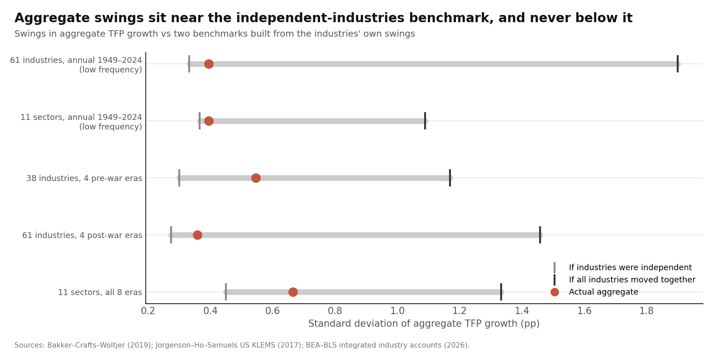
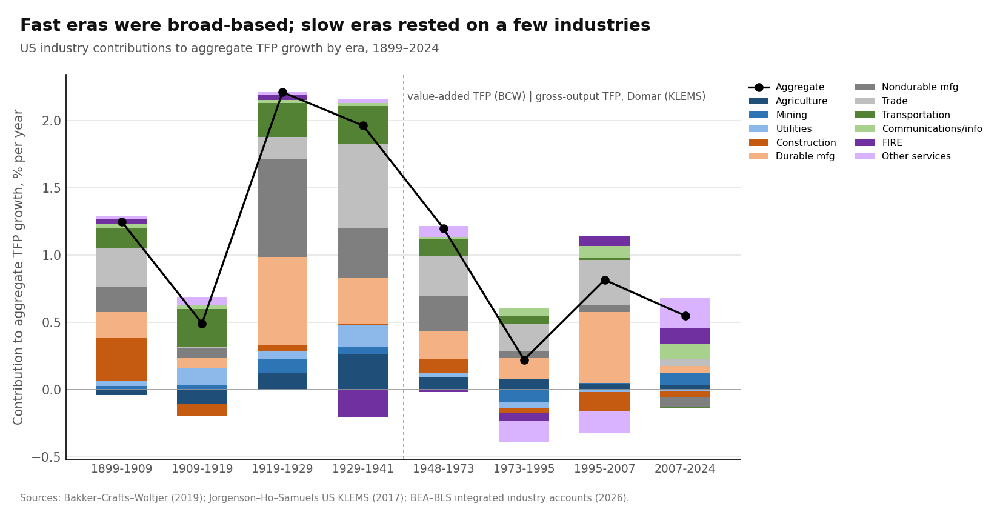

# Is Steady Growth an Average of Unsteady Industries? US Industry Productivity, 1899–2024

Draft of 17 October 2026 · @Manuel Antonio Sanchez Garcia · ex-ante review and pre-registered design: [litreview_sectoral_averaging.md](litreview_sectoral_averaging.md) · code: `scripts/run_sectoral.py` · numbers: `output/sectoral/results.json`

## Abstract

Aggregate productivity is a weighted sum of industries' productivity. If industry booms are unsynchronized, the sum can be much steadier than any industry. A Baumol-type feedback could add to this: booming industries lose share and so damp the aggregate. We test both ideas, as fixed in advance, with:
- 38 industries for 1899–1941 (Bakker, Crafts and Woltjer 2019);
- 61 industries for 1948–2024 (Jorgenson–Ho–Samuels and the official BEA–BLS accounts).

The focus is on decade-long swings.

**Four findings:**
1. **Averaging removes most industry noise, but nothing more.** Over the long run, aggregate productivity growth swings about as much as it would if industries were *independent*: 0.39 pp against 0.33 for independence and 1.90 if all industries moved together. It never swings *less* than independence, so there is no offsetting.
2. **What remains is common waves.** Industry co-movements account for 30–70% of what is left of the aggregate's swings: variance ratio 1.4–3.3 against about 0.9 under independence. They are significant before 1941 (p = 0.007) and in the experimental BEA–BLS data (p = 0.04).
3. **Fast eras are broad-based; slow eras rest on a few industries.**
   - 95% of industries contributed positively in 1919–29, against 49–51% in 1973–95 and 2007–24.
   - The correlation between aggregate growth and the share of industries contributing is 0.85.
   - Leadership rotates: rank correlations of industry growth between eras are 0.0–0.4.
4. **Baumol reweighting is a small drag, not a stabilizer.**
   - Before 1941, fast-growing industries *gained* share (correlation +0.28, p = 0.002). After 1948, there was no response (−0.08).
   - With weights frozen at their starting values, aggregate swings would have been at most 9% larger, and in the annual long-run test slightly *smaller*.
   - Reweighting lowered average growth after 1948 by about 0.13 pp a year.

**Bottom line:** averaging across industries explains why aggregate productivity is far steadier than its parts. It does **not** explain the frontier's slow/fast/slow path: those swings come from broad waves across many industries at once, which averaging cannot cancel.

## 1. Question and short answer

**Question.** Is the steadiness of aggregate growth produced by many unsynchronized industry waves cancelling out, or by booming industries losing weight?

**Short answer.**
- **Partly yes: independent industry swings cancel out.** That is ordinary diversification, and it makes the aggregate 4–5 times steadier than its parts.
- **But nothing cancels *more* than chance would, and common waves survive the averaging.**
- **Those common waves are the episodes that made frontier growth uneven:** the 1920s surge and the post-1973 slowdown.

## 2. Data

| Period | Source | Industries | Productivity measure | Weights |
| --- | --- | --- | --- | --- |
| 1899–1941 (four periods) | Bakker, Crafts and Woltjer (2019) | 38 (private domestic economy) | value-added TFP, adjusted for labor quality | value-added shares (cover 75–81% of the private economy) |
| 1948–2014 (annual) | Jorgenson–Ho–Samuels US KLEMS (2017 release) | 61 private industries | gross-output TFP, computed by us as a Törnqvist residual (capital, labor, intermediates) | Domar weights |
| 2015–2024 (annual) | Official BEA–BLS Integrated Industry-Level Production Account (April 2026) | same 61 | integrated TFP index | Domar weights |
| 1964–2016 (robustness) | BEA–BLS experimental account | same 61 | Törnqvist with 5 capital and 2 labor types | Domar weights |

**Comparability.** A Domar-weighted sum of gross-output TFP equals a value-added-share-weighted sum of value-added TFP, so the pre-war and post-war contributions measure the same thing.

**Validation.**
- **Jorgenson–Ho–Samuels vs the official account (1998–2014):** annual aggregate correlation 0.96; industry average growth correlation 0.82. The official account is 0.27 pp higher on average (it treats capital differently).
- **Experimental vs main (1964–2016):** annual correlation 0.98.
- **The splice is harmless:** without it (1949–2014 only) the results are the same.

**Caveat.** Pre-war and post-war *levels* are not comparable (coverage and capital measures differ). Results across the 1941/1948 break are read qualitatively, and the main tests are run within each source.

## 3. Result 1: averaging removes industry noise, but no offsetting

Three numbers for each sample:
- the actual standard deviation of aggregate productivity growth;
- what it would be if industries were **independent**;
- what it would be if they all **moved together**.

| Sample | Actual | Independent | Moving together | R = actual² ÷ independent² | R under independence (90% band) | p (R above independence) | Average pairwise correlation |
| --- | --- | --- | --- | --- | --- | --- | --- |
| 61 industries, annual, 1949–2024, long-run swings | **0.39** | 0.33 | 1.90 | 1.42 | 0.90 (0.25–2.12) | 0.21 | 0.04 |
| 11 sectors, same | 0.39 | 0.37 | 1.09 | 1.17 | 0.92 | 0.34 | 0.06 |
| 61 industries, 1949–2014 (no splice) | 0.41 | 0.32 | 1.78 | 1.58 | 0.96 | 0.17 | 0.05 |
| 61 industries, BEA–BLS experimental, 1964–2016 | 0.46 | 0.29 | 1.62 | **2.44** | 0.85 | **0.04** | 0.06 |
| 38 industries, 4 pre-war periods | 0.55 | 0.30 | 1.17 | **3.32** | 0.81 | **0.007** | 0.18 |
| 61 industries, 4 post-war eras | 0.36 | 0.27 | 1.46 | 1.72 | 0.82 | 0.16 | 0.06 |
| 11 sectors, all 8 eras (crosses the measurement break) | 0.66 | 0.45 | 1.33 | 2.19 | 0.93 | 0.02 | 0.07 |

*Long-run swings: periods of about 25 years or more (q = 6). The independence null comes from simulations that keep each industry's own swings but remove co-movement.*



**What this shows.**
1. **Averaging is powerful.** If all industries boomed and slumped together, aggregate swings would be 4–5 times larger (1.9 pp vs 0.39). Industries' long swings are nearly uncorrelated (average correlation 0.04).
2. **But there is no offsetting.**
   - R is never below 1 in any sample or source. Industries do not boom *because* others slump; at most they are independent.
   - This mirrors paper 2 for capital, hours and productivity.
3. **Small correlations add up.**
   - **The mechanism:** with 61 industries there are about 1,800 pairs, so a tiny average correlation still makes covariances 30% of the aggregate's variance after 1949. That share is 59% in the experimental account and 70% before 1941.
   - **Why the aggregate isn't smoother:** the averaging removes the independent noise, so what's left is mostly *common* movement.
   - **This is Carvalho and Gabaix's (2013) "fundamental volatility" logic, here applied to decade-long swings.**
4. **No single factor dominates.** A first-factor test on post-war long-run swings is not significant (share 0.29 vs 0.27, p = 0.18). The common component is diffuse, not one big factor.

## 4. Result 2: fast eras are broad, slow eras are narrow, and leaders rotate

**Aggregate TFP growth and how broad it was:**

| Era | Aggregate (pp/yr) | Share of industries contributing positively | Top-5 industries' share of aggregate | Top industries |
| --- | --- | --- | --- | --- |
| 1899–1909 | 1.25 | 87% | 74% | construction, trade, railroads, primary metals, printing |
| 1909–1919 | 0.49 | 66% | 119% | railroads, transport equipment, electric utilities |
| **1919–1929** | **2.21** | **95%** | **36%** | food, transport equipment, trade, primary metals, agriculture |
| 1929–1941 | 1.96 | 87% | 69% | trade, agriculture, food, railroads, electric utilities |
| 1948–1973 | 1.20 | 69% | 50% | retail, wholesale, farms, food, construction |
| **1973–1995** | **0.22** | **51%** | **262%** | computers, wholesale, retail, farms, telecom |
| 1995–2007 | 0.82 | 70% | 112% | computers, wholesale, retail, real estate, securities |
| 2007–2024 | 0.55 | 49% | 95% | real estate, retail, oil and gas, computer services, professional services |

*Pre-war values are for the covered economy (BCW industries). Pre-war and post-war levels are not comparable.*



**How strongly industry rankings persist from one era to the next** (rank correlation of industry productivity growth):

| Transition | Before 1941 (38 industries) | After 1948 (61 industries) |
| --- | --- | --- |
| First → second era | 0.44 (p = 0.006) | 0.11 |
| Second → third | −0.06 | 0.25 (p = 0.05) |
| Third → fourth | 0.16 | 0.04 |

**What this shows.**
- **Leadership rotates** (Harberger's "mushrooms"). Today's fast industries say little about tomorrow's. Our pre-war correlations (0.44, −0.06, 0.16) reproduce Bakker, Crafts and Woltjer's working-paper figures (about 0.4, 0.0, 0.2).
- **How fast the aggregate grows depends on how *broad* growth is, not on who leads.**
  - Correlation between aggregate growth and the share of industries contributing: **0.85**; with top-5 concentration: −0.78.
  - **In the 1920s nearly every industry improved at once** (David and Wright's electrification surge).
  - **After 1973 half the industries went backwards,** and a few (computers, trade) carried the rest.
- **This replicates Inklaar and Timmer's (2007) finding** (concentration is high when growth is low) over 125 years instead of 16.

## 5. Result 3: Baumol reweighting is a drag, not a stabilizer

| Test | Before 1941 | After 1948 |
| --- | --- | --- |
| Correlation of an industry's TFP growth with the change in its value-added share in the next era (Baumol stabilizer predicts **negative**) | **+0.28** (p = 0.002) | −0.08 (p = 0.28); Domar version −0.05 |
| SD of aggregate growth across eras: actual vs weights frozen at the first era | 0.67 vs 0.73 | 0.36 vs 0.37 |
| Long-run SD, annual 1949–2024: actual vs 1949 weights | — | 0.39 vs 0.38 |
| Average growth: actual vs 1949 weights | — | 0.71 vs 0.84 (**−0.13 pp/yr**) |
| Long-run response of Domar weights to TFP growth, by industry | — | median +0.10; 49% negative |

**What this shows.**
- **Before 1941, Baumol worked in reverse.** Industries with fast productivity growth *gained* share: autos, electricity, rubber and chemicals were new goods with elastic demand. That amplifies swings rather than damping them.
- **After 1948, shares don't respond systematically to productivity.** Freezing weights changes swings by at most 9%, in either direction.
- **The level effect is the familiar one:** a 0.13 pp a year drag, in line with Nordhaus (2008) and Sarte and Taylor (2025, 0.24 pp with a different measure).
- **Baumol lowers growth; it does not steady it.**

## 6. Result 4: were the big accelerations and slowdowns broad?

Changes in aggregate TFP growth between eras, split by sector (weights held at the average of the two eras):

| Change | Aggregate change (pp) | Share of sectors moving the same way | Main sectors |
| --- | --- | --- | --- |
| 1909–19 → 1919–29 (the 1920s surge) | **+1.72** | 64% | durable + nondurable manufacturing 73% of the change; 95% of industries positive |
| 1948–73 → 1973–95 (the slowdown) | **−0.98** | **73%** | other services and nondurables 51%; broad |
| 1973–95 → 1995–2007 (the IT boom) | +0.59 | 82% | durable manufacturing (computers) 61% |
| 1995–2007 → 2007–24 (the IT bust) | −0.27 | 45% | durables and trade |

**What this shows.**
- **The two episodes that shaped the frontier's path were broad:**
  - the 1920s surge was led by manufacturing but reached almost every industry;
  - the 1973 slowdown hit three-quarters of sectors.
- **The IT boom and bust were concentrated,** as in Stiroh (2002), Jorgenson, Ho, Samuels and Stiroh (2007) and Fernald (2015).
- **Averaging can cancel concentrated episodes but not broad ones,** and the broad ones are what made the frontier uneven.

## 7. Scorecard against the pre-registered tests

| Hypothesis | Prediction | Outcome |
| --- | --- | --- |
| **H1. Averaging** | aggregate near the independent benchmark, R ≤ 1, weak common factor | **Partly.** Near independence (position 0.04–0.28 between independent and moving together) and a weak first factor. But R ≥ 1 everywhere, so no offsetting |
| **H1 alternative: common waves (Gordon)** | near moving-together, R ≫ 1 | **Partly.** R is 1.4–3.3, significant before 1941 and in the experimental data. Common waves explain most of the *remaining* swings, but the aggregate is far from fully synchronized |
| **H2. Relay of leaders** | low rank persistence, rotating leaders | **Yes** (0.0–0.4). But leadership rotation doesn't stabilize growth: breadth drives the aggregate |
| **H3. Baumol stabilizer** | fast industries lose share; actual aggregate steadier than fixed weights | **No.** Positive before 1941, zero after; swings unchanged; a level drag only |
| **H4. Broadness** | mid-century acceleration broad (common wave) or concentrated | **Broad** (1920s surge; 1973 slowdown). IT boom and bust concentrated |

## 8. What this means, within the literature

| Literature | Our evidence |
| --- | --- |
| Carvalho and Gabaix (2013): composition and diversification govern business-cycle volatility | **Extended to decade-long swings:** diversification removes about 80% of potential industry swings. The remainder is common co-movement |
| Foerster, Hornstein, Sarte and Watson (2022): sector-specific trends drive post-war trend changes | **Partly consistent.** The IT boom and bust were sector-specific, but the 1973 slowdown was broad across sectors. They also model input-output propagation, which we don't |
| Harberger (1998); Inklaar and Timmer (2007): growth comes in "mushrooms"; concentration rises when growth is low | **Replicated over 1899–2024** |
| Bakker, Crafts and Woltjer (2019): broad-based pre-war growth, low persistence of leaders | **Replicated:** rank correlations of 0.44, −0.06, 0.16 |
| Gordon (2016); Field (2011); David and Wright (2003): a synchronized mid-century / 1920s wave | **Supported for the 1920s** (95% of industries) |
| Nordhaus (2008); Baqaee and Farhi (2019): Baumol lowers growth | **Replicated as a level drag** (−0.13 pp/yr). **New: it is not a stabilizer, and before 1941 it amplified swings** |
| Moro (2012, 2015): the services shift lowers cyclical volatility | **Not at decade frequency:** freezing weights barely changes swings |
| Kortum (1997); Jones (2005): many Pareto ideas give steady aggregate growth | **Consistent with the averaging of independent industry noise,** but the common waves are outside these models |

**Honest flag: replication vs novelty.**
- **Replicated:**
  - rotating leadership and concentration rising when growth is low (Harberger; Inklaar–Timmer; BCW);
  - the IT concentration (Stiroh; Jorgenson et al.);
  - the Baumol drag (Nordhaus).
- **New, as far as our review found:**
  1. the low-frequency decomposition into independent, offsetting and common parts, over 1899–2024;
  2. the finding that offsetting never occurs (R ≥ 1 in every sample);
  3. Baumol reweighting is not a stabilizer, and before 1941 it amplified swings.

**For your original question.** Averaging across industries is why aggregate productivity isn't wildly volatile, which is a real but ordinary diversification effect. It is **not** a mechanism that holds growth at 2%:
- it never offsets;
- it can't cancel broad waves;
- the broad waves (the 1920s surge, the post-1973 slowdown) are exactly what made the frontier's growth slow, then fast, then slow.

Combined with the earlier projects:
- **the leading economies show a slow–fast–slow pattern that is suggestive, not established** (corrected 17 October 2026; see [findings_register.md](findings_register.md), A5–A6);
- **its swings came from common waves across the whole economy,** such as electrification and the mid-century research surge, which then faded;
- **no stabilizer we have tested** (capital, hours, research feedback, policy, aggregation, Baumol) holds the rate constant.

## 9. Limitations

1. **Industry TFP is noisy,** which inflates both benchmarks (independent and moving together). The aggregate and R are less affected, but small-industry noise makes industries look less correlated than they are.
2. **The 1941/1948 measurement break** (coverage, capital measures, value-added vs gross-output) makes cross-break levels unreliable. That is why the main tests are run within each source.
3. **Pre-war coverage is 75–81% of the private economy.** Most services and government are missing.
4. **Few eras:** 4 per source and about 6 long cycles after 1949. Results are suggestive.
5. **First-order (Hulten) aggregation only.** Input-output propagation and second-order effects (Baqaee and Farhi 2019) are not modelled; they would make common waves *more* important, not less.
6. **Shares are nominal value-added or gross-output shares.** Services output measurement can manufacture or hide Baumol effects.

## 10. Reproduce

```bash
python scripts/run_sectoral.py   # ~1 min; data in data/raw/sectoral/ (see SOURCES.csv) and data/raw/balancing/bcw2019/
```

## References

See [litreview_sectoral_averaging.md](litreview_sectoral_averaging.md) (verified 17 October 2026). Data: Bakker, Crafts and Woltjer (2019), Data S1; Jorgenson, Ho and Samuels, US KLEMS (World KLEMS, 2017 release, NBER WP 22453); BEA–BLS Integrated Industry-Level Production Account (April 2026 release); Eldridge et al., BEA–BLS experimental integrated account 1947–2016.
