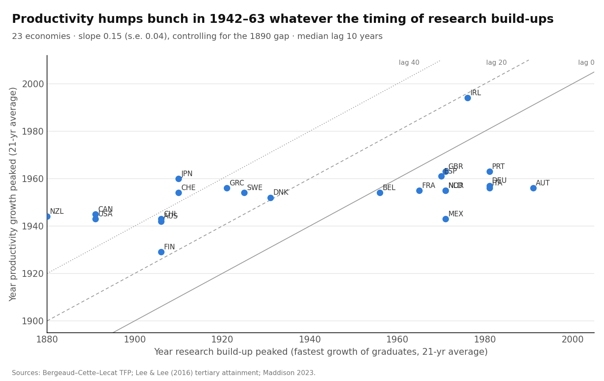

# Do Productivity Humps Follow Research Build-Ups Across Countries? A Timing Test, 23 Economies, 1870–2019

Draft of 17 October 2026 · @Manuel Antonio Sanchez Garcia · ex-ante review and pre-registered design: [litreview_staggered_transitions.md](litreview_staggered_transitions.md) · code: `scripts/run_staggered_transitions.py` · numbers: `output/staggered_transitions/results.json`

## Abstract

If research build-ups drive productivity humps, each country's hump should follow its *own* build-up. We date both for 23 economies over 1870–2019:
- **productivity humps:** Bergeaud–Cette–Lecat TFP;
- **research build-ups:** the fastest growth of the university-educated population (Lee–Lee).

We also run panel tests with graduates (1891–2010) and with R&D (1970–2009).

**Five findings:**
1. **The pre-registered timing test passes on paper, but the rule turned out to be too weak.** Productivity-hump years rise with research-peak years (slope 0.15, s.e. 0.04), and the median lag is 9.5 years. But only 27% of countries have a lag between 0 and 40 years: **in 11 of 22 countries productivity peaked *before* research did.**
2. **Productivity humps are bunched in time** (1942–1963 for 21 of the 22 countries in the regressions, all but Finland; spread 8 years), while research peaks are spread over 1880–1991 (spread 36 years). A 36-year difference in research timing shifts the productivity hump by only about 5 years.
3. **The pre-registered low-frequency robustness check fails** (slope −0.02). Among war-hit Europe and Japan, the correlation is negative (−0.18).
4. **In panels, own research adds nothing once common periods are controlled for.** Lagged graduate growth: −0.00 (s.e. 0.02). Lagged R&D-effort growth: 0.02 (s.e. 0.02).
5. **Catch-up and common waves dominate.**
   - Distance to the leader is strongly significant: +2.2 and +3.0 pp of TFP growth per log point of gap.
   - Common period effects explain 32% of TFP-growth variation; country effects explain 5%.

**Bottom line:** across countries, a country's productivity hump does not follow its own research build-up. Humps follow a common, staggered wave (the US and the New World in the 1940s, Europe and Japan in the 1950s–60s) and how far each country was behind. This is consistent with ideas being *global*: Jones (2022) warns the semi-endogenous model applies to the world frontier, not to individual countries. But it does **not** validate the research-transition story either.

## 1. Question and short answer

**Question.** Do countries' productivity humps follow their own research build-ups, as a research-transition story would predict?

**Short answer.**
- **No, not in a way we can detect.**
- **Humps cluster in mid-century,** whatever the timing of each country's research build-up.
- **About half the countries built up their university-educated population *after* their productivity peak,** which suggests that rising incomes drove education rather than the reverse.
- **What predicts productivity growth across countries is the distance to the leader and common world waves.**

## 2. Data and dating

**Data.**
- **Productivity:** BCL TFP, 23 economies, 1891–2019.
- **Research build-up:** Lee–Lee population with completed tertiary education, 1870–2010, interpolated annually. It is a weak proxy for researchers: correlation 0.34 with US engineers and chemists, and 0.23 with researcher growth across countries.
- **R&D:** Madsen's R&D intensity × population, **1965–2009 only**. Before about 1963 that series is one common back-cast path: its 1870–1913 change is identical (log 0.703) in 19 of 21 countries.
- **Gap to the leader:** ln(highest GDP per capita ÷ own), Maddison.

**Dating.**
- **Productivity hump:** the year of the highest 21-year centred average of TFP growth (1901–2009).
- **Research peak:** the year of the fastest 21-year average growth of graduates (1880–2000).

| Country | Research peak | Productivity hump | Lag (years) |
| --- | --- | --- | --- |
| New Zealand | 1880 | 1944 | 64 |
| United States | 1891 | 1943 | 52 |
| Canada | 1891 | 1945 | 54 |
| Australia | 1906 | 1942 | 36 |
| Finland | 1906 | 1929 | 23 |
| Japan | 1910 | 1960 | 50 |
| Switzerland | 1910 | 1954 | 44 |
| Sweden | 1925 | 1954 | 29 |
| Denmark | 1931 | 1952 | 21 |
| Belgium | 1956 | 1954 | −2 |
| France | 1965 | 1955 | −10 |
| United Kingdom | 1971 | 1963 | −8 |
| Netherlands | 1971 | 1955 | −16 |
| Norway | 1971 | 1955 | −16 |
| Ireland | 1976 | 1994 | 18 |
| Germany | 1981 | 1957 | −24 |
| Italy | 1981 | 1956 | −25 |
| Austria | 1991 | 1956 | −35 |

*Also in the sample: Chile, Greece, Mexico, Portugal, Spain. Ireland has no 1890 GDP figure, so it is shown here but excluded from the regressions (n = 22).*

## 3. Result 1: the timing test, and why its "pass" doesn't mean much

| Specification | Slope on research-peak year (s.e.) | One-sided p | Median lag | Share with lag 0–40 years |
| --- | --- | --- | --- | --- |
| **Main (pre-registered)** | **0.15 (0.04)** | < 0.001 | 9.5 | **27%** |
| 31-year windows | 0.12 (0.05) | 0.006 | −2.5 | 14% |
| **Low-frequency trend (pre-registered robustness)** | **−0.02 (0.10)** | 0.60 | 14 | 18% |
| Rich economies only | 0.15 (0.04) | < 0.001 | 21 | 24% |
| Madsen's TFP gap instead of the GDP gap | 0.19 (0.06) | < 0.001 | 18 | 29% |
| *Exploratory:* + war-damage dummy | 0.13 (0.06) | 0.015 | — | — |

*The 1890 gap to the leader is insignificant in every specification.*

**What this shows.**
1. **By the rule we wrote, the transition story "passes"** (positive slope, median lag within 0–40 years). **But the rule was too weak.** A median of large positive and large negative lags can fall inside 0–40 even when almost no country fits. We report the pass as written, and say clearly that it is not meaningful.
2. **Half the countries have productivity peaking *before* research** (11 of 22). Germany, Italy, Austria, the Netherlands and Norway peaked in the 1950s and built up graduates in the 1970s–90s. That points to **reverse causality**: richer countries expand universities, as in Bils and Klenow's (2000) argument for schooling.
3. **Humps are bunched (spread 8 years) while research peaks are spread out (36 years).** The slope of 0.15 is far from the 1 a lag-based story implies. This is the staggered common wave documented by Bergeaud, Cette and Lecat (2016): the US and the New World first, war-hit Europe and Japan after the war.
4. **The positive slope comes from the countries spared by the war.** Within war-hit Europe and Japan the correlation is −0.18; within the others it is 0.67. That contrast is mostly the New World (US, Canada, Australia, New Zealand, Chile: early research peaks, 1940s humps) against Spain, Portugal and the UK (later on both).

## 4. Result 2: panels, with own research vs catch-up vs common waves

**10-year blocks, 1891–2010, graduates (272 country-blocks):**

| Regressor | Country + period effects | Country effects only |
| --- | --- | --- |
| Lagged graduate growth (semi-endogenous) | −0.00 (0.02) | −0.03 (0.02) |
| Log graduate share (Schumpeterian) | 0.12 (0.16) | **0.23 (0.08)** |
| Log gap to the leader (catch-up) | **2.17 (0.43)** | **2.47 (0.56)** |

*Share of TFP-growth variation explained by common period effects alone: **32%**; by country effects alone: 5%.*

**5-year blocks, 1970–2009, R&D (168 country-blocks), with country and period effects:**

| Regressor | Coefficient (s.e.) |
| --- | --- |
| Lagged R&D-effort growth (semi-endogenous) | 0.02 (0.02) |
| Log R&D intensity (Schumpeterian) | 0.46 (0.41) |
| Log gap to the leader (catch-up) | **2.99 (1.05)** |

**What this shows.**
- **Own research growth (graduates or R&D) does not predict own productivity growth** once common periods and catch-up are controlled for.
- **Research *intensity* looks significant only without period effects.** It shares a common upward trend with world-wide productivity waves.
- **Catch-up is the robust predictor:** a country 10% further behind grows about 0.2–0.3 pp faster.
- **Common world periods matter six times more than country differences.**
- **These panel results replicate the Madsen / Griffith–Redding–Van Reenen type of finding** (catch-up dominant). We add nothing new here except confirming it with Lee–Lee graduates.

## 5. Scorecard against the pre-registered tests

| Test | Transition story predicts | Outcome |
| --- | --- | --- |
| T1 timing, main | positive slope, one-sided p < 0.10, median lag 0–40 | **"Pass" by the letter**, but 50% of lags are negative, humps are bunched, and the slope is 0.15 |
| T1 low-frequency robustness | same | **Fail** (−0.02) |
| T1b spread of hump years | (common wave predicts small) | **Small:** 8 years against 36 for research peaks, so it favours a common wave |
| T2 graduates panel | lagged growth > 0 | **Fail** (−0.00); catch-up +2.2; period effects dominate |
| T3 R&D panel | lagged R&D growth > 0 | **Fail** (0.02, n.s.); catch-up +3.0 |

**Overall verdict:** not supported. The formal "pass" comes from a badly designed criterion and does not survive the pre-registered robustness check.

## 6. What this means, within the literature

| Literature | Our evidence |
| --- | --- |
| Bergeaud, Cette and Lecat (2016): the big wave hit the US first, others after WWII | **Confirmed, and now shown to be unrelated to own research timing** |
| Jones (2022): semi-endogenous growth applies to the world frontier, not to countries | **Consistent:** country humps follow common waves and catch-up, not own research |
| Madsen (2007, 2014); Griffith, Redding and Van Reenen (2004); Coe and Helpman (1995): catch-up and spillovers dominate | **Replicated** with graduates and post-1970 R&D |
| Madsen (2008); Ang and Madsen (2011): research intensity matters (Schumpeterian) | **Only without period effects;** with them, not significant |
| Bils and Klenow (2000): growth causes schooling | **Consistent:** half the countries expanded graduates after their productivity peak |
| Gordon (2016): a wave of great inventions | **Consistent** with bunched humps; staggered by catch-up and war rather than by own research |

**Honest flag.**
- **Replicated:** the panel results (catch-up dominates; own research insignificant with period effects) and the staggered wave (BCL 2016).
- **New:** the explicit timing test, and its failure for the research-transition story at country level. Also the finding that Madsen's widely used pre-1950 R&D series are a common back-cast, unusable for cross-country timing before about 1963.
- **About our own rule:** the median-lag criterion was poorly designed. Next time it should be "share of countries with lag 0–40 above one half".

## 7. Limitations

1. **Graduates are a weak proxy for researchers,** and no national research-labour data exist before about 1960 outside the US. A test with census-based research labour for several countries is the decisive version, and it remains to be done.
2. **About 23 countries.** The peak dating is sensitive to wars (1914–19, 1939–49) and to the window.
3. **Peak dating ignores the size of the hump.** A country with a flat profile gets an arbitrary peak.
4. **Catch-up and own research move together for followers.** Our controls are coarse.

## References

See [litreview_staggered_transitions.md](litreview_staggered_transitions.md). Additional: Bils, M., and Klenow, P. J. (2000). Does schooling cause growth? *AER* 90(5): 1160–1183.
