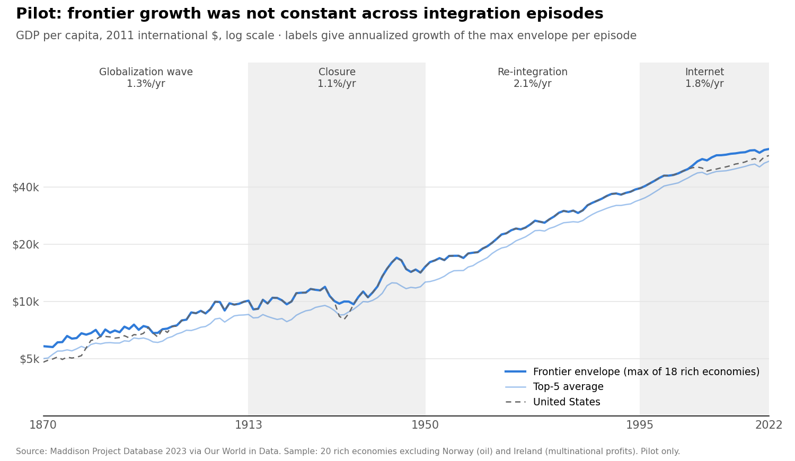

# Does Deglobalization Slow the World's Frontier?

**Evidence from 150 years of integration and disintegration, 1870–2022**

Research proposal · draft of 16 October 2026 · @Manuel Antonio Sanchez Garcia

## 1. Question and contribution

**Main question.** When the world fragments, does growth at the technological frontier itself slow down, or do only the countries that get cut off fall behind?

**Secondary question.** Is the famous "constant ~2%" a property of the frontier wherever it sits, and does it survive large shocks to integration?

**Idea.** In semi-endogenous growth theory, frontier growth is driven by the growth of world research effort (Jones 1995, 2002). That world pool is usually a simple sum of national researchers. We replace it with an **effective** pool, in which each country's research counts toward the frontier in proportion to how integrated it is with the rest of the world.

Over the last 150 years, integration rose and fell through four episodes:

- the first globalization wave, 1870–1913;
- the closure of 1914–1945 (wars, the Depression, the collapse of trade and of international science);
- re-integration after 1950;
- the internet after 1995.

The model predicts that frontier growth moves with these episodes. We test this on a **frontier envelope**: the highest (or top-5 average) GDP per capita among leading economies each year, instead of the US alone.

**Contribution.**
1. **Frontier-level evidence on the cost of fragmentation.** The 1914–1945 closure is the only large historical case of the world's research pool breaking apart. We estimate how much it slowed the frontier, and use the estimate to inform today's fragmentation debate.
2. **A semi-endogenous model with a time-varying, integration-weighted world research pool.** It yields testable implications for frontier growth.
3. **The first test of growth constancy on a frontier envelope** rather than on a single country. This separates frontier growth from catch-up and from US-specific factors.

## 2. Why it matters

**Fragmentation is a live policy question.** Rising trade barriers, export controls on technology and restrictions on scientific collaboration are reshaping how ideas cross borders; US–China tensions are already affecting scientific collaboration (Flynn et al. 2024). Model-based work finds that geopolitical decoupling magnifies growth losses once knowledge diffusion is accounted for (Góes and Bekkers 2022). But those results rest on assumed parameters. What is missing is historical evidence on whether fragmentation slows the frontier itself, and by how much.

**Long-run forecasts assume a fixed trend.** Debt-sustainability projections, pension systems and the discount rates used in climate policy all assume a trend of roughly 1.5–2% that does not depend on how integrated the world is. If frontier growth shifts with integration, those forecasts should depend on it.

**It disciplines growth theory.** "Constancy" has a strong and a weak version, and only the weak one is at stake:

| Version | Claim | Status |
| --- | --- | --- |
| Strong | Growth is ~2% in every decade | Obviously false: wars, the Depression and the post-2005 slowdown |
| Weak | Deviations are temporary; the growth rate has no lasting shifts | Assumed by balanced-growth models and the Kaldor facts; not settled. Papell and Prodan (2014) find the US consistent with it; Jones, López-Salido and Philippon (2026) challenge the exponential form |

If frontier growth has decade-long regimes tied to integration, the weak version fails at the frontier, and models that impose balanced growth miss them. If it holds, one candidate explanation for constancy (global idea flows) is ruled out.

**Why the frontier, and not individual countries.** Countries below the frontier grow fast while catching up and then slow down, so their growth is never expected to be constant. Constancy is a claim about the leader. Testing it on the US alone confuses "the frontier" with one country that happened to win.

**Both outcomes are informative.** Breaks that follow integration give a historical estimate of the growth cost of fragmentation. A flat frontier shows the frontier is robust to fragmentation, and that constancy comes from elsewhere.

## 3. Background

The literature review ([literature_review_constant_growth.md](literature_review_constant_growth.md)) leaves three open questions. This project targets **Q3** (is constancy a US fact or a frontier fact?) and feeds **Q1** (was the 2% a steady state or a transition?).

The leading explanation for constant growth is that research effort grows steadily while ideas get harder to find (Jones 1995; Bloom et al. 2020). It assumes ideas are global, so the frontier grows at the rate world research pushes it. But "world research" is not a fixed object:
- **Ideas spread faster than they used to.** Adoption lags for new technologies have shortened (Comin and Hobijn 2010).
- **Cutting countries off from science hurt.** After 1914 the boycott of Central Powers scientists cut the citation of foreign frontier research and reduced scientific output (Iaria, Schwarz and Waldinger 2018).
- **US innovation leans on foreign ideas.** About 56% of US technologies build on a foreign input (Hassan, Kalyani and Lopez Del Valle 2026).

Two facts already sit awkwardly with a simple "global ideas" story:
- **The closure era was a US productivity boom.** US TFP growth was highest around 1920–1970 (Field 2011; Gordon 2016). Nelson and Wright (1992) argue US leadership then rested on a large, relatively closed home market.
- **The internet era was a slowdown.** Frontier productivity slowed after 2005 despite the internet. Diffusion from frontier firms to the rest appears to have weakened (Andrews, Criscuolo and Gal 2016; Akcigit and Ates 2021).

## 4. Model sketch

Ideas $A$ are produced from an effective world research input $S^{\text{eff}}$, with diminishing returns to the existing stock ($\phi < 1$):

$$
\dot A_t = \alpha \, \left(S^{\text{eff}}_t\right)^{\lambda} A_t^{\phi}
$$

The effective pool weights each country's researchers $S_{it}$ by an integration weight $w_{it} \in [0,1]$. The weight depends on observed integration $I_{it}$ (trade, communication, migration, scientific links):

$$
S^{\text{eff}}_t = \sum_i w(I_{it}) \, S_{it}
$$

Along a balanced path, frontier productivity grows at

$$
g_A = \frac{\lambda}{1-\phi} \, g_{S^{\text{eff}}}, \qquad g_{S^{\text{eff}}} = \sum_i s_{it} \left( g_{S_{it}} + g_{w_{it}} \right)
$$

where $s_{it}$ is country $i$'s share of the effective pool. Output per person at the frontier grows at $g_y = g_A / (1-\alpha_K)$ once capital adjusts, with capital share $\alpha_K \approx 1/3$.

**Implications.**
- **Fragmentation slows the frontier temporarily, and costs income permanently.** Because $w \le 1$, a fall in integration lowers frontier growth only while integration is falling. It leaves a permanent loss in the *level* of income. Long-run growth still equals $\lambda n/(1-\phi)$.
- **The effects should show up within a decade or two.** With the estimated diminishing returns ($\beta = 1-\phi \approx 3$), transitional dynamics are fast. Jones (2022b) reports a half-life of about 14 years. Integration shocks should therefore produce visible breaks lasting a decade or more.
- **The model gives a signed prediction for each episode** (Section 5) and a counterfactual cost for any fragmentation scenario (Section 6, Step 4).

## 5. Hypotheses and pilot evidence

| Episode | Change in integration | H1 prediction (fragmentation slows the frontier) | Pilot: envelope, max | Pilot: envelope, top-5 | Pilot: US |
| --- | --- | --- | --- | --- | --- |
| 1870–1913 | Rising | Above baseline | 1.3% | 1.2% | 1.7% |
| 1913–1950 | Falling sharply | Below baseline | 1.1% | 1.1% | 1.1% |
| 1950–1995 | Rising | Above baseline | 2.1% | 2.2% | 2.1% |
| 1995–2022 | Rising (internet) | Above baseline | 1.8% | 1.7% | 1.5% |
| 1870–2022 | — | — | 1.6% | 1.6% | 1.6% |

*Annualized log growth of GDP per capita, Maddison Project 2023. Envelope over 20 rich economies, excluding Norway (oil) and Ireland (multinational profits).*

**Reading the pilot.** Frontier growth was **not** constant across episodes; it ranged from 1.1% to 2.1%. Two episodes fit H1:
- growth was lowest in the closure;
- it was highest in re-integration.

Two do not:
- the first globalization wave was slow;
- the internet era slowed compared with 1950–1995.

**Caveats.** These are endpoint averages over episodes chosen by eye:
- **Endpoint bias.** 1950 was still below trend, which depresses 1913–1950.
- **Unstable leader.** The leading economy switches several times before 1900 (UK, Australia, New Zealand, US).
- **Catch-up in the top-5.** After 1950 the top-5 average mixes in European catch-up.

The pilot motivates the project; it is not a result.

**Hypotheses.**
- **H0, robust frontier.** Envelope growth has no breaks linked to integration. Fragmentation does not slow the frontier, and constancy does not come from global idea flows.
- **H1, fragmentation slows the frontier.** Envelope growth moves with $g_{S^{\text{eff}}}$, with the signs in the table.
- **H2, rival explanations.** Breaks exist but track something else:
  - domestic research at the leader (Nelson and Wright 1992);
  - automation (Jones and Tonetti 2026);
  - additive rather than exponential growth (Jones, López-Salido and Philippon 2026).

## 6. Empirical design

**Step 1. Build the frontier.**
- **Fixed sample.** Use 18–20 leading economies chosen in advance. Exclude oil states, Luxembourg and Ireland: in the raw Maddison file Qatar is the yearly maximum from 1950 to 2022.
- **Three envelopes.** Max, top-5 average, and top-k average.
- **Survivorship check.** Compare an ex-ante set (rich in 1870) with an ex-post set (rich today).
- **Three measures.** Per capita (Maddison), per hour and TFP (Bergeaud–Cette–Lecat, 1890–2024).
- **Benchmark sensitivity.** Check how robust the envelope is to Maddison's benchmark choice (2011 PPP and the 1909 US–UK benchmark). That choice moves the dates when the leading economy changes.

**Step 2. Build the effective research pool.**
- **Research effort $S_{it}$:**
  - patent filings by office, 1883–1979 (WIPO historical) spliced with the WIPO data center from 1980;
  - R&D and researchers from 1981 (OECD MSTI) to calibrate patents against R&D;
  - Lederman–Saenz (1960–2000) and NSF (US, from 1953) as bridges.
- **Integration $I_{it}$:**
  - trade openness: Federico–Tena 1800–1938, TRADHIST bilateral 1827–2014, and JST imports and exports 1870–2020;
  - communication technologies from CHAT (telegraph, telephone, mail), and internet use from ITU/WDI;
  - the KOF Globalisation Index from 1970;
  - if available, foreign inputs in patent genealogies (Hassan et al. 2026).
- **Weighting function.** Parametric, such as logistic in openness, so the weight stays between 0 and 1.

**Step 3. Separate fewer idea flows from war damage.** This is the core identification problem. In 1914–1945 the wars cut integration and destroyed output at the same time. Five strategies separate the two:
1. **Peacetime integration shocks.** These change integration without war:
   - the trade expansion of the 1870s–1900s;
   - the peacetime trade collapse of 1929–1938, driven by tariffs and the Depression;
   - the internet after 1995.
2. **Leaders that were not physically damaged.** The US, Switzerland and Sweden lost international links in 1914–1945 without large-scale destruction at home. If the frontier slowed *there*, destruction is not the explanation.
3. **Measures less exposed to destruction.** TFP and output per hour are less affected by destroyed capital than GDP per capita.
4. **Excluding war years.** Maddison and Bergeaud–Cette–Lecat interpolate 1914–18 and 1939–45.
5. **Channel-specific integration.** Compare scientific links (citations, foreign patent inputs) with goods trade. If research links predict frontier growth better than trade does, the channel is ideas, not markets.

**Step 4. Tests.**
1. **Unknown-date break tests.** Bai–Perron multiple-break tests on envelope growth: do the estimated break dates cluster near 1914, 1929, 1950 and 1995?
2. **Known-date tests** at those dates, excluding war years.
3. **Low-frequency regressions.** Regress envelope growth on $g_{S^{\text{eff}}}$ using Müller–Watson low-frequency methods. These are honest about how few independent long-run cycles 150 years of data contain.
4. **Structural estimation.** Estimate $\lambda/(1-\phi)$ and the weighting function by minimum distance. Then run counterfactuals:
   - frontier growth without the 1914–45 closure;
   - frontier growth without the internet;
   - **a present-day scenario in which the world's research pool splits into two blocs**, with the implied loss in frontier growth and income.
5. **Placebo.** Repeat on followers. Catch-up growth should respond to integration *more* than frontier growth (Madsen 2007), so a frontier response is the sharper test.

**Step 5. Rival explanations (H2).** Nest the leader-only domestic research pool and the additive-growth specification as alternatives, and compare their fit and forecasts.

## 7. Data

The core sources below were opened and their coverage checked on 16 October 2026.

| Purpose | Source | Coverage | Main limitation |
| --- | --- | --- | --- |
| Output | [Maddison Project Database 2023](https://www.rug.nl/ggdc/historicaldevelopment/maddison/releases/maddison-project-database-2023) | Year 1–2022, 169 countries; complete 1870–2022 for 18 rich economies | War years interpolated; levels depend on PPP benchmark |
| Output cross-check, trade | [Jordà–Schularick–Taylor Macrohistory, R6](https://www.macrohistory.net/database/) | 1870–2020, 18 economies | GDP taken from Maddison; trade gaps in war years |
| TFP, hours | [Bergeaud–Cette–Lecat Long-Term Productivity, v2.7](https://www.longtermproductivity.com/download.html) | 1890–2024, 23 countries | Starts 1890; war years interpolated |
| TFP after 1950 | [Penn World Table 11.0](https://www.rug.nl/ggdc/productivity/pwt/) | 1950–2023, 185 countries | Post-1950 only |
| Research (patents) | [WIPO historical IP statistics](https://www.wipo.int/en/web/ip-statistics) | 1883–1979 by office (US, UK, Canada and Germany from 1883), then WIPO data center from 1980 | Patent-law changes; foreign/resident split sparse before 1960; gaps Germany 1944–48 |
| Research (R&D) | [OECD MSTI](https://sdmx.oecd.org/public/rest/) | 1981–2025 | Starts 1981; holes in researcher counts |
| Integration (trade) | [Federico–Tena World Trade Historical Database](https://uc3m.es/ss/Satellite/UC3MInstitucional/en/TextoMixta/1371246237481/Federico-Tena_World_Trade_Historical_Database); [CEPII TRADHIST](http://www.cepii.fr/CEPII/en/bdd_modele/bdd_modele_item.asp?id=32) | 1800–1938; bilateral 1827–2014 | Must be spliced to post-1948 data |
| Integration (communication, diffusion) | [CHAT, Comin and Hobijn](https://www.nber.org/research/data/cross-country-historical-adoption-technology) | 1750–2008, 161 countries | Effectively ends about 2003 |
| Integration (after 1970) | [KOF Globalisation Index 2025](https://kof.ethz.ch/en/forecasts-and-indicators/indicators/kof-globalisation-index.html) | 1970–2023 | Starts 1970 |

**Biggest data risks.**
1. **No international R&D or researcher series before about 1950.** The pre-war research pool must be proxied by patents.
2. **War years are interpolated** in the output series, which can create or hide breaks exactly at 1914 and 1945.
3. **International scientific links before 1950 are almost unobservable** in public data. The Iaria et al. (2018) data are not public. Before 1950, integration will rest mainly on trade openness and communication technologies.

## 8. Novelty check

**How it was checked (16 October 2026).** Google Scholar was queried first; it returned results, but lists were often truncated. Papers were confirmed through OpenAlex, RePEc and NBER, plus web search. Two Google Scholar queries pairing "semi-endogenous" with "world research" and integration returned **zero results**. No paper was found that combines an integration-weighted world research pool, a frontier envelope, and break tests at the integration episodes.

| Closest work | What it does | Overlap | How this project differs |
| --- | --- | --- | --- |
| Madsen (2007, *JIE*); Madsen (2008, *Scand. J. Econ.*) | Trade-weighted foreign knowledge and TFP in OECD countries over 120–135 years | Same mechanism (imported knowledge), same horizon | Studies followers' TFP levels and convergence, not frontier growth; no break tests by episode |
| Madsen (2008, *J. Econ. Growth*) | Century-long test favoring Schumpeterian over semi-endogenous growth | Historical model test, reportedly with war-era sub-periods* | No integration-weighted pool, no envelope; its negative result for semi-endogenous growth must be addressed |
| Ben-David and Papell (1995); Papell and Prodan (2014) | Break tests on long GDP series around the wars and Depression | Same episodes and methods | Country by country; they find the US roughly linear and followers breaking, the pattern an envelope test must separate |
| Jones (2002, 2022b) | Frontier growth driven by world (G-5) research | Same framework | World pool is an unweighted sum; no integration, no historical break tests |
| Rivera-Batiz and Romer (1991) | Integrating research sectors raises growth | Same mechanism | Fully endogenous (permanent effects); no test |
| Góes and Bekkers (2022) | Simulates growth losses from geopolitical decoupling with knowledge diffusion | Same policy question | Model simulation; no historical evidence |
| Iaria, Schwarz and Waldinger (2018) | WWI boycott cut idea flows and scientific output | Micro evidence for the 1914 drop in integration | Micro, not frontier growth |

\* Reported in a search summary of the paper; the full text was not opened. Confirm before citing.

**Positioning.** This is **historical, frontier-level evidence on the growth cost of fragmentation**, which current policy models simulate but do not measure. It is not another spillover-to-TFP regression, which is Madsen's territory. The constancy puzzle provides the scientific motivation: a flat frontier through all episodes would itself be a publishable negative result.

## 9. Threats and responses

| Threat | Why it matters | Response |
| --- | --- | --- |
| Wars hit integration and output at the same time | Breaks in 1914–45 could reflect destruction, not idea flows | Section 6, Step 3: peacetime shocks (1929–38, 1995), undamaged leaders (US, Switzerland, Sweden), TFP and per-hour measures, war years excluded |
| Closure-era productivity boom (Field 2011; Gordon 2016) | Contradicts H1 at the frontier in 1920–1970 | Test whether the boom came from domestic research at the leader (H2); use the envelope rather than US TFP |
| Madsen (2008) rejects semi-endogenous growth on similar data | Undercuts the model | Nest the Schumpeterian alternative (growth depends on R&D intensity); report both |
| Internet-era slowdown | Contradicts H1 after 1995 | Measure integration of *research* (co-authorship, foreign patent inputs), not just trade; diffusion between firms may have weakened (Akcigit and Ates 2021) |
| Low power at long horizons (Lunsford and West 2026; Russo and Foster-McGregor 2022) | A null result could be an underpowered test | Report power against H1 explicitly, via Monte Carlo under the calibrated model |
| Integration responds to growth (reverse causality) | Faster growth could raise trade, not the other way round | Use integration measures fixed in advance (geography, cable laying, policy-driven tariff shocks) |
| Envelope fragility | Leader switches and benchmark choice change the series | Fixed sample, top-k averages, benchmark sensitivity, per-hour and TFP envelopes |
| Extrapolating 1914–45 to today | Today's fragmentation is partial and research is far larger and more networked | Present the bloc-split counterfactual as a range under alternative weighting functions, not a point forecast |

## 10. What each outcome would mean

| Result | Interpretation | For today's fragmentation debate |
| --- | --- | --- |
| Envelope breaks at the episodes with the predicted signs, and $g_{S^{\text{eff}}}$ explains them | Global idea flows drive frontier growth; integration moves the rate for a decade or two | Fragmentation slows the frontier itself, with a historical estimate of the cost |
| Envelope flat through all episodes, with good power | Global idea flows do not explain constancy | The frontier is robust to fragmentation; the costs fall on cut-off countries, not on the leader's growth |
| Breaks exist but track domestic research or automation better | Constancy is a property of the leading country (Nelson and Wright 1992; Jones and Tonetti 2026) | What matters is the leader's own research effort, not its openness |
| Tests have little power | 150 years of data cannot settle it; report the bounds | Claims in either direction about fragmentation and frontier growth go beyond the historical evidence |

## 11. Next steps

1. Fix the country sample and build the envelopes (max, top-5, ex-ante set) from Maddison 2023 and BCL; replicate the pilot with Bai–Perron break tests.
2. Assemble the integration series (Federico–Tena + TRADHIST + JST; CHAT; KOF) and the patent-based research series (WIPO 1883–2024).
3. Write the model formally and derive the transition path after an integration shock; calibrate with $\beta \approx 3$.
4. Run the identification checks (Step 3), the tests (Step 4) and the power analysis.
5. Contact Madsen (long-run research-intensity data) and Iaria et al. (international citation data) for data access.

## References

Entries were checked on 16 October 2026 through Google Scholar, OpenAlex, RePEc, NBER or publisher pages, except those marked † (cited from memory; verify before use).

- Akcigit, U., and Ates, S. T. (2021). Ten facts on declining business dynamism and lessons from endogenous growth theory. *AEJ: Macroeconomics* 13(1).
- Andrews, D., Criscuolo, C., and Gal, P. N. (2016). The best versus the rest: the global productivity slowdown, divergence across firms and the role of public policy. OECD Productivity Working Papers 5.
- Bai, J., and Perron, P. (1998). Estimating and testing linear models with multiple structural changes. *Econometrica* 66(1). †
- Ben-David, D., and Papell, D. H. (1995). The great wars, the great crash, and steady state growth: some new evidence about an old stylized fact. *Journal of Monetary Economics* 36(3): 453–475.
- Bergeaud, A., Cette, G., and Lecat, R. (2016). Productivity trends in advanced countries between 1890 and 2012. *Review of Income and Wealth* 62(3).
- Bloom, N., Jones, C. I., Van Reenen, J., and Webb, M. (2020). Are ideas getting harder to find? *AER* 110(4).
- Bolt, J., and van Zanden, J. L. (2025). Maddison-style estimates of the evolution of the world economy: a new 2023 update. *Journal of Economic Surveys* 39(2).
- Buera, F., and Oberfield, E. (2020). The global diffusion of ideas. *Econometrica* 88(1).
- Comin, D., and Hobijn, B. (2010). An exploration of technology diffusion. *AER* 100(5).
- Comin, D., and Mestieri, M. (2018). If technology has arrived everywhere, why has income diverged? *AEJ: Macroeconomics* 10(3).
- Eaton, J., and Kortum, S. (1999). International technology diffusion: theory and measurement. *International Economic Review* 40(3).
- Federico, G., and Tena-Junguito, A. (2019). World trade, 1800–1938: a new synthesis. *Revista de Historia Económica* 37(1).
- Field, A. J. (2011). *A Great Leap Forward: 1930s Depression and U.S. Economic Growth*. Yale University Press.
- Flynn, R., Glennon, B., Murciano-Goroff, R., and Xiao, J. (2024). Building a wall around science: the effect of U.S.–China tensions on international scientific research. NBER WP 32622. †(title)
- Fouquin, M., and Hugot, J. (2016). Two centuries of bilateral trade and gravity data: 1827–2014. CEPII Working Paper 2016-14. †
- Góes, C., and Bekkers, E. (2022). The impact of geopolitical conflicts on trade, growth, and innovation. WTO Staff Working Paper. †(title)
- Gordon, R. J. (2016). *The Rise and Fall of American Growth*. Princeton University Press.
- Hassan, T., Kalyani, A., and Lopez Del Valle, L. (2026). Foreign giants' broad shoulders: the causal effect of foreign ideas on U.S. innovation. Working paper, Boston University.
- Iaria, A., Schwarz, C., and Waldinger, F. (2018). Frontier knowledge and scientific production: evidence from the collapse of international science. *QJE* 133(2).
- Jones, C. I. (1995). R&D-based models of economic growth. *JPE* 103(4).
- Jones, C. I. (2002). Sources of U.S. economic growth in a world of ideas. *AER* 92(1).
- Jones, C. I. (2022b). The past and future of economic growth: a semi-endogenous perspective. *Annual Review of Economics* 14: 125–152.
- Jones, C. I., and Tonetti, C. (2026). Past automation and future A.I.: how weak links tame the growth explosion. Working paper, Stanford GSB.
- Jones, C. J., López-Salido, D., and Philippon, T. (2026). Is growth additive? NBER WP 35415.
- Jordà, Ò., Schularick, M., and Taylor, A. M. (2017). Macrofinancial history and the new business cycle facts. *NBER Macroeconomics Annual* 31. †
- Keller, W. (2004). International technology diffusion. *Journal of Economic Literature* 42(3).
- Lunsford, K. G., and West, K. D. (2026). An empirical evaluation of some long-horizon macroeconomic forecasts. *Journal of Econometrics* 255.
- Madsen, J. B. (2007). Technology spillover through trade and TFP convergence: 135 years of evidence for the OECD countries. *Journal of International Economics* 72(2): 464–480.
- Madsen, J. B. (2008a). Economic growth, TFP convergence and the world export of ideas: a century of evidence. *Scandinavian Journal of Economics* 110(1): 145–167.
- Madsen, J. B. (2008b). Semi-endogenous versus Schumpeterian growth models: testing the knowledge production function using international data. *Journal of Economic Growth* 13(1): 1–26.
- Moser, P., and Voena, A. (2012). Compulsory licensing: evidence from the Trading with the Enemy Act. *AER* 102(1).
- Müller, U. K., and Watson, M. W. (2016). Measuring uncertainty about long-run predictions. *REStud* 83(4). †
- Nelson, R. R., and Wright, G. (1992). The rise and fall of American technological leadership: the postwar era in historical perspective. *Journal of Economic Literature* 30(4): 1931–1964.
- Papell, D. H., and Prodan, R. (2014). Long run time series tests of constant steady-state growth. *Economic Modelling* 42: 464–474.
- Rivera-Batiz, L. A., and Romer, P. M. (1991). Economic integration and endogenous growth. *QJE* 106(2).
- Russo, E., and Foster-McGregor, N. (2022). Characterizing growth instability: new evidence on unit roots and structural breaks in countries' long run trajectories. *Journal of Evolutionary Economics* 32(2): 713–756.
